# Name index benchmark: sorted array vs AVL tree

Measurements for the ordered, RAM-only contact name index. **This file contains measurements only, not a recommendation.**

| Run | Platform | Status | File |
|---|---|---|---|
| Host, `-O3` | x86-64 Linux (non-authoritative) | **done** | `results/2026-10-14_host_O3.csv`, `_meta.txt` |
| Target, `-Os` (project Release), run 2 | STM32H723ZG | **done** (2026-10-14, 3 h 06 min); main target data | `results/2026-10-14_target_Os.csv`, `_meta.txt` |
| Target, `-Os`, run 1 | STM32H723ZG | done; superseded harness, kept for the layout comparison (one wrapped row, see its `_meta.txt`) | `results/2026-10-14_target_Os_run1.csv`, `_meta.txt` |
| Target, `-O0` (project Debug, reference) | STM32H723ZG | **done** (2026-10-15, 5 h 20 min) | `results/2026-10-15_target_O0.csv`, `_meta.txt` |

Host numbers are in **nanoseconds** (the CSV keeps the `cycles_*` column names). They are a sanity check for CI and **must not be compared with, or mixed into, the target tables**. The authoritative numbers are the target runs, in cycles.

## How to run on the target

1. Connect the NUCLEO-H723ZG over ST-LINK with an SD card inserted. The SD baseline **writes to the card's DB region** (the same sectors `db_main.c` wipes).
2. From `source/benchmark/name_index/`, run `scripts/run_target.sh Release` and then `scripts/run_target.sh Debug`. Each script:
   - builds `build-bench-<type>` with `-DNAME_INDEX_BENCH=ON`;
   - flashes and starts the firmware with OpenOCD, with semihosting enabled;
   - waits for `done,1`;
   - moves `target.csv` and `target_meta.txt` into `results/<date>_target_<Os|O0>.*`.

   OpenOCD stays attached for the whole run because the target writes its results over semihosting. Without a debugger attached, the first semihosting call faults. `scripts/ocd_resume.py` runs alongside and resumes the core if OpenOCD leaves it halted outside a semihosting call for more than 15 s (seen twice in the `-O0` run); the script lists any such resumes at the end.

   Expected run times: about 3 h 10 min at `-Os` and 5 h 20 min at `-O0`. The slowest single points are the descending array `bulk_insert` builds with the D-cache off (about 71 s per repetition at N = 10,000).
3. Generate the tables and plots for this file:

   ```
   python3 scripts/summarize.py results/<date>_target_Os.csv --dcache on --mode warm
   python3 scripts/summarize.py results/<date>_target_Os.csv --dcache on --mode cold
   python3 scripts/summarize.py results/<date>_target_Os.csv --dcache off --mode warm
   python3 scripts/plot.py results/<date>_target_Os.csv --dcache on --mode warm
   ```

   Use `--dist ascending|descending|prefix` for the other key distributions.
4. Fill in the target sections below, keeping the host and target tables separate.

## Configuration

### Common to all runs

- **Entry and node size.** `SortedEntry` is 12 B. `AvlNode` is 17 B of fields padded to **18 B**.
- **Capacity.** Both indexes are compiled with `NI_MAX_CONTACTS = 10001` for the benchmark: the 10,000-contact design maximum plus one spare slot, so that "insert into an index already holding 10,000 entries" can be measured. The unit tests use 10,000.
- **Sweep.** N = 100, 500, 1,000, 1,500, 2,000, 2,500, 3,000, 4,000, 5,000, 7,500 and 10,000. The sweep stops at 10,000 (the design maximum) instead of the brief's 50,000. It is dense between 1,500 and 4,000 because that is where the structures cross the size of the 32 KB D-cache.
- **Key and ordering.** The key is the ASCII lower-cased first 8 bytes of the name, zero padded. Entries are ordered by `memcmp` on the key, then by the tie-break callback: case-folded full name, then raw bytes, then sector number.
- **Names.** Each name is "First Last" built from two word lists in `bench_names.c`: 135 first names (8 to 11 letters for 16 of them) and 422 surnames, plus reserved words. The name table holds 4 B per contact (two word indices) plus the precomputed 8 B key, and lives in RAM. The tie-break counts its calls; that `volatile` increment is inside the timed region and costs the same for both indexes.
- **Distributions.** Seed 0x01352896 (xorshift32):
  - `random`: uniform first and last names.
  - `ascending` and `descending`: random names, inserted in index order or reverse order. This is the AVL degenerate case.
  - `prefix`: 30% of entries take one of the 16 long first names, so they share keys; the other 70% use first names of five letters or fewer.

  Each distribution draws its own names. The fraction of entries that share their 8-byte key with another entry was measured:

  | N | random | ascending | descending | prefix |
  |---:|---:|---:|---:|---:|
  | 1,000 | 29.4% | 30.5% | 30.4% | 32.4% |
  | 2,500 | 37.6% | 38.9% | 37.6% | 40.0% |
  | 10,000 | 57.2% | 57.1% | 57.0% | 55.5% |

  With realistic names, the `random` distribution already shares keys about as much as `prefix` does. The heavy-prefix distribution as specified ("about 30% share a prefix") is therefore **not** a harder case than `random` at these N. See the caveats.
- **What each operation times.** The timed region is the public API call only: `insert(name)`, `remove(name, sector)`, `find(name)` and so on. Those calls include building the key from the name string. Composing the string, picking the target, evicting the cache and restoring the structure all happen outside the timed region.
  - Insert repetitions remove the new entry again, untimed.
  - Remove repetitions reinsert the removed entry, untimed.
  - The array returns to exactly the same state. The AVL returns to the same set of entries but **not necessarily the same shape**, because rotations can differ. See the caveats.
- **Warm-up and repetitions.**
  - 50 untimed warm-up repetitions per point (2 for bulk builds).
  - Then 1,000 timed repetitions for single operations; 50 for host cold runs.
  - Traversal: `max(50, 1,000,000 / N)` repetitions, capped at 1,000.
  - Bulk builds: 50 / 10 / 5 repetitions for N ≤ 1,000 / ≤ 5,000 / above.
  - The `reps` column always holds the actual count.
- **Varying the targets.** Each repetition picks a random target (sector, name or rank), so repetitions do not hit the same cache lines. The RNG is reseeded for each (distribution, N, operation), so the array and the AVL get identical target sequences.
- **Results kept live.** Results go to a `volatile` sink, and compiler barriers surround the timer reads.
- **Statistics.** Per point: min, median, p99 and max of per-repetition time, plus the average and maximum number of tie-break calls. `bytes_total` is the header plus N × entry (or node) size.
- **Operations.**
  - `bulk_insert`: n sequential inserts in distribution order.
  - `bulk_rebuild`: append all entries unsorted, then one in-place heapsort; for the AVL, also link a perfectly balanced tree. Neither uses scratch memory or recursion in the sort. The AVL link step recurses about log2(n) deep.
  - `insert_*`, `remove_*`, `find_hit`, `find_miss` and `update_message`: single operations, as in the brief. `find` returns the first entry with that full name.
  - `traverse_all` and `traverse_per_entry`: one full in-order pass. `traverse_per_entry` is the integer quotient by N, so it is coarse on the host.
  - `page_rank20`: jump to a random rank k and read 20 entries. The array indexes directly. **The AVL walks from the start**, because nodes have no subtree sizes, so the cost is O(k).
  - `page_name20`: seek the first entry ≥ a name (O(log n) for both), then read 20.
- **Word-copy variant.** `sorted_array_wordcopy` is the sorted array with a hand-written 32-bit word loop instead of `memmove`. It is timed only for the operations that move entries: `bulk_insert`, `insert_*` and `remove_*`.

### Host run (2026-10-14)

- Intel Core Ultra 5 125H (L2 14 MiB, L3 18 MiB), Linux 7.0.0-38, gcc 13.3.0, CMake Release flags `-O3 -DNDEBUG`.
- Timer: `clock_gettime(CLOCK_MONOTONIC)`, in ns. An empty timed region costs a median of 34 ns (p99 275 ns) warm, and 12 ns (p99 24 ns) cold.
- No interrupt masking and no CPU pinning. Max and p99 include OS preemption and frequency changes.
- "Cold" means writing one byte per 64 B line of a 32 MiB buffer (larger than L3) before each repetition, with 50 repetitions per single operation.
- Run on an otherwise idle machine. A first run that overlapped with firmware builds was discarded and repeated.

### Target runs

| Setting | Value |
|---|---|
| MCU | STM32H723ZG (Cortex-M7), NUCLEO-H723ZG |
| Core clock | **64 MHz**: SYSCLK = HSI, PLL configured but not selected, VOS3. `SystemCoreClock` is recorded in `_meta.txt`. Convert with µs = cycles / 64. |
| Toolchain | arm-none-eabi-gcc 13.2.1 (Arm GNU 13.2.rel1), newlib-nano (`--specs=nano.specs`) |
| Flags | `-mcpu=cortex-m7 -mfpu=fpv5-d16 -mfloat-abi=hard -Wall -fdata-sections -ffunction-sections -fstack-usage` plus `-Os -g0` (Release) or `-O0 -g3` (Debug). These are the firmware's own flags, and the indexes are compiled in the same CMake project. The exact string is in `_meta.txt`. |
| Placement | Index arena (union of the two structures, used one at a time) and name table in **RAM_D1 / AXI SRAM** (`.ram_d1`). DTCM is not swept, per the decision to keep DTCM for phone code. |
| Caches | I-cache on throughout. Three passes: D-cache on warm, D-cache on cold (`SCB_CleanInvalidateDCache()` before each repetition), and D-cache off. With the D-cache off, cold and warm are the same, so only `warm` is emitted. D-cache geometry read from CCSIDR: **32 KB, 4-way, 256 sets, 32 B lines**. |
| MPU | CubeMX region 0 (4 GB background, no access, subregions 0x87) and region 1 (FMC LCD, 0x60000000). No region covers 0x24000000, so AXI SRAM uses the default map attributes (Normal, write-back, write-allocate). Live registers: `MPU_CTRL` 0x00000005, region 0 RASR 0x1004873f, region 1 RBAR 0x60000001 / RASR 0x13040033. |
| Timer | `DWT->CYCCNT` (32-bit, wraps every 2^32 cycles = 67 s), with unsigned subtraction. `bulk_insert` is timed with chained reads: the counter is read after every insert and the deltas are summed in 64 bits, so builds longer than 67 s are measured correctly. All other regions are far shorter than one period. An empty timed region measured 1 cycle (min = max) in every cache pass at `-Os`. |
| Preemption | The benchmark runs as a FreeRTOS task (`osPriorityHigh`), because the SD driver calls `osDelay()`. **PRIMASK is set** (all maskable IRQs off) around every timed index operation. The SD baseline runs with IRQs enabled because the driver needs the tick. |
| SD baseline | Run first, with the D-cache off, using the project's Storage and journal code (`sd_baseline.c`). It times `read_block`, `write_block`, `read_sector` with CRC check, and the journaled `write_contact`. Min, median and max are reported (p99 is also in the CSV). |
| Link | RAM_D1 304,136 / 327,680 B (92.8%), DTCM 63,608 B (`-Os`) / 63,616 B (`-O0`), FLASH 50,820 B (`-Os`) / 81,668 B (`-O0`) |

## Memory footprint

| N | Sorted array (B) | AVL tree (B) | AVL / array |
|---:|---:|---:|---:|
| 100 | 1,212 | 1,814 | 1.50 |
| 1,000 | 12,012 | 18,014 | 1.50 |
| 2,500 | 30,012 | 45,014 | 1.50 |
| 5,000 | 60,012 | 90,014 | 1.50 |
| 10,000 | 120,012 | 180,014 | 1.50 |

These are the `bytes_total` values: the header plus N entries. A static pool is sized to capacity, so what is actually reserved is `sizeof` at `NI_MAX_CONTACTS`: NameArray 120,024 B and AvlTree 180,032 B at 10,001 entries. At 10,000 entries that is 120,008 B and 180,012 B.

The structures cross the 32 KB D-cache at about 2,730 entries (array) and 1,820 entries (AVL).

**RAM_D1 budget (bytes, observation only).** The current default firmware already uses 204,200 B of RAM_D1. Most of that is the `db_main.c` hash table and its free lists: `HashEntry` 8 B × 14,293 = 114,344 B, plus 28,586 B and 57,172 B of free-list memory. Adding the index at a capacity of 10,000 gives:
- sorted array: 204,200 + 120,008 = 324,208 B, which leaves 3,472 B of the 327,680 B region;
- AVL: 204,200 + 180,012 = 384,212 B, which is 56,532 B over.

The full-name table the real tie-break callback would need is not included. This is the hardware-test layout; the production layout may differ.

**AVL recursion.** The maximum depth observed was:
- 17 levels for `random` and `prefix`;
- 15 levels for `ascending`;
- 16 levels for `descending`.

After insertion-order builds at N = 10,000, the tree height was 14 to 16. The bound is 1.44·log2(10,002) ≈ 19.1, and the iterator's depth limit is 24.

Stack frames from `-fstack-usage` (target):

| Function | `-Os` | `-O0` |
|---|---:|---:|
| `insert_rec` | 40 B | 48 B |
| `remove_rec` | 64 B | 56 B |
| `remove_min_rec` | 24 B | 32 B |
| `rebalance` (leaf call) | 24 B | 32 B |

At the observed depth of 17, the worst case is about 17 × 64 + 24 + 24 ≈ **1.1 KB** at `-Os`. At the theoretical bound of 20 levels, it is about 1.3 KB.

## Target results (STM32H723ZG, cycles)

All numbers in this section are DWT cycles at 64 MHz (µs = cycles / 64), from `results/2026-10-14_target_Os.csv` (`-Os`, project Release, run 2). Index and name table in AXI SRAM, I-cache on, PRIMASK set around every timed index operation. Each cell is median / max; "tb avg" is the average number of tie-break calls per operation. Plots: log-log, median solid, max dashed. The crossover rule and the "too close to call" flag are the same as for the host section. The empty timed region costs **1 cycle** (min = max = 1) in all three cache passes, so in practice only the 10% rule applies.

Two `-Os` runs were made. Run 1 (`results/2026-10-14_target_Os_run1.csv`) used a harness whose `bulk_insert` timer could wrap; run 2 is the main data set. The difference between them is a code-layout effect on the AVL of 5% to 25%; see [Run-to-run (code layout) sensitivity](#run-to-run-code-layout-sensitivity) before comparing medians that are close.

### SD baseline (D-cache off, IRQs enabled)

Run first, through the project's Storage and journal code, writing to the card's DB region. All repetitions succeeded.

| SD operation | reps | min (cycles) | median (cycles) | p99 (cycles) | max (cycles) | median (µs) | max (µs) |
|---|---:|---:|---:|---:|---:|---:|---:|
| `sd_read_block` | 200 | 26,730 | 26,793 | 26,953 | 26,967 | 418.6 | 421.4 |
| `sd_write_block` | 200 | 107,772 | 119,355 | 252,562 | 253,256 | 1,864.9 | 3,957.1 |
| `sd_read_sector_crc` | 200 | 45,902 | 46,068 | 46,263 | 79,973 | 719.8 | 1,249.6 |
| `sd_write_contact_journaled` | 100 | 1,104,540 | 1,634,802 | 2,171,489 | 2,189,254 | 25,543.8 | 34,207.1 |

Run 1 measured the same operations on the same card at 23,619 / 197,911 / 45,073 / 1,664,573 cycles median: the block read differs by 13% and the block write by 40% between runs; the journaled write by 2%.

For scale: one `sd_read_block` costs about as much as 12 to 13 `find_hit` calls at N = 10,000, and a journaled `sd_write_contact` costs about as much as 13 array `insert_random` calls (memmove) at N = 10,000 or about 470 AVL ones.

### Target observations (`-Os`)

These are measurements only.

**newlib-nano `memmove` direction (confirmed).** At N = 10,000, D-cache on, warm:
- `sorted_array` `insert_random` (backward move, byte loop) is 127,538 cycles; `remove_random` (forward move, word copy) is 35,025: insert is 3.6× remove.
- `insert_front` is 260,719 vs `remove_first` 66,720 (3.9×).
- The hand-written word loop (`sorted_array_wordcopy`) lowers insert to 52,535 (`insert_random`) and 108,187 (`insert_front`), but raises remove to 49,090 and 94,959: newlib's forward copy is faster than the word loop.

**Operations that move entries** (random, D-cache on, warm):

| Operation | AVL median below `sorted_array` from N = | AVL median below `sorted_array_wordcopy` from N = | N = 10,000: array / array_wc / AVL |
|---|---:|---:|---|
| `bulk_insert` | 500 | 1,000 | 638.0 M / 268.6 M / 29.9 M |
| `insert_random` | 100 | 500 | 127,538 / 52,535 / 3,447 |
| `insert_front` | 100 | 100 | 260,719 / 108,187 / 2,459 |
| `remove_random` | 500 (within 10% at 500) | 500 | 35,025 / 49,090 / 3,532 |
| `remove_first` | 500 | 500 | 66,720 / 94,959 / 4,406 |
| `insert_end` | none | none | 967 / 965 / 2,591 |
| `remove_last` | none | none | 1,477 / 1,481 / 3,343 |

The word-copy column uses the same rule on the same CSV.

**Operations that do not move entries** (random, D-cache on, warm, N = 10,000):
- `find_hit`: AVL median lower at every N (2,263 vs 2,007 at N = 10,000). The array makes about one more tie-break call per lookup (3.69 vs 2.61).
- `find_miss`: array lower at every N (1,055 vs 1,417). In run 1 the two were within 10% at every N.
- `update_message`: array lower at every N (1,592 vs 2,055). In run 1 they were within 10% at most N.
- `page_name20`: array lower at every N (2,418 vs 3,537).
- `page_rank20`: array constant at about 780; AVL grows with N to 226,959 median and 470,119 max (it walks from the start).
- `traverse_all`: 390,071 (array) vs 751,292 (AVL), i.e. 39 vs 75 cycles per entry.
- `bulk_rebuild`: array lower at every N (19.8 M vs 35.8 M).

**Worst single-operation maxima** at N = 10,000 (D-cache on, warm, PRIMASK set, excluding bulk, traversal and paging):
- `sorted_array`: 261,947 cycles (4.1 ms), `insert_front`.
- `sorted_array_wordcopy`: 111,956 cycles (1.7 ms), `insert_front`.
- `avl_tree`: 6,417 cycles (100 µs), `insert_random`.

**Cold vs warm** (whole D-cache cleaned and invalidated before each repetition):
- Single-operation medians at N = 10,000 are 0.7% to 8% above warm (e.g. `insert_random` 130,769 / 56,616 / 3,564; `find_hit` 2,354 / 2,113).
- Every crossover against `sorted_array` is the same as warm. Against the word-copy variant, `remove_first` moves from 500 to 100.

**D-cache off** (N = 10,000):
- Array `insert_random` 438,469 (3.4× its warm value), word copy 130,386 (2.5×), AVL 4,710 (1.4×).
- `bulk_insert`: 2.26 G cycles (35 s) array, 657 M word copy, 41.8 M AVL.
- `bulk_insert`, `remove_random` and `remove_first` crossovers move down to N = 100.
- `traverse_all`: 482,560 vs 1,027,376. `find_hit`: 3,150 vs 2,737.
- The same operations as with the D-cache on show no crossover (`insert_end`, `remove_last`, `bulk_rebuild`, `find_miss`, `update_message`, traversal, paging).

**Insertion order** (D-cache on, warm, N = 10,000):
- AVL `bulk_insert` is 29.9 M to 31.9 M cycles across all four distributions.
- Array `bulk_insert`: 11.0 M (ascending, every insert at the end), 638 M (random), 653 M (prefix), 1.30 G (descending, about 20 s). Word copy: 10.8 M, 269 M, 276 M, 556 M.
- Descending with the D-cache off: array 4.55 G cycles (71 s, longer than one 32-bit counter period, measured with the chained timer), word copy 1.31 G, AVL 43.0 M.
- Random-target single operations (`insert_random`, `remove_random`, `find_hit`) differ by at most 7% between distributions. `prefix` raises tie-break calls (`find_hit` 4.57 / 3.59 vs 3.69 / 2.61 for random) and lowers AVL `remove_first` to 3,430 (the first entry then needs 1 tie-break call instead of 7).

**AVL recursion on target.** The maximum depth is 17 for `random` and `prefix`, 15 for `ascending`, 16 for `descending`, the same as on the host; tree heights after building at N = 10,000 are 14 to 16.

### Run-to-run (code layout) sensitivity

Run 2 differs from run 1 only in the harness: `bulk_insert` reads the cycle counter after every insert (chained timing), samples are 64-bit, and the SD samples go through a separate buffer. The index sources (`sorted_array.c`, `avl_tree.c`, `bench_names.c`) are unchanged, but the flashed image grew by 344 B (OpenOCD: image end 0x0800c52c in run 1, 0x0800c684 in run 2), and the index code, which links after the harness, moved with it. The run 1 ELF was not kept; a rebuild of the run 1 source (not byte-identical, 104 B larger) puts the index functions 348 B lower than in run 2 (for example `insert_rec` at 0x080098a2 vs 0x080099fe), which changes their position within the 32-byte I-cache lines. newlib `memmove` sits at 0x08000f4c in both.

Change of the median, run 2 vs run 1 (random, D-cache on, warm):

| Operation | array N=1000 | array N=10000 | array_wc N=1000 | array_wc N=10000 | avl N=1000 | avl N=10000 |
|---|---:|---:|---:|---:|---:|---:|
| `bulk_insert` | -0.1% | -0.0% | +0.1% | +0.1% | +9.8% | +9.6% |
| `bulk_rebuild` | -0.6% | -0.4% | - | - | +18.1% | +16.7% |
| `insert_random` | -0.0% | +0.3% | -0.0% | -0.1% | +7.6% | +7.9% |
| `insert_front` | +0.0% | +0.0% | +0.0% | +0.2% | +7.4% | +9.2% |
| `insert_end` | -0.7% | -0.5% | +0.0% | +0.5% | +8.9% | +9.2% |
| `remove_random` | -0.5% | +0.2% | -13.0% | -8.5% | +5.8% | +7.0% |
| `remove_first` | -0.2% | +0.0% | -13.7% | -9.3% | +5.5% | +5.3% |
| `remove_last` | -0.4% | -0.5% | +0.0% | -0.6% | +8.4% | +8.2% |
| `find_hit` | -0.1% | -0.3% | - | - | +11.7% | +14.1% |
| `find_miss` | -1.2% | -1.5% | - | - | +24.4% | +25.0% |
| `update_message` | +0.7% | +0.4% | - | - | +12.0% | +13.8% |
| `traverse_all` | +2.8% | +2.6% | - | - | +1.4% | +1.3% |
| `page_rank20` | -2.4% | -2.2% | - | - | -0.1% | +0.1% |
| `page_name20` | +0.0% | -0.3% | - | - | +5.5% | +6.9% |

- Every `avl_tree` operation is 5% to 25% higher in run 2, except traversal and `page_rank20` (within ±2%).
- `sorted_array_wordcopy` removes are 8% to 14% lower; its inserts are unchanged.
- `sorted_array` (memmove) is within ±3% everywhere.
- The `bulk_insert` change for the AVL (+9.6%) matches its `insert_random` change (+7.9%), and the array `bulk_insert` is unchanged, so the per-insert counter read itself adds no visible cost.
- All crossover N values in the six (distribution, cache) configurations are identical between the runs, except `find_miss` (ascending, D-cache on, warm), where run 1 has the AVL below the array at N = 10,000 only.
- Differences between the two implementations smaller than about 25% are therefore within what a code-layout change alone produced here. Pinning function alignment (for example `-falign-functions=32`) was not tried.

### `-O0` (project Debug, reference)

From `results/2026-10-15_target_O0.csv`: same harness as `-Os` run 2, same three cache passes and four distributions, compiled `-O0 -g3`. The empty timed region costs **16 cycles** (D-cache on) and 20 cycles (D-cache off), and the summarize noise threshold uses it. newlib (`memmove`, `memcmp`, `memcpy`) is the prebuilt library in both builds, so only the index, harness and name code change optimisation level.

During this run OpenOCD twice left the core halted at the entry of `TIM6_DAC_IRQHandler` (the HAL tick) after a semihosting call (about 12 min the first time, 15 s the second, resumed by a watchdog script). Timed regions run with PRIMASK set, so neither halt fell inside a measurement.

**SD baseline at `-O0`** (D-cache off, IRQs enabled):

| SD operation | reps | min (cycles) | median (cycles) | p99 (cycles) | max (cycles) | median (µs) | max (µs) |
|---|---:|---:|---:|---:|---:|---:|---:|
| `sd_read_block` | 200 | 24,719 | 24,770 | 24,989 | 24,991 | 387.0 | 390.5 |
| `sd_write_block` | 200 | 109,945 | 196,839 | 449,824 | 454,166 | 3,075.6 | 7,096.3 |
| `sd_read_sector_crc` | 200 | 135,494 | 135,799 | 135,989 | 169,915 | 2,121.9 | 2,654.9 |
| `sd_write_contact_journaled` | 100 | 1,832,471 | 2,402,453 | 2,918,124 | 3,513,619 | 37,538.3 | 54,900.3 |

`sd_read_sector_crc` is 3.0× its `-Os` value (the CRC is computed in project code); the raw block read and write are within the run-to-run spread seen at `-Os`.

**Observations** (random, N = 10,000; ratios are `-O0` / `-Os` run 2):
- `sorted_array` (memmove) operations that move entries barely change: `insert_random` 131,466 (1.03×), `insert_front` 262,179 (1.01×), `remove_random` 41,002 (1.17×), `bulk_insert` 668 M (1.05×).
- `sorted_array_wordcopy` is 3.4× to 5.1× slower than at `-Os` and is slower than `memmove` for both directions at `-O0`: `insert_random` 190,964, `remove_random` 242,506.
- `sorted_array` non-moving operations are 1.7× to 4.0× slower (`find_hit` 9,081, `find_miss` 2,366, `update_message` 5,525, `page_name20` 7,384).
- `avl_tree` operations are 1.5× to 3.9× slower (`insert_random` 9,331, `remove_random` 10,206, `find_hit` 5,346, `find_miss` 2,145, `bulk_insert` 87.3 M, `traverse_all` 1.91 M).

Crossovers at `-O0`, D-cache on, warm (AVL median below the `sorted_array` median from N = …):

| Operation | `-O0` | `-Os` run 2 |
|---|---:|---:|
| `bulk_insert` | 1,000 (within 10% at 500) | 500 |
| `insert_random` | 500 | 100 |
| `insert_front` | 100 (within 10% at 100) | 100 |
| `remove_random` | 1,500 (within 10% at 1,000) | 500 |
| `remove_first` | 1,000 (within 10% at 500 and 1,000) | 500 |
| `find_hit` | 100 | 100 |
| `find_miss` | 100 (within 10% at 10,000) | none |
| `update_message` | none (within 10% at every N) | none |
| `insert_end`, `remove_last`, `bulk_rebuild`, `traverse_all`, `page_rank20`, `page_name20` | none | none |

- Cold: crossovers are the same as warm except `remove_random` (1,000) and `remove_first` (500).
- D-cache off: `bulk_insert`, `remove_random` and `remove_first` move to 500, `insert_random` to 100.
- Max values: single-operation maxima are much further above the median at `-O0` than at `-Os` for operations that compare names (e.g. AVL `find_hit` median 5,346 / max 19,532; array 9,081 / 25,807), while the move-dominated maxima scale like the medians (array `insert_random` 131,466 / 273,367). AVL `insert_random` max is 26,638 cycles (416 µs).
- AVL recursion depth is identical to `-Os` (maximum 17).

The tables below are random, D-cache on, warm. The cold and D-cache-off `-O0` data are in the CSV.

#### bulk_insert (random, warm, dcache on)

| N | array med | array max | array_wc med | array_wc max | avl med | avl max | tb avg (array/avl) |
|---:|---:|---:|---:|---:|---:|---:|---:|
| 100 | 168808 | 168808 | 199237 | 199273 | 326959 | 327052 | 9.00/8.00 |
| 500 | 2405862 | 2405892 | 3154161 | 3154176 | 2410073 | 2410128 | 178.00/183.00 |
| 1000 | 8436783 | 8437062 | 11547528 | 11547717 | 5551821 | 5552383 | 517.00/517.00 |
| 1500 | 17374424 | 17374825 | 24178382 | 24178631 | 9054810 | 9055170 | 985.00/990.00 |
| 2000 | 29414714 | 29415211 | 41427003 | 41427451 | 12723856 | 12724197 | 1472.00/1477.00 |
| 2500 | 43925291 | 43926569 | 62330466 | 62331386 | 16532827 | 16533514 | 2003.00/2020.00 |
| 3000 | 62402760 | 62404380 | 89064267 | 89066575 | 20584572 | 20584992 | 2626.00/2653.00 |
| 4000 | 108120055 | 108128781 | 155283442 | 155290925 | 28952377 | 28953270 | 3918.00/3957.00 |
| 5000 | 168476792 | 168489470 | 242550057 | 242557479 | 37983179 | 37984407 | 5510.00/5568.00 |
| 7500 | 381029424 | 381057022 | 549887418 | 549903276 | 62091358 | 62091744 | 10047.00/10139.00 |
| 10000 | 668343109 | 668368970 | 965993144 | 966006092 | 87285737 | 87289024 | 14857.00/14997.00 |

Crossover: from N = 1000 the AVL median is below the array median for every larger N in the sweep. Medians within 10% (or within the 16 timer overhead) at N = 500: too close to call there.

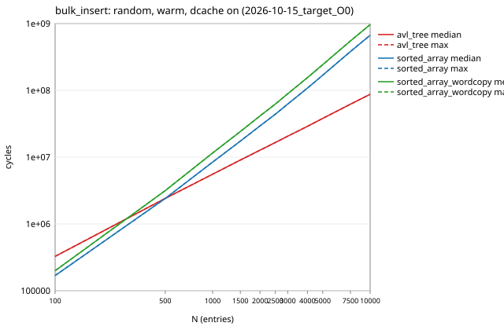

#### bulk_rebuild (random, warm, dcache on)

| N | array med | array max | avl med | avl max | tb avg (array/avl) |
|---:|---:|---:|---:|---:|---:|
| 100 | 181365 | 181365 | 708892 | 708892 | 10.00/10.00 |
| 500 | 1470687 | 1470910 | 2251688 | 2251723 | 203.00/203.00 |
| 1000 | 3457748 | 3457949 | 4596539 | 4596573 | 542.00/542.00 |
| 1500 | 5811004 | 5811447 | 7333290 | 7333313 | 1045.00/1045.00 |
| 2000 | 8226408 | 8227221 | 10154570 | 10154599 | 1552.00/1552.00 |
| 2500 | 10749757 | 10750560 | 13093929 | 13093975 | 2076.00/2076.00 |
| 3000 | 13536579 | 13536958 | 16310278 | 16310320 | 2749.00/2749.00 |
| 4000 | 19170836 | 19171719 | 22821967 | 22822049 | 4056.00/4056.00 |
| 5000 | 25566142 | 25566698 | 30108927 | 30109708 | 5755.00/5755.00 |
| 7500 | 42495120 | 42496828 | 49371885 | 49372650 | 10373.00/10373.00 |
| 10000 | 60505712 | 60514720 | 69793479 | 69793484 | 15352.00/15352.00 |

Crossover: none (the AVL median is not below the array median at the largest N).

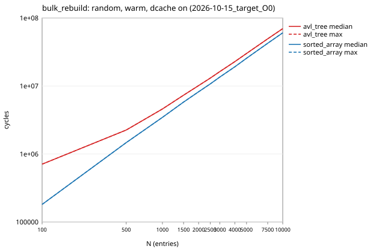

#### insert_random (random, warm, dcache on)

| N | array med | array max | array_wc med | array_wc max | avl med | avl max | tb avg (array/avl) |
|---:|---:|---:|---:|---:|---:|---:|---:|
| 100 | 3169 | 6679 | 3854 | 7762 | 4010 | 9236 | 0.15/0.15 |
| 500 | 8777 | 18425 | 11733 | 24326 | 5454 | 13025 | 0.56/0.53 |
| 1000 | 14599 | 31955 | 19593 | 43721 | 5978 | 16241 | 0.74/0.74 |
| 1500 | 19878 | 45261 | 27573 | 63200 | 6774 | 17594 | 1.03/1.06 |
| 2000 | 26488 | 57400 | 36912 | 80739 | 6845 | 17967 | 1.10/1.12 |
| 2500 | 31476 | 73527 | 45138 | 102759 | 6988 | 19250 | 1.06/1.07 |
| 3000 | 38682 | 84532 | 55579 | 120150 | 7373 | 21688 | 1.32/1.31 |
| 4000 | 50562 | 108326 | 73337 | 156253 | 7775 | 18959 | 1.43/1.44 |
| 5000 | 61046 | 138064 | 87724 | 198134 | 7866 | 21293 | 1.71/1.71 |
| 7500 | 94446 | 204910 | 138198 | 294138 | 8396 | 22455 | 1.93/1.95 |
| 10000 | 131466 | 273367 | 190964 | 392420 | 9331 | 26638 | 2.22/2.19 |

Crossover: from N = 500 the AVL median is below the array median for every larger N in the sweep.

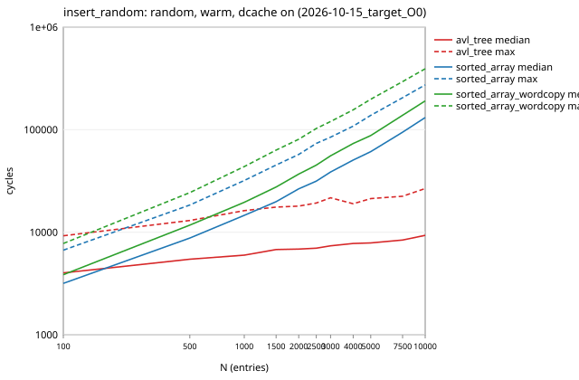

#### insert_front (random, warm, dcache on)

| N | array med | array max | array_wc med | array_wc max | avl med | avl max | tb avg (array/avl) |
|---:|---:|---:|---:|---:|---:|---:|---:|
| 100 | 3995 | 4001 | 5192 | 5192 | 3923 | 3923 | 0.00/0.00 |
| 500 | 13861 | 13866 | 19853 | 19858 | 4425 | 4425 | 0.00/0.00 |
| 1000 | 25992 | 25997 | 37984 | 37984 | 4418 | 4418 | 0.00/0.00 |
| 1500 | 38119 | 38124 | 56111 | 56111 | 5344 | 5344 | 0.00/0.00 |
| 2000 | 50128 | 50133 | 74120 | 74120 | 5325 | 5325 | 0.00/0.00 |
| 2500 | 62391 | 62453 | 92388 | 92467 | 5801 | 5801 | 0.00/0.00 |
| 3000 | 75283 | 75513 | 111272 | 111445 | 5786 | 5786 | 0.00/0.00 |
| 4000 | 102267 | 102954 | 150112 | 150368 | 6264 | 6264 | 0.00/0.00 |
| 5000 | 129492 | 130408 | 188818 | 189677 | 6261 | 6261 | 0.00/0.00 |
| 7500 | 196235 | 197265 | 284829 | 287114 | 6270 | 6270 | 0.00/0.00 |
| 10000 | 262179 | 263235 | 380367 | 383492 | 6276 | 6276 | 0.00/0.00 |

Crossover: from N = 100 the AVL median is below the array median for every larger N in the sweep. Medians within 10% (or within the 16 timer overhead) at N = 100: too close to call there.

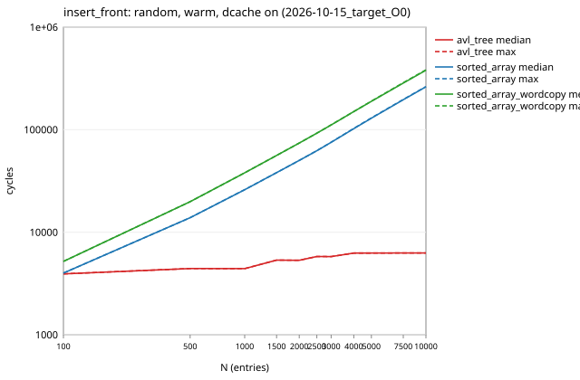

#### insert_end (random, warm, dcache on)

| N | array med | array max | array_wc med | array_wc max | avl med | avl max | tb avg (array/avl) |
|---:|---:|---:|---:|---:|---:|---:|---:|
| 100 | 1472 | 1472 | 1468 | 1473 | 3924 | 3924 | 0.00/0.00 |
| 500 | 1726 | 1726 | 1722 | 1727 | 4377 | 4377 | 0.00/0.00 |
| 1000 | 1859 | 1859 | 1855 | 1860 | 5724 | 5724 | 0.00/0.00 |
| 1500 | 1992 | 1992 | 1988 | 1993 | 5739 | 5739 | 0.00/0.00 |
| 2000 | 1992 | 1992 | 1988 | 1993 | 6174 | 6174 | 0.00/0.00 |
| 2500 | 2128 | 2128 | 2124 | 2129 | 6198 | 6198 | 0.00/0.00 |
| 3000 | 2126 | 2126 | 2122 | 2127 | 6205 | 6205 | 0.00/0.00 |
| 4000 | 2126 | 2126 | 2122 | 2127 | 6203 | 6203 | 0.00/0.00 |
| 5000 | 2262 | 2262 | 2258 | 2263 | 6209 | 6209 | 0.00/0.00 |
| 7500 | 2259 | 2259 | 2255 | 2260 | 6209 | 6209 | 0.00/0.00 |
| 10000 | 2396 | 2396 | 2392 | 2397 | 6674 | 6674 | 0.00/0.00 |

Crossover: none (the AVL median is not below the array median at the largest N).

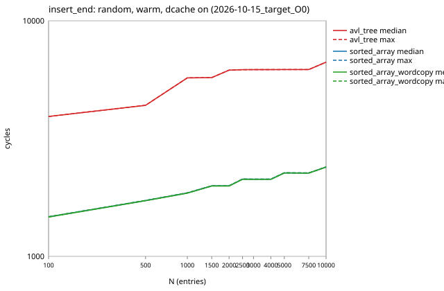

#### remove_random (random, warm, dcache on)

| N | array med | array max | array_wc med | array_wc max | avl med | avl max | tb avg (array/avl) |
|---:|---:|---:|---:|---:|---:|---:|---:|
| 100 | 4626 | 8094 | 6579 | 10424 | 6402 | 10459 | 1.08/1.08 |
| 500 | 6181 | 12640 | 16778 | 30828 | 7603 | 13968 | 1.32/1.33 |
| 1000 | 7978 | 18300 | 28663 | 53702 | 8049 | 18757 | 1.45/1.54 |
| 1500 | 9784 | 22586 | 42006 | 77930 | 8336 | 17989 | 1.68/1.61 |
| 2000 | 11365 | 24838 | 53370 | 99304 | 8582 | 17731 | 1.69/1.68 |
| 2500 | 12737 | 28224 | 61058 | 124570 | 8715 | 21527 | 1.75/1.74 |
| 3000 | 14298 | 32817 | 76070 | 148522 | 8867 | 19722 | 1.75/1.81 |
| 4000 | 17693 | 37268 | 96184 | 195991 | 9197 | 23062 | 1.95/1.97 |
| 5000 | 22149 | 48306 | 128180 | 244896 | 9308 | 25799 | 1.94/1.97 |
| 7500 | 30641 | 69478 | 178801 | 369161 | 9681 | 24035 | 2.11/2.12 |
| 10000 | 41002 | 86488 | 242506 | 485089 | 10206 | 24462 | 2.44/2.45 |

Crossover: from N = 1500 the AVL median is below the array median for every larger N in the sweep. Medians within 10% (or within the 16 timer overhead) at N = 1000: too close to call there.

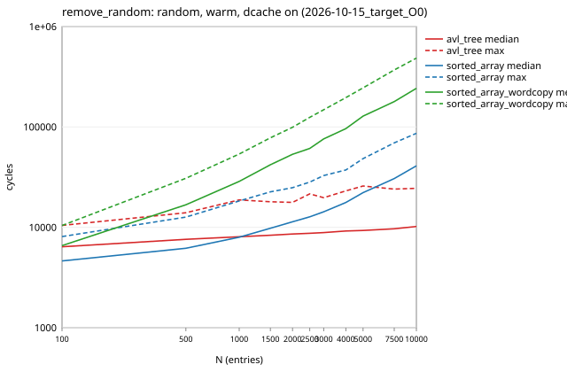

#### remove_first (random, warm, dcache on)

| N | array med | array max | array_wc med | array_wc max | avl med | avl max | tb avg (array/avl) |
|---:|---:|---:|---:|---:|---:|---:|---:|
| 100 | 4572 | 4582 | 8504 | 8515 | 6025 | 6037 | 1.00/1.00 |
| 500 | 10294 | 10299 | 30277 | 30282 | 10423 | 10428 | 3.00/3.00 |
| 1000 | 13005 | 13010 | 53050 | 53055 | 12300 | 12314 | 3.00/4.00 |
| 1500 | 16819 | 16819 | 76928 | 76933 | 12770 | 12780 | 4.00/4.00 |
| 2000 | 19271 | 19286 | 99443 | 99449 | 13982 | 13992 | 4.00/5.00 |
| 2500 | 23216 | 23274 | 123471 | 123533 | 13800 | 13810 | 5.00/5.00 |
| 3000 | 26420 | 26649 | 146877 | 147001 | 13801 | 13811 | 5.00/5.00 |
| 4000 | 33349 | 33760 | 194415 | 194679 | 17050 | 17062 | 5.00/7.00 |
| 5000 | 41685 | 42062 | 243352 | 243817 | 17050 | 17060 | 6.00/7.00 |
| 7500 | 60112 | 60818 | 363145 | 364933 | 18854 | 18868 | 7.00/8.00 |
| 10000 | 78442 | 79366 | 482467 | 485142 | 17254 | 17264 | 8.00/7.00 |

Crossover: from N = 1000 the AVL median is below the array median for every larger N in the sweep. Medians within 10% (or within the 16 timer overhead) at N = 500, 1000: too close to call there.

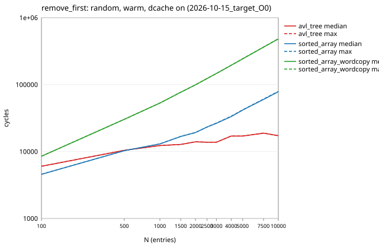

#### remove_last (random, warm, dcache on)

| N | array med | array max | array_wc med | array_wc max | avl med | avl max | tb avg (array/avl) |
|---:|---:|---:|---:|---:|---:|---:|---:|
| 100 | 3733 | 3738 | 3730 | 3735 | 5832 | 5832 | 1.00/1.00 |
| 500 | 3987 | 3997 | 3984 | 3989 | 6727 | 6733 | 1.00/1.00 |
| 1000 | 4120 | 4125 | 4117 | 4122 | 7591 | 7596 | 1.00/1.00 |
| 1500 | 4253 | 4258 | 4250 | 4255 | 8478 | 8478 | 1.00/1.00 |
| 2000 | 4253 | 4258 | 4250 | 4255 | 8504 | 8504 | 1.00/1.00 |
| 2500 | 4389 | 4394 | 4386 | 4391 | 8028 | 8028 | 1.00/1.00 |
| 3000 | 4412 | 4417 | 4409 | 4424 | 8058 | 8058 | 1.00/1.00 |
| 4000 | 4420 | 4425 | 4417 | 4422 | 10414 | 10414 | 1.00/2.00 |
| 5000 | 6882 | 6887 | 6879 | 6884 | 10429 | 10429 | 2.00/2.00 |
| 7500 | 4553 | 4558 | 4550 | 4555 | 10415 | 10415 | 1.00/2.00 |
| 10000 | 5441 | 5446 | 5438 | 5443 | 9750 | 9750 | 1.00/1.00 |

Crossover: none (the AVL median is not below the array median at the largest N).

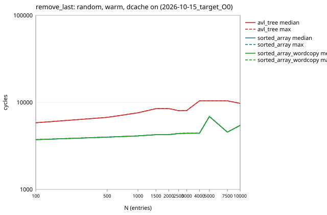

#### find_hit (random, warm, dcache on)

| N | array med | array max | avl med | avl max | tb avg (array/avl) |
|---:|---:|---:|---:|---:|---:|
| 100 | 7375 | 11852 | 4219 | 7714 | 2.15/1.15 |
| 500 | 7668 | 14489 | 4581 | 11531 | 2.46/1.52 |
| 1000 | 7790 | 17993 | 4671 | 13603 | 2.68/1.70 |
| 1500 | 7918 | 19835 | 4748 | 13759 | 2.78/1.76 |
| 2000 | 7940 | 19713 | 4826 | 15504 | 2.89/1.88 |
| 2500 | 8300 | 20687 | 4890 | 15594 | 2.99/2.00 |
| 3000 | 8332 | 21673 | 4993 | 15525 | 3.09/2.08 |
| 4000 | 8461 | 23313 | 5067 | 16283 | 3.16/2.13 |
| 5000 | 8548 | 23683 | 5120 | 17216 | 3.33/2.31 |
| 7500 | 8683 | 22434 | 5268 | 18993 | 3.52/2.53 |
| 10000 | 9081 | 25807 | 5346 | 19532 | 3.69/2.61 |

Crossover: from N = 100 the AVL median is below the array median for every larger N in the sweep.

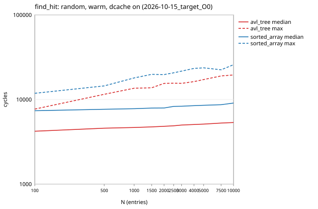

#### find_miss (random, warm, dcache on)

| N | array med | array max | avl med | avl max | tb avg (array/avl) |
|---:|---:|---:|---:|---:|---:|
| 100 | 1447 | 5355 | 1236 | 4390 | 0.19/0.15 |
| 500 | 1747 | 9314 | 1525 | 7742 | 0.71/0.53 |
| 1000 | 1891 | 9444 | 1655 | 9390 | 0.92/0.72 |
| 1500 | 2003 | 14245 | 1747 | 9230 | 1.16/0.92 |
| 2000 | 2030 | 12556 | 1815 | 9507 | 1.17/0.94 |
| 2500 | 2073 | 12560 | 1858 | 11125 | 1.19/1.07 |
| 3000 | 2143 | 14408 | 1871 | 10990 | 1.27/1.04 |
| 4000 | 2178 | 12809 | 1919 | 12652 | 1.34/1.17 |
| 5000 | 2240 | 14576 | 1993 | 12300 | 1.39/1.18 |
| 7500 | 2316 | 16414 | 2069 | 14401 | 1.55/1.33 |
| 10000 | 2366 | 16552 | 2145 | 15971 | 1.81/1.60 |

Crossover: from N = 100 the AVL median is below the array median for every larger N in the sweep. Medians within 10% (or within the 16 timer overhead) at N = 10000: too close to call there.

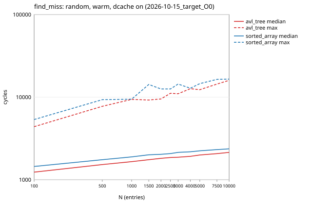

#### update_message (random, warm, dcache on)

| N | array med | array max | avl med | avl max | tb avg (array/avl) |
|---:|---:|---:|---:|---:|---:|
| 100 | 4252 | 7922 | 4320 | 7957 | 1.07/1.07 |
| 500 | 4529 | 10101 | 4705 | 11911 | 1.34/1.35 |
| 1000 | 4706 | 13501 | 4884 | 13528 | 1.46/1.48 |
| 1500 | 4859 | 15621 | 4965 | 15220 | 1.66/1.65 |
| 2000 | 4898 | 15482 | 5076 | 15519 | 1.71/1.74 |
| 2500 | 4987 | 16058 | 5121 | 15817 | 1.80/1.84 |
| 3000 | 5015 | 16219 | 5165 | 16332 | 1.81/1.81 |
| 4000 | 5156 | 15952 | 5265 | 18161 | 1.92/1.89 |
| 5000 | 5314 | 18001 | 5428 | 17667 | 2.17/2.16 |
| 7500 | 5428 | 19649 | 5602 | 19966 | 2.20/2.28 |
| 10000 | 5525 | 18116 | 5753 | 19866 | 2.44/2.51 |

Crossover: none (the AVL median is not below the array median at the largest N). Medians within 10% (or within the 16 timer overhead) at N = 100, 500, 1000, 1500, 2000, 2500, 3000, 4000, 5000, 7500, 10000: too close to call there.

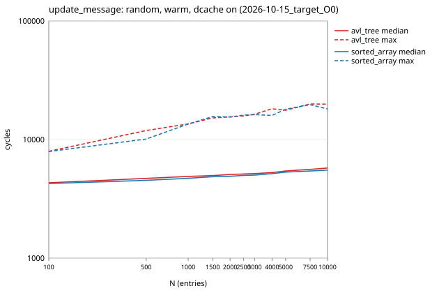

#### traverse_all (random, warm, dcache on)

| N | array med | array max | avl med | avl max | tb avg (array/avl) |
|---:|---:|---:|---:|---:|---:|
| 100 | 6599 | 6610 | 18558 | 18620 | 0.00/0.00 |
| 500 | 32662 | 32662 | 92236 | 92241 | 0.00/0.00 |
| 1000 | 65225 | 65225 | 184389 | 184395 | 0.00/0.00 |
| 1500 | 97797 | 97797 | 276476 | 276524 | 0.00/0.00 |
| 2000 | 130370 | 130375 | 370828 | 371049 | 0.00/0.00 |
| 2500 | 163002 | 163047 | 467237 | 467532 | 0.00/0.00 |
| 3000 | 196595 | 196705 | 563846 | 564210 | 0.00/0.00 |
| 4000 | 265105 | 265285 | 756343 | 756693 | 0.00/0.00 |
| 5000 | 333000 | 333255 | 948646 | 949090 | 0.00/0.00 |
| 7500 | 501707 | 502477 | 1427850 | 1428210 | 0.00/0.00 |
| 10000 | 669995 | 670135 | 1906970 | 1907420 | 0.00/0.00 |

Crossover: none (the AVL median is not below the array median at the largest N).

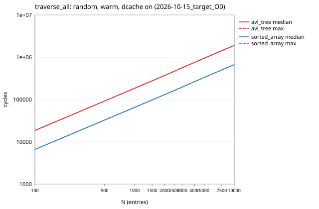

#### traverse_per_entry (random, warm, dcache on)

| N | array med | array max | avl med | avl max | tb avg (array/avl) |
|---:|---:|---:|---:|---:|---:|
| 100 | 65 | 66 | 185 | 186 | 0.00/0.00 |
| 500 | 65 | 65 | 184 | 184 | 0.00/0.00 |
| 1000 | 65 | 65 | 184 | 184 | 0.00/0.00 |
| 1500 | 65 | 65 | 184 | 184 | 0.00/0.00 |
| 2000 | 65 | 65 | 185 | 185 | 0.00/0.00 |
| 2500 | 65 | 65 | 186 | 187 | 0.00/0.00 |
| 3000 | 65 | 65 | 187 | 188 | 0.00/0.00 |
| 4000 | 66 | 66 | 189 | 189 | 0.00/0.00 |
| 5000 | 66 | 66 | 189 | 189 | 0.00/0.00 |
| 7500 | 66 | 66 | 190 | 190 | 0.00/0.00 |
| 10000 | 66 | 67 | 190 | 190 | 0.00/0.00 |

Crossover: none (the AVL median is not below the array median at the largest N).

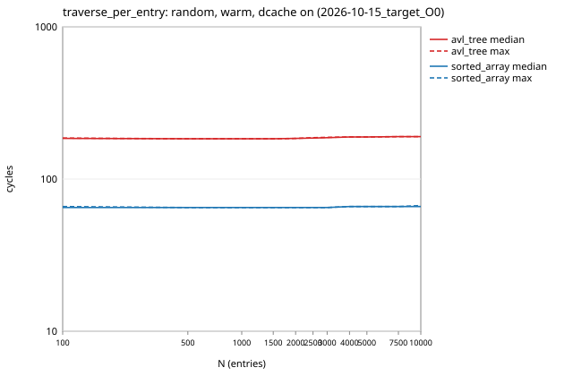

#### page_rank20 (random, warm, dcache on)

| N | array med | array max | avl med | avl max | tb avg (array/avl) |
|---:|---:|---:|---:|---:|---:|
| 100 | 1512 | 1523 | 9233 | 14074 | 0.00/0.00 |
| 500 | 1513 | 1523 | 34305 | 64116 | 0.00/0.00 |
| 1000 | 1513 | 1523 | 68210 | 126753 | 0.00/0.00 |
| 1500 | 1513 | 1528 | 99324 | 188965 | 0.00/0.00 |
| 2000 | 1513 | 1527 | 125707 | 253353 | 0.00/0.00 |
| 2500 | 1514 | 1535 | 156913 | 319210 | 0.00/0.00 |
| 3000 | 1514 | 1557 | 187084 | 384397 | 0.00/0.00 |
| 4000 | 1524 | 1559 | 258565 | 517060 | 0.00/0.00 |
| 5000 | 1533 | 1568 | 327193 | 647900 | 0.00/0.00 |
| 7500 | 1543 | 1568 | 503965 | 974727 | 0.00/0.00 |
| 10000 | 1548 | 1564 | 631059 | 1299888 | 0.00/0.00 |

Crossover: none (the AVL median is not below the array median at the largest N).

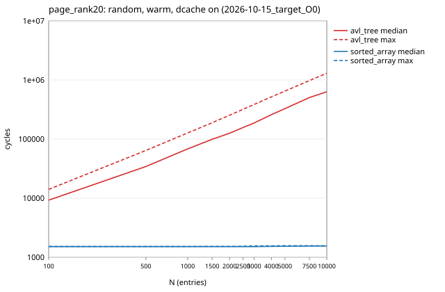

#### page_name20 (random, warm, dcache on)

| N | array med | array max | avl med | avl max | tb avg (array/avl) |
|---:|---:|---:|---:|---:|---:|
| 100 | 5781 | 8692 | 8057 | 10634 | 1.15/1.15 |
| 500 | 6096 | 11811 | 8437 | 15404 | 1.54/1.56 |
| 1000 | 6213 | 14782 | 8527 | 17624 | 1.61/1.64 |
| 1500 | 6360 | 16980 | 8653 | 17616 | 1.85/1.82 |
| 2000 | 6384 | 16836 | 8760 | 17823 | 1.87/1.89 |
| 2500 | 6511 | 19349 | 8862 | 21612 | 1.96/1.98 |
| 3000 | 6552 | 19210 | 8928 | 19565 | 2.09/2.06 |
| 4000 | 6704 | 17384 | 9088 | 21753 | 2.10/2.10 |
| 5000 | 6880 | 19212 | 9223 | 21089 | 2.36/2.33 |
| 7500 | 6905 | 20627 | 9299 | 22994 | 2.57/2.52 |
| 10000 | 7384 | 23208 | 9493 | 24276 | 2.69/2.68 |

Crossover: none (the AVL median is not below the array median at the largest N).

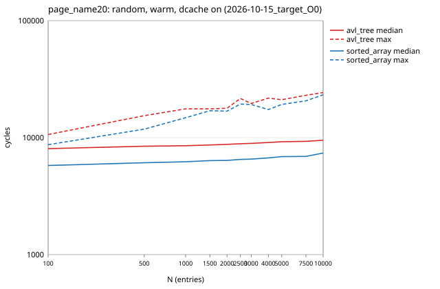

### `-Os`, D-cache on, warm

#### bulk_insert (random, warm, dcache on)

| N | array med | array max | array_wc med | array_wc max | avl med | avl max | tb avg (array/avl) |
|---:|---:|---:|---:|---:|---:|---:|---:|
| 100 | 102167 | 102167 | 62442 | 62444 | 122886 | 122918 | 9.00/8.00 |
| 500 | 1808415 | 1808415 | 862090 | 862096 | 879021 | 879161 | 178.00/183.00 |
| 1000 | 6948547 | 6948755 | 3037269 | 3037476 | 2002274 | 2002567 | 517.00/517.00 |
| 1500 | 14809768 | 14810146 | 6269513 | 6269767 | 3235734 | 3236061 | 985.00/990.00 |
| 2000 | 25726988 | 25727364 | 10663389 | 10663935 | 4532683 | 4533275 | 1472.00/1477.00 |
| 2500 | 39051511 | 39052328 | 15985055 | 15985910 | 5876046 | 5876398 | 2003.00/2020.00 |
| 3000 | 56207974 | 56209512 | 22807007 | 22808620 | 7285046 | 7285649 | 2626.00/2653.00 |
| 4000 | 99165339 | 99168151 | 40110770 | 40119586 | 10203973 | 10205071 | 3918.00/3957.00 |
| 5000 | 156334498 | 156343623 | 63622189 | 63639075 | 13279497 | 13280143 | 5510.00/5568.00 |
| 7500 | 360057246 | 360077486 | 149463758 | 149518686 | 21414571 | 21415497 | 10047.00/10139.00 |
| 10000 | 638021255 | 638049362 | 268582197 | 268605142 | 29892675 | 29894043 | 14857.00/14997.00 |

Crossover: from N = 500 the AVL median is below the array median for every larger N in the sweep.

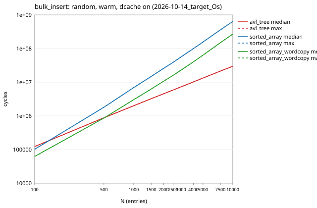

#### bulk_rebuild (random, warm, dcache on)

| N | array med | array max | avl med | avl max | tb avg (array/avl) |
|---:|---:|---:|---:|---:|---:|
| 100 | 72309 | 72309 | 224304 | 224335 | 10.00/10.00 |
| 500 | 543151 | 543152 | 1129155 | 1129431 | 203.00/203.00 |
| 1000 | 1252020 | 1252247 | 2467522 | 2467660 | 542.00/542.00 |
| 1500 | 2059135 | 2059419 | 3966549 | 3966577 | 1045.00/1045.00 |
| 2000 | 2892295 | 2892722 | 5516474 | 5517006 | 1552.00/1552.00 |
| 2500 | 3767679 | 3768369 | 7145391 | 7145404 | 2076.00/2076.00 |
| 3000 | 4699779 | 4701052 | 8842238 | 8842432 | 2749.00/2749.00 |
| 4000 | 6597277 | 6600341 | 12319739 | 12319892 | 4056.00/4056.00 |
| 5000 | 8658515 | 8662590 | 16021453 | 16022439 | 5755.00/5755.00 |
| 7500 | 14069766 | 14070910 | 25674983 | 25676637 | 10373.00/10373.00 |
| 10000 | 19791856 | 19793673 | 35821424 | 35822986 | 15352.00/15352.00 |

Crossover: none (the AVL median is not below the array median at the largest N).

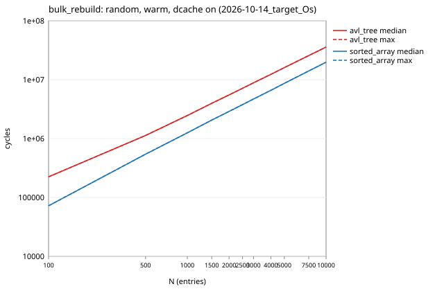

#### insert_random (random, warm, dcache on)

| N | array med | array max | array_wc med | array_wc max | avl med | avl max | tb avg (array/avl) |
|---:|---:|---:|---:|---:|---:|---:|---:|
| 100 | 2111 | 3312 | 1196 | 1946 | 1555 | 2680 | 0.15/0.15 |
| 500 | 6717 | 13417 | 3197 | 5964 | 2116 | 3527 | 0.56/0.53 |
| 1000 | 11845 | 25471 | 5133 | 10651 | 2381 | 4049 | 0.74/0.74 |
| 1500 | 17128 | 38012 | 7191 | 15581 | 2595 | 4408 | 1.03/1.06 |
| 2000 | 23265 | 49700 | 9377 | 19859 | 2659 | 4518 | 1.10/1.12 |
| 2500 | 28009 | 62451 | 11456 | 25233 | 2743 | 4719 | 1.06/1.07 |
| 3000 | 36229 | 75506 | 14347 | 30579 | 2882 | 5228 | 1.32/1.31 |
| 4000 | 47842 | 101714 | 19001 | 41762 | 2960 | 4877 | 1.43/1.44 |
| 5000 | 56698 | 128422 | 22601 | 54028 | 3078 | 5181 | 1.71/1.71 |
| 7500 | 92475 | 195052 | 37332 | 82950 | 3270 | 5436 | 1.93/1.95 |
| 10000 | 127538 | 261585 | 52535 | 111527 | 3447 | 6417 | 2.22/2.19 |

Crossover: from N = 100 the AVL median is below the array median for every larger N in the sweep.

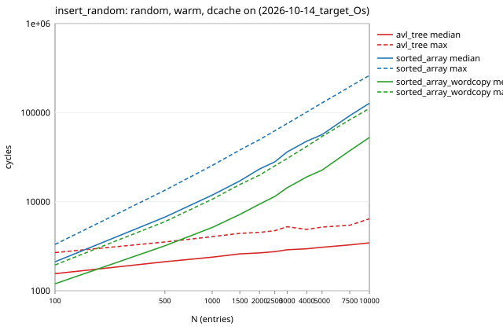

#### insert_front (random, warm, dcache on)

| N | array med | array max | array_wc med | array_wc max | avl med | avl max | tb avg (array/avl) |
|---:|---:|---:|---:|---:|---:|---:|---:|
| 100 | 3048 | 3048 | 1547 | 1557 | 1496 | 1505 | 0.00/0.00 |
| 500 | 12764 | 12764 | 5263 | 5273 | 1715 | 1727 | 0.00/0.00 |
| 1000 | 24820 | 24820 | 9819 | 9827 | 1713 | 1725 | 0.00/0.00 |
| 1500 | 36866 | 36880 | 14365 | 14378 | 2087 | 2096 | 0.00/0.00 |
| 2000 | 48886 | 48895 | 18876 | 18890 | 2087 | 2098 | 0.00/0.00 |
| 2500 | 61046 | 61107 | 23535 | 23619 | 2265 | 2270 | 0.00/0.00 |
| 3000 | 73946 | 74121 | 28925 | 29291 | 2265 | 2272 | 0.00/0.00 |
| 4000 | 100928 | 101574 | 40753 | 41595 | 2450 | 2450 | 0.00/0.00 |
| 5000 | 128272 | 128956 | 52366 | 54406 | 2450 | 2455 | 0.00/0.00 |
| 7500 | 194815 | 195862 | 80183 | 83466 | 2457 | 2464 | 0.00/0.00 |
| 10000 | 260719 | 261947 | 108187 | 111956 | 2459 | 2466 | 0.00/0.00 |

Crossover: from N = 100 the AVL median is below the array median for every larger N in the sweep.

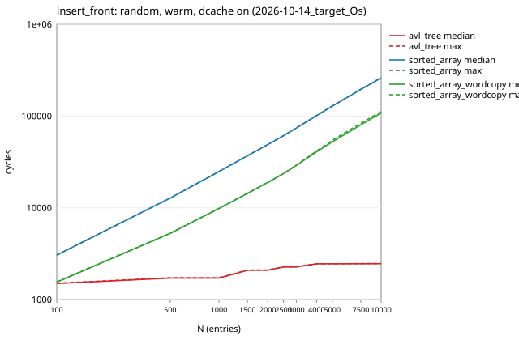

#### insert_end (random, warm, dcache on)

| N | array med | array max | array_wc med | array_wc max | avl med | avl max | tb avg (array/avl) |
|---:|---:|---:|---:|---:|---:|---:|---:|
| 100 | 588 | 599 | 586 | 595 | 1518 | 1529 | 0.00/0.00 |
| 500 | 686 | 697 | 684 | 693 | 1683 | 1697 | 0.00/0.00 |
| 1000 | 741 | 752 | 734 | 748 | 2221 | 2228 | 0.00/0.00 |
| 1500 | 796 | 807 | 794 | 803 | 2220 | 2227 | 0.00/0.00 |
| 2000 | 796 | 807 | 794 | 803 | 2393 | 2397 | 0.00/0.00 |
| 2500 | 854 | 865 | 852 | 861 | 2401 | 2404 | 0.00/0.00 |
| 3000 | 852 | 863 | 850 | 859 | 2400 | 2405 | 0.00/0.00 |
| 4000 | 852 | 863 | 850 | 859 | 2409 | 2413 | 0.00/0.00 |
| 5000 | 910 | 921 | 903 | 917 | 2408 | 2412 | 0.00/0.00 |
| 7500 | 907 | 918 | 900 | 914 | 2410 | 2414 | 0.00/0.00 |
| 10000 | 967 | 978 | 965 | 974 | 2591 | 2596 | 0.00/0.00 |

Crossover: none (the AVL median is not below the array median at the largest N).

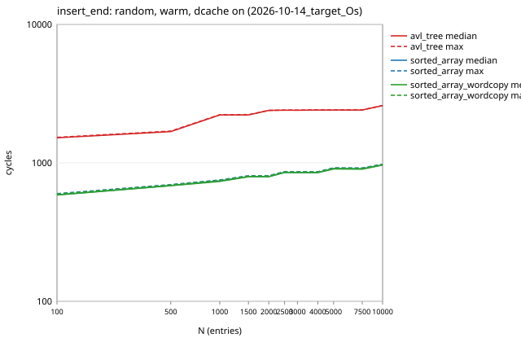

#### remove_random (random, warm, dcache on)

| N | array med | array max | array_wc med | array_wc max | avl med | avl max | tb avg (array/avl) |
|---:|---:|---:|---:|---:|---:|---:|---:|
| 100 | 1426 | 1904 | 1502 | 2121 | 1949 | 2703 | 1.08/1.08 |
| 500 | 2650 | 4605 | 3240 | 5564 | 2430 | 3660 | 1.32/1.33 |
| 1000 | 4139 | 7586 | 5297 | 9370 | 2643 | 4318 | 1.45/1.54 |
| 1500 | 5687 | 10642 | 7563 | 13450 | 2800 | 4483 | 1.68/1.61 |
| 2000 | 7019 | 13359 | 9440 | 17262 | 2893 | 4460 | 1.69/1.68 |
| 2500 | 8097 | 16339 | 10808 | 22132 | 2990 | 4940 | 1.75/1.74 |
| 3000 | 9693 | 20222 | 13425 | 26946 | 3042 | 4817 | 1.75/1.81 |
| 4000 | 12793 | 27012 | 17131 | 38147 | 3160 | 5281 | 1.95/1.97 |
| 5000 | 17280 | 35674 | 24196 | 48968 | 3240 | 5887 | 1.94/1.97 |
| 7500 | 24907 | 55993 | 34957 | 75589 | 3411 | 5675 | 2.11/2.12 |
| 10000 | 35025 | 73909 | 49090 | 100046 | 3532 | 5877 | 2.44/2.45 |

Crossover: from N = 500 the AVL median is below the array median for every larger N in the sweep. Medians within 10% (or within the 1 timer overhead) at N = 500: too close to call there.

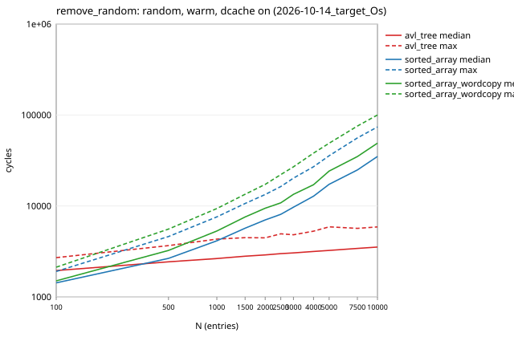

#### remove_first (random, warm, dcache on)

| N | array med | array max | array_wc med | array_wc max | avl med | avl max | tb avg (array/avl) |
|---:|---:|---:|---:|---:|---:|---:|---:|
| 100 | 1622 | 1622 | 1835 | 1854 | 1941 | 1945 | 1.00/1.00 |
| 500 | 4225 | 4226 | 5501 | 5501 | 2812 | 2826 | 3.00/3.00 |
| 1000 | 6733 | 6737 | 9321 | 9321 | 3280 | 3284 | 3.00/4.00 |
| 1500 | 9406 | 9409 | 13308 | 13317 | 3458 | 3466 | 4.00/4.00 |
| 2000 | 11872 | 11900 | 17089 | 17118 | 3629 | 3636 | 4.00/5.00 |
| 2500 | 14689 | 14742 | 21237 | 21306 | 3606 | 3613 | 5.00/5.00 |
| 3000 | 17924 | 18121 | 25898 | 26345 | 3607 | 3614 | 5.00/5.00 |
| 4000 | 25111 | 25497 | 36189 | 37450 | 4395 | 4404 | 5.00/7.00 |
| 5000 | 32277 | 32731 | 46469 | 48458 | 4394 | 4403 | 6.00/7.00 |
| 7500 | 49543 | 50530 | 70702 | 73415 | 4696 | 4707 | 7.00/8.00 |
| 10000 | 66720 | 67748 | 94959 | 97391 | 4406 | 4417 | 8.00/7.00 |

Crossover: from N = 500 the AVL median is below the array median for every larger N in the sweep.

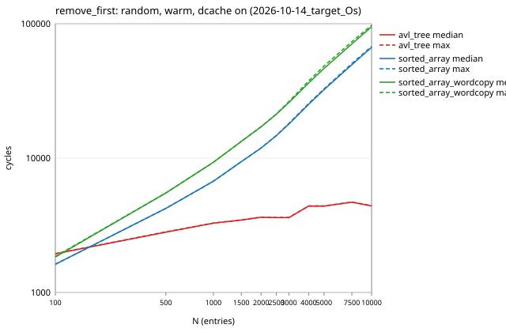

#### remove_last (random, warm, dcache on)

| N | array med | array max | array_wc med | array_wc max | avl med | avl max | tb avg (array/avl) |
|---:|---:|---:|---:|---:|---:|---:|---:|
| 100 | 1012 | 1012 | 1023 | 1023 | 1949 | 1955 | 1.00/1.00 |
| 500 | 1109 | 1109 | 1120 | 1120 | 2308 | 2313 | 1.00/1.00 |
| 1000 | 1164 | 1164 | 1175 | 1176 | 2656 | 2659 | 1.00/1.00 |
| 1500 | 1219 | 1219 | 1230 | 1230 | 3045 | 3053 | 1.00/1.00 |
| 2000 | 1220 | 1220 | 1231 | 1231 | 3059 | 3064 | 1.00/1.00 |
| 2500 | 1277 | 1277 | 1288 | 1288 | 2848 | 2869 | 1.00/1.00 |
| 3000 | 1305 | 1305 | 1316 | 1317 | 2860 | 2877 | 1.00/1.00 |
| 4000 | 1321 | 1324 | 1328 | 1328 | 3272 | 3281 | 1.00/2.00 |
| 5000 | 1779 | 1782 | 1786 | 1792 | 3285 | 3294 | 2.00/2.00 |
| 7500 | 1376 | 1380 | 1383 | 1383 | 3272 | 3281 | 1.00/2.00 |
| 10000 | 1477 | 1477 | 1481 | 1498 | 3343 | 3353 | 1.00/1.00 |

Crossover: none (the AVL median is not below the array median at the largest N).

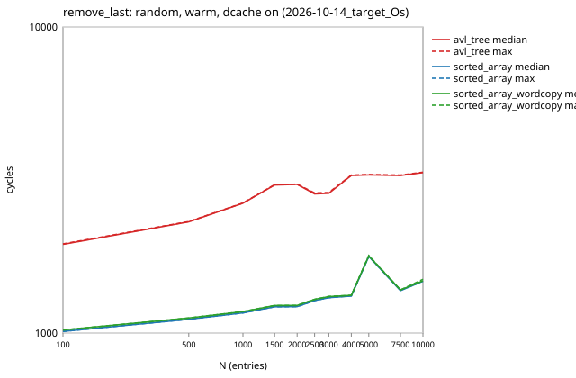

#### find_hit (random, warm, dcache on)

| N | array med | array max | avl med | avl max | tb avg (array/avl) |
|---:|---:|---:|---:|---:|---:|
| 100 | 1691 | 2342 | 1240 | 1749 | 2.15/1.15 |
| 500 | 1842 | 2782 | 1478 | 2652 | 2.46/1.52 |
| 1000 | 1901 | 3250 | 1561 | 2869 | 2.68/1.70 |
| 1500 | 1950 | 3554 | 1617 | 3078 | 2.78/1.76 |
| 2000 | 1982 | 3538 | 1682 | 3279 | 2.89/1.88 |
| 2500 | 2015 | 3758 | 1717 | 3435 | 2.99/2.00 |
| 3000 | 2045 | 4011 | 1752 | 3418 | 3.09/2.08 |
| 4000 | 2092 | 4153 | 1822 | 3520 | 3.16/2.13 |
| 5000 | 2128 | 4417 | 1859 | 3765 | 3.33/2.31 |
| 7500 | 2183 | 4192 | 1953 | 4010 | 3.52/2.53 |
| 10000 | 2263 | 4721 | 2007 | 4086 | 3.69/2.61 |

Crossover: from N = 100 the AVL median is below the array median for every larger N in the sweep.

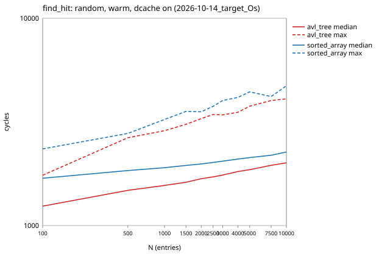

#### find_miss (random, warm, dcache on)

| N | array med | array max | avl med | avl max | tb avg (array/avl) |
|---:|---:|---:|---:|---:|---:|
| 100 | 578 | 1305 | 734 | 1316 | 0.19/0.15 |
| 500 | 734 | 1950 | 944 | 1979 | 0.71/0.53 |
| 1000 | 815 | 1999 | 1039 | 2358 | 0.92/0.72 |
| 1500 | 860 | 2703 | 1102 | 2217 | 1.16/0.92 |
| 2000 | 881 | 2523 | 1160 | 2443 | 1.17/0.94 |
| 2500 | 915 | 2550 | 1193 | 2703 | 1.19/1.07 |
| 3000 | 929 | 2836 | 1201 | 2593 | 1.27/1.04 |
| 4000 | 959 | 2612 | 1239 | 3014 | 1.34/1.17 |
| 5000 | 993 | 2902 | 1303 | 3104 | 1.39/1.18 |
| 7500 | 1027 | 3117 | 1356 | 3246 | 1.55/1.33 |
| 10000 | 1055 | 3217 | 1417 | 3637 | 1.81/1.60 |

Crossover: none (the AVL median is not below the array median at the largest N).

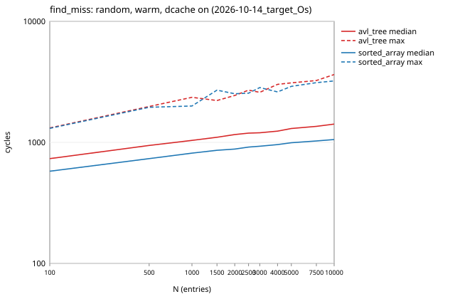

#### update_message (random, warm, dcache on)

| N | array med | array max | avl med | avl max | tb avg (array/avl) |
|---:|---:|---:|---:|---:|---:|
| 100 | 1074 | 1669 | 1238 | 1792 | 1.07/1.07 |
| 500 | 1214 | 2041 | 1455 | 2706 | 1.34/1.35 |
| 1000 | 1290 | 2510 | 1556 | 2857 | 1.46/1.48 |
| 1500 | 1335 | 2833 | 1627 | 3191 | 1.66/1.65 |
| 2000 | 1361 | 2820 | 1705 | 3296 | 1.71/1.74 |
| 2500 | 1389 | 2977 | 1738 | 3429 | 1.80/1.84 |
| 3000 | 1416 | 2998 | 1750 | 3561 | 1.81/1.81 |
| 4000 | 1456 | 3032 | 1828 | 3825 | 1.92/1.89 |
| 5000 | 1503 | 3398 | 1883 | 3865 | 2.17/2.16 |
| 7500 | 1547 | 3564 | 1981 | 4144 | 2.20/2.28 |
| 10000 | 1592 | 3577 | 2055 | 4398 | 2.44/2.51 |

Crossover: none (the AVL median is not below the array median at the largest N).

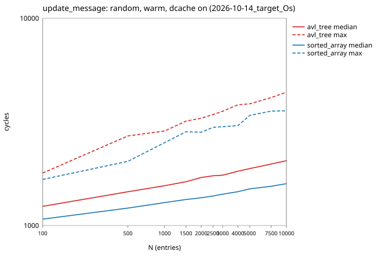

#### traverse_all (random, warm, dcache on)

| N | array med | array max | avl med | avl max | tb avg (array/avl) |
|---:|---:|---:|---:|---:|---:|
| 100 | 3762 | 3763 | 6941 | 6949 | 0.00/0.00 |
| 500 | 18612 | 18613 | 34413 | 34421 | 0.00/0.00 |
| 1000 | 37175 | 37176 | 68816 | 68824 | 0.00/0.00 |
| 1500 | 55738 | 55738 | 103099 | 103107 | 0.00/0.00 |
| 2000 | 74301 | 74301 | 139595 | 139839 | 0.00/0.00 |
| 2500 | 92918 | 92942 | 178371 | 178713 | 0.00/0.00 |
| 3000 | 112531 | 112646 | 217087 | 217480 | 0.00/0.00 |
| 4000 | 153026 | 153196 | 294166 | 294534 | 0.00/0.00 |
| 5000 | 192930 | 193141 | 370536 | 370849 | 0.00/0.00 |
| 7500 | 291728 | 292418 | 560949 | 561304 | 0.00/0.00 |
| 10000 | 390071 | 390081 | 751292 | 751735 | 0.00/0.00 |

Crossover: none (the AVL median is not below the array median at the largest N).

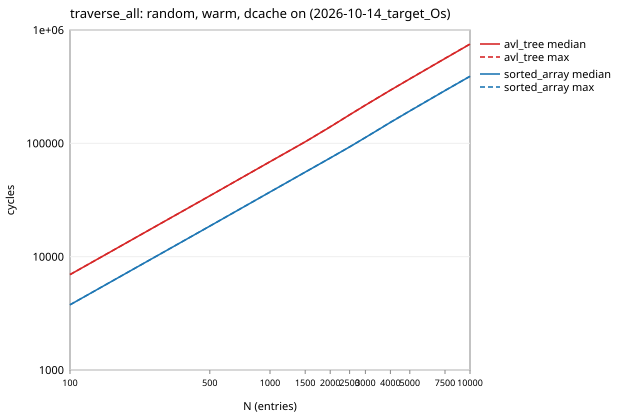

#### traverse_per_entry (random, warm, dcache on)

| N | array med | array max | avl med | avl max | tb avg (array/avl) |
|---:|---:|---:|---:|---:|---:|
| 100 | 37 | 37 | 69 | 69 | 0.00/0.00 |
| 500 | 37 | 37 | 68 | 68 | 0.00/0.00 |
| 1000 | 37 | 37 | 68 | 68 | 0.00/0.00 |
| 1500 | 37 | 37 | 68 | 68 | 0.00/0.00 |
| 2000 | 37 | 37 | 69 | 69 | 0.00/0.00 |
| 2500 | 37 | 37 | 71 | 71 | 0.00/0.00 |
| 3000 | 37 | 37 | 72 | 72 | 0.00/0.00 |
| 4000 | 38 | 38 | 73 | 73 | 0.00/0.00 |
| 5000 | 38 | 38 | 74 | 74 | 0.00/0.00 |
| 7500 | 38 | 38 | 74 | 74 | 0.00/0.00 |
| 10000 | 39 | 39 | 75 | 75 | 0.00/0.00 |

Crossover: none (the AVL median is not below the array median at the largest N).

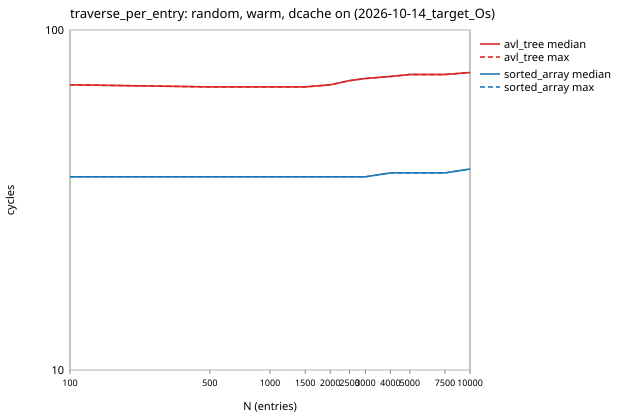

#### page_rank20 (random, warm, dcache on)

| N | array med | array max | avl med | avl max | tb avg (array/avl) |
|---:|---:|---:|---:|---:|---:|
| 100 | 746 | 748 | 3211 | 4802 | 0.00/0.00 |
| 500 | 747 | 748 | 11668 | 21714 | 0.00/0.00 |
| 1000 | 747 | 754 | 23095 | 42866 | 0.00/0.00 |
| 1500 | 747 | 754 | 33609 | 63833 | 0.00/0.00 |
| 2000 | 747 | 753 | 42894 | 86696 | 0.00/0.00 |
| 2500 | 748 | 764 | 54304 | 110823 | 0.00/0.00 |
| 3000 | 748 | 787 | 65014 | 135140 | 0.00/0.00 |
| 4000 | 758 | 793 | 92173 | 184431 | 0.00/0.00 |
| 5000 | 767 | 793 | 116729 | 232372 | 0.00/0.00 |
| 7500 | 777 | 793 | 181123 | 351644 | 0.00/0.00 |
| 10000 | 782 | 793 | 226959 | 470119 | 0.00/0.00 |

Crossover: none (the AVL median is not below the array median at the largest N).

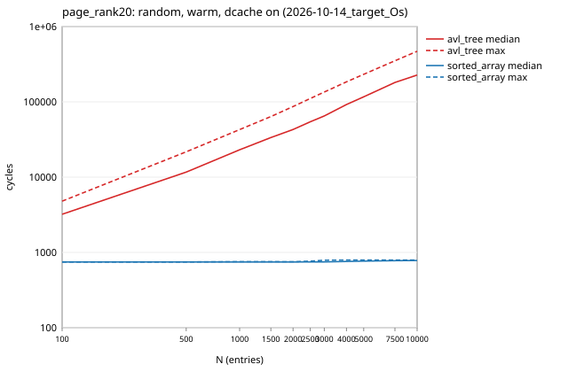

#### page_name20 (random, warm, dcache on)

| N | array med | array max | avl med | avl max | tb avg (array/avl) |
|---:|---:|---:|---:|---:|---:|
| 100 | 1826 | 2221 | 2614 | 3098 | 1.15/1.15 |
| 500 | 1977 | 2816 | 2865 | 4025 | 1.54/1.56 |
| 1000 | 2040 | 3230 | 2944 | 4339 | 1.61/1.64 |
| 1500 | 2100 | 3556 | 3040 | 4364 | 1.85/1.82 |
| 2000 | 2125 | 3540 | 3116 | 4540 | 1.87/1.89 |
| 2500 | 2166 | 4090 | 3178 | 5188 | 1.96/1.98 |
| 3000 | 2189 | 4071 | 3220 | 4919 | 2.09/2.06 |
| 4000 | 2230 | 3849 | 3316 | 5252 | 2.10/2.10 |
| 5000 | 2283 | 4129 | 3370 | 5204 | 2.36/2.33 |
| 7500 | 2322 | 4305 | 3461 | 5505 | 2.57/2.52 |
| 10000 | 2418 | 4734 | 3537 | 5813 | 2.69/2.68 |

Crossover: none (the AVL median is not below the array median at the largest N).

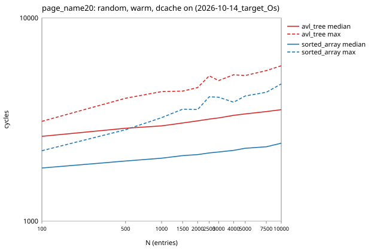

### `-Os`, D-cache on, cold

#### bulk_insert (random, cold, dcache on)

| N | array med | array max | array_wc med | array_wc max | avl med | avl max | tb avg (array/avl) |
|---:|---:|---:|---:|---:|---:|---:|---:|
| 100 | 102528 | 102528 | 62776 | 62779 | 122701 | 122716 | 9.00/8.00 |
| 500 | 1810151 | 1810151 | 863813 | 863821 | 878224 | 878284 | 178.00/183.00 |
| 1000 | 6951023 | 6951197 | 3039695 | 3039769 | 1999861 | 1999917 | 517.00/517.00 |
| 1500 | 14812070 | 14812436 | 6271818 | 6272044 | 3232718 | 3232889 | 985.00/990.00 |
| 2000 | 25729814 | 25730588 | 10666324 | 10666544 | 4529583 | 4530008 | 1472.00/1477.00 |
| 2500 | 39054605 | 39055516 | 15987513 | 15989058 | 5873300 | 5873711 | 2003.00/2020.00 |
| 3000 | 56211012 | 56213273 | 22809757 | 22811119 | 7282095 | 7282715 | 2626.00/2653.00 |
| 4000 | 99172991 | 99177321 | 40110749 | 40118052 | 10201443 | 10202128 | 3918.00/3957.00 |
| 5000 | 156341927 | 156345626 | 63626417 | 63646708 | 13276422 | 13277214 | 5510.00/5568.00 |
| 7500 | 360045533 | 360045533 | 149465689 | 149514221 | 21412174 | 21413256 | 10047.00/10139.00 |
| 10000 | 638022824 | 638033645 | 268595049 | 268616170 | 29888632 | 29891279 | 14857.00/14997.00 |

Crossover: from N = 500 the AVL median is below the array median for every larger N in the sweep.

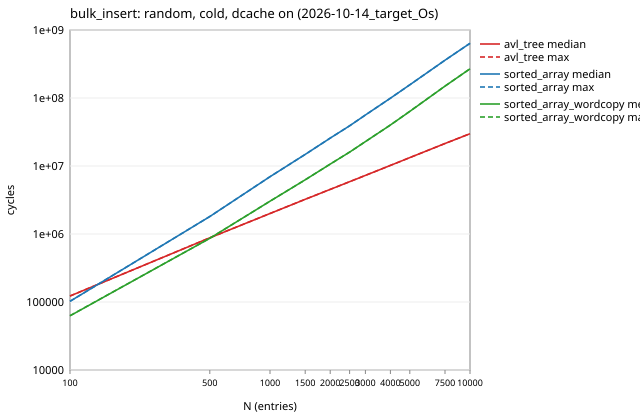

#### bulk_rebuild (random, cold, dcache on)

| N | array med | array max | avl med | avl max | tb avg (array/avl) |
|---:|---:|---:|---:|---:|---:|
| 100 | 72626 | 72626 | 224204 | 224265 | 10.00/10.00 |
| 500 | 544825 | 544830 | 1128375 | 1128459 | 203.00/203.00 |
| 1000 | 1254336 | 1254447 | 2465314 | 2465453 | 542.00/542.00 |
| 1500 | 2060410 | 2060809 | 3963418 | 3963644 | 1045.00/1045.00 |
| 2000 | 2892572 | 2893199 | 5515072 | 5515437 | 1552.00/1552.00 |
| 2500 | 3767577 | 3768490 | 7143434 | 7143900 | 2076.00/2076.00 |
| 3000 | 4700140 | 4700567 | 8841226 | 8841869 | 2749.00/2749.00 |
| 4000 | 6597525 | 6600767 | 12319334 | 12319680 | 4056.00/4056.00 |
| 5000 | 8658209 | 8662025 | 16020075 | 16020954 | 5755.00/5755.00 |
| 7500 | 14070188 | 14071328 | 25675605 | 25677115 | 10373.00/10373.00 |
| 10000 | 19792411 | 19793442 | 35821701 | 35823274 | 15352.00/15352.00 |

Crossover: none (the AVL median is not below the array median at the largest N).


#### insert_random (random, cold, dcache on)

| N | array med | array max | array_wc med | array_wc max | avl med | avl max | tb avg (array/avl) |
|---:|---:|---:|---:|---:|---:|---:|---:|
| 100 | 2271 | 3568 | 1337 | 2203 | 1646 | 2858 | 0.15/0.15 |
| 500 | 7204 | 14447 | 3705 | 6983 | 2236 | 3765 | 0.56/0.53 |
| 1000 | 12754 | 27430 | 6011 | 12608 | 2512 | 4280 | 0.74/0.74 |
| 1500 | 18421 | 40847 | 8461 | 18431 | 2726 | 4651 | 1.03/1.06 |
| 2000 | 25054 | 53471 | 11128 | 23546 | 2787 | 4705 | 1.10/1.12 |
| 2500 | 30128 | 66678 | 13514 | 29428 | 2879 | 4933 | 1.06/1.07 |
| 3000 | 38904 | 80170 | 16942 | 35181 | 3003 | 5433 | 1.32/1.31 |
| 4000 | 50896 | 105835 | 22062 | 45971 | 3096 | 5098 | 1.43/1.44 |
| 5000 | 60040 | 132796 | 25912 | 57889 | 3220 | 5376 | 1.71/1.71 |
| 7500 | 95315 | 198341 | 41080 | 85973 | 3388 | 5681 | 1.93/1.95 |
| 10000 | 130769 | 264277 | 56616 | 114517 | 3564 | 6573 | 2.22/2.19 |

Crossover: from N = 100 the AVL median is below the array median for every larger N in the sweep.

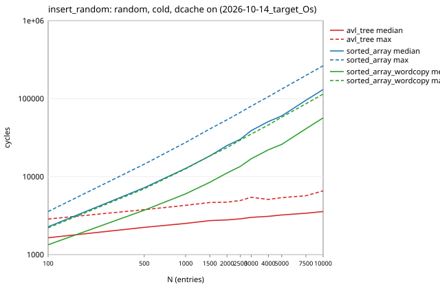

#### insert_front (random, cold, dcache on)

| N | array med | array max | array_wc med | array_wc max | avl med | avl max | tb avg (array/avl) |
|---:|---:|---:|---:|---:|---:|---:|---:|
| 100 | 3241 | 3252 | 1741 | 1755 | 1572 | 1581 | 0.00/0.00 |
| 500 | 13705 | 13716 | 6205 | 6219 | 1815 | 1827 | 0.00/0.00 |
| 1000 | 26695 | 26706 | 11700 | 11710 | 1817 | 1829 | 0.00/0.00 |
| 1500 | 39682 | 39691 | 17182 | 17196 | 2208 | 2217 | 0.00/0.00 |
| 2000 | 52626 | 52635 | 22628 | 22640 | 2208 | 2217 | 0.00/0.00 |
| 2500 | 65631 | 65643 | 28131 | 28146 | 2384 | 2393 | 0.00/0.00 |
| 3000 | 78676 | 78693 | 33670 | 33690 | 2384 | 2396 | 0.00/0.00 |
| 4000 | 104929 | 104955 | 44936 | 44958 | 2584 | 2596 | 0.00/0.00 |
| 5000 | 131258 | 131275 | 56259 | 56274 | 2584 | 2596 | 0.00/0.00 |
| 7500 | 196896 | 196910 | 84401 | 84406 | 2591 | 2603 | 0.00/0.00 |
| 10000 | 262587 | 262587 | 112585 | 112590 | 2586 | 2598 | 0.00/0.00 |

Crossover: from N = 100 the AVL median is below the array median for every larger N in the sweep.

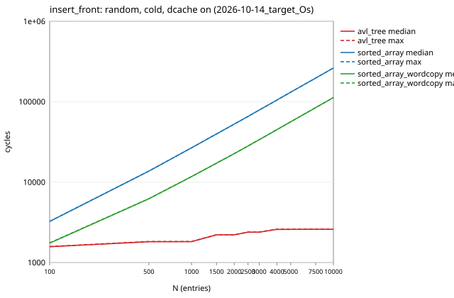

#### insert_end (random, cold, dcache on)

| N | array med | array max | array_wc med | array_wc max | avl med | avl max | tb avg (array/avl) |
|---:|---:|---:|---:|---:|---:|---:|---:|
| 100 | 633 | 644 | 617 | 642 | 1608 | 1617 | 0.00/0.00 |
| 500 | 739 | 750 | 723 | 748 | 1782 | 1791 | 0.00/0.00 |
| 1000 | 798 | 809 | 782 | 807 | 2352 | 2364 | 0.00/0.00 |
| 1500 | 857 | 868 | 846 | 866 | 2361 | 2373 | 0.00/0.00 |
| 2000 | 857 | 868 | 846 | 866 | 2539 | 2548 | 0.00/0.00 |
| 2500 | 915 | 926 | 899 | 924 | 2544 | 2554 | 0.00/0.00 |
| 3000 | 913 | 924 | 897 | 922 | 2548 | 2558 | 0.00/0.00 |
| 4000 | 919 | 928 | 901 | 922 | 2551 | 2560 | 0.00/0.00 |
| 5000 | 975 | 986 | 959 | 979 | 2551 | 2560 | 0.00/0.00 |
| 7500 | 972 | 987 | 960 | 980 | 2551 | 2560 | 0.00/0.00 |
| 10000 | 1036 | 1043 | 1020 | 1040 | 2749 | 2761 | 0.00/0.00 |

Crossover: none (the AVL median is not below the array median at the largest N).

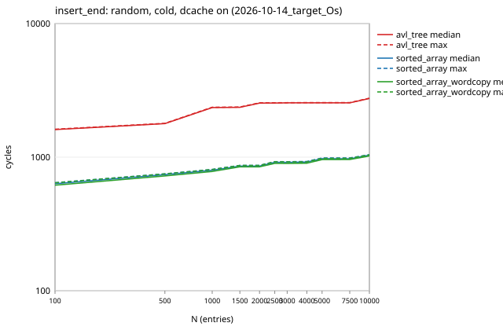

#### remove_random (random, cold, dcache on)

| N | array med | array max | array_wc med | array_wc max | avl med | avl max | tb avg (array/avl) |
|---:|---:|---:|---:|---:|---:|---:|---:|
| 100 | 1584 | 2157 | 1662 | 2365 | 2075 | 2867 | 1.08/1.08 |
| 500 | 3162 | 5312 | 3749 | 6570 | 2584 | 3868 | 1.32/1.33 |
| 1000 | 4995 | 8614 | 6355 | 11299 | 2810 | 4562 | 1.45/1.54 |
| 1500 | 6902 | 12424 | 9116 | 16233 | 2960 | 4686 | 1.68/1.61 |
| 2000 | 8649 | 15635 | 11507 | 20841 | 3042 | 4680 | 1.69/1.68 |
| 2500 | 9871 | 19365 | 13124 | 25852 | 3144 | 5166 | 1.75/1.74 |
| 3000 | 11942 | 22828 | 16274 | 30617 | 3191 | 4990 | 1.75/1.81 |
| 4000 | 15038 | 29416 | 20294 | 40338 | 3306 | 5429 | 1.95/1.97 |
| 5000 | 19306 | 36159 | 26570 | 50067 | 3374 | 6049 | 1.94/1.97 |
| 7500 | 26686 | 54537 | 36919 | 75217 | 3545 | 5835 | 2.11/2.12 |
| 10000 | 35832 | 72010 | 49799 | 99177 | 3669 | 6078 | 2.44/2.45 |

Crossover: from N = 500 the AVL median is below the array median for every larger N in the sweep.

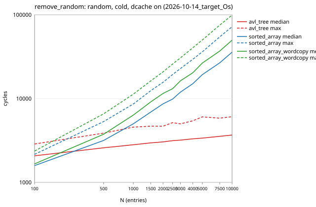

#### remove_first (random, cold, dcache on)

| N | array med | array max | array_wc med | array_wc max | avl med | avl max | tb avg (array/avl) |
|---:|---:|---:|---:|---:|---:|---:|---:|
| 100 | 1852 | 1852 | 2085 | 2104 | 2062 | 2066 | 1.00/1.00 |
| 500 | 5233 | 5237 | 6512 | 6512 | 2980 | 2989 | 3.00/3.00 |
| 1000 | 8678 | 8684 | 11266 | 11266 | 3459 | 3473 | 3.00/4.00 |
| 1500 | 12303 | 12306 | 16208 | 16214 | 3675 | 3681 | 4.00/4.00 |
| 2000 | 15685 | 15697 | 20902 | 20903 | 3854 | 3862 | 4.00/5.00 |
| 2500 | 19317 | 19317 | 25856 | 25859 | 3842 | 3846 | 5.00/5.00 |
| 3000 | 22682 | 22687 | 30642 | 30652 | 3833 | 3837 | 5.00/5.00 |
| 4000 | 29413 | 29416 | 40367 | 40377 | 4672 | 4678 | 5.00/7.00 |
| 5000 | 36417 | 36422 | 50369 | 50374 | 4667 | 4670 | 6.00/7.00 |
| 7500 | 53500 | 53529 | 74970 | 74975 | 4997 | 5015 | 7.00/8.00 |
| 10000 | 70639 | 70666 | 99608 | 99613 | 4691 | 4700 | 8.00/7.00 |

Crossover: from N = 500 the AVL median is below the array median for every larger N in the sweep.

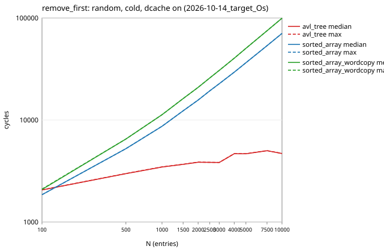

#### remove_last (random, cold, dcache on)

| N | array med | array max | array_wc med | array_wc max | avl med | avl max | tb avg (array/avl) |
|---:|---:|---:|---:|---:|---:|---:|---:|
| 100 | 1095 | 1095 | 1099 | 1118 | 2071 | 2074 | 1.00/1.00 |
| 500 | 1202 | 1202 | 1206 | 1225 | 2461 | 2464 | 1.00/1.00 |
| 1000 | 1262 | 1262 | 1266 | 1266 | 2845 | 2848 | 1.00/1.00 |
| 1500 | 1322 | 1322 | 1326 | 1327 | 3243 | 3249 | 1.00/1.00 |
| 2000 | 1322 | 1322 | 1326 | 1326 | 3267 | 3270 | 1.00/1.00 |
| 2500 | 1380 | 1399 | 1384 | 1384 | 3034 | 3037 | 1.00/1.00 |
| 3000 | 1413 | 1413 | 1417 | 1431 | 3038 | 3041 | 1.00/1.00 |
| 4000 | 1422 | 1425 | 1429 | 1429 | 3472 | 3481 | 1.00/2.00 |
| 5000 | 1890 | 1893 | 1897 | 1905 | 3490 | 3499 | 2.00/2.00 |
| 7500 | 1486 | 1489 | 1493 | 1493 | 3472 | 3481 | 1.00/2.00 |
| 10000 | 1594 | 1594 | 1598 | 1598 | 3557 | 3564 | 1.00/1.00 |

Crossover: none (the AVL median is not below the array median at the largest N).

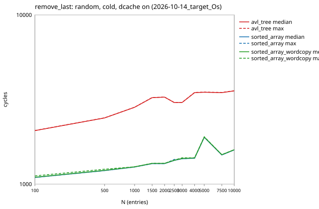

#### find_hit (random, cold, dcache on)

| N | array med | array max | avl med | avl max | tb avg (array/avl) |
|---:|---:|---:|---:|---:|---:|
| 100 | 1766 | 2451 | 1341 | 1881 | 2.15/1.15 |
| 500 | 1928 | 2915 | 1590 | 2821 | 2.46/1.52 |
| 1000 | 1990 | 3410 | 1681 | 3058 | 2.68/1.70 |
| 1500 | 2040 | 3730 | 1741 | 3253 | 2.78/1.76 |
| 2000 | 2073 | 3716 | 1798 | 3458 | 2.89/1.88 |
| 2500 | 2108 | 3909 | 1827 | 3595 | 2.99/2.00 |
| 3000 | 2138 | 4147 | 1864 | 3581 | 3.09/2.08 |
| 4000 | 2181 | 4305 | 1933 | 3673 | 3.16/2.13 |
| 5000 | 2213 | 4524 | 1964 | 3948 | 3.33/2.31 |
| 7500 | 2272 | 4337 | 2059 | 4173 | 3.52/2.53 |
| 10000 | 2354 | 4844 | 2113 | 4241 | 3.69/2.61 |

Crossover: from N = 100 the AVL median is below the array median for every larger N in the sweep. Medians within 10% (or within the 1 timer overhead) at N = 7500: too close to call there.

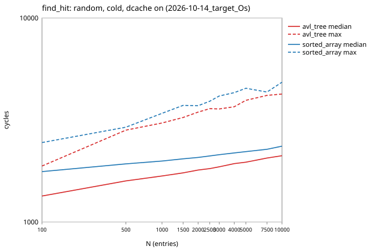

#### find_miss (random, cold, dcache on)

| N | array med | array max | avl med | avl max | tb avg (array/avl) |
|---:|---:|---:|---:|---:|---:|
| 100 | 637 | 1442 | 790 | 1439 | 0.19/0.15 |
| 500 | 795 | 2109 | 1009 | 2134 | 0.71/0.53 |
| 1000 | 878 | 2162 | 1113 | 2543 | 0.92/0.72 |
| 1500 | 935 | 2889 | 1177 | 2384 | 1.16/0.92 |
| 2000 | 956 | 2703 | 1236 | 2630 | 1.17/0.94 |
| 2500 | 984 | 2704 | 1265 | 2876 | 1.19/1.07 |
| 3000 | 1005 | 2987 | 1275 | 2773 | 1.27/1.04 |
| 4000 | 1035 | 2774 | 1313 | 3188 | 1.34/1.17 |
| 5000 | 1068 | 3069 | 1381 | 3265 | 1.39/1.18 |
| 7500 | 1105 | 3303 | 1429 | 3430 | 1.55/1.33 |
| 10000 | 1134 | 3381 | 1490 | 3807 | 1.81/1.60 |

Crossover: none (the AVL median is not below the array median at the largest N).

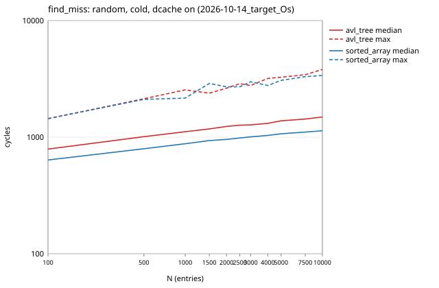

#### update_message (random, cold, dcache on)

| N | array med | array max | avl med | avl max | tb avg (array/avl) |
|---:|---:|---:|---:|---:|---:|
| 100 | 1158 | 1781 | 1339 | 1931 | 1.07/1.07 |
| 500 | 1307 | 2173 | 1560 | 2878 | 1.34/1.35 |
| 1000 | 1382 | 2664 | 1676 | 3018 | 1.46/1.48 |
| 1500 | 1431 | 3009 | 1741 | 3379 | 1.66/1.65 |
| 2000 | 1457 | 2991 | 1816 | 3489 | 1.71/1.74 |
| 2500 | 1490 | 3167 | 1844 | 3596 | 1.80/1.84 |
| 3000 | 1516 | 3166 | 1862 | 3702 | 1.81/1.81 |
| 4000 | 1553 | 3197 | 1937 | 3972 | 1.92/1.89 |
| 5000 | 1596 | 3538 | 1985 | 4009 | 2.17/2.16 |
| 7500 | 1636 | 3727 | 2086 | 4334 | 2.20/2.28 |
| 10000 | 1681 | 3717 | 2165 | 4579 | 2.44/2.51 |

Crossover: none (the AVL median is not below the array median at the largest N).

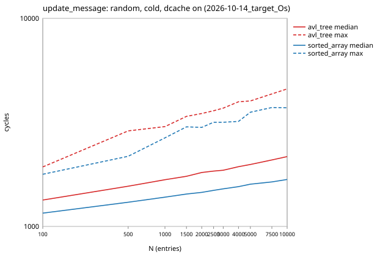

#### traverse_all (random, cold, dcache on)

| N | array med | array max | avl med | avl max | tb avg (array/avl) |
|---:|---:|---:|---:|---:|---:|
| 100 | 3962 | 3962 | 7233 | 7240 | 0.00/0.00 |
| 500 | 19562 | 19562 | 35832 | 35839 | 0.00/0.00 |
| 1000 | 39060 | 39060 | 71641 | 71641 | 0.00/0.00 |
| 1500 | 58562 | 58562 | 107306 | 107311 | 0.00/0.00 |
| 2000 | 78060 | 78060 | 144000 | 144076 | 0.00/0.00 |
| 2500 | 97562 | 97567 | 181453 | 181661 | 0.00/0.00 |
| 3000 | 117060 | 117065 | 219544 | 219795 | 0.00/0.00 |
| 4000 | 156065 | 156070 | 295742 | 296011 | 0.00/0.00 |
| 5000 | 195065 | 195070 | 371623 | 371841 | 0.00/0.00 |
| 7500 | 292582 | 292582 | 561686 | 561802 | 0.00/0.00 |
| 10000 | 390090 | 390090 | 751737 | 751957 | 0.00/0.00 |

Crossover: none (the AVL median is not below the array median at the largest N).

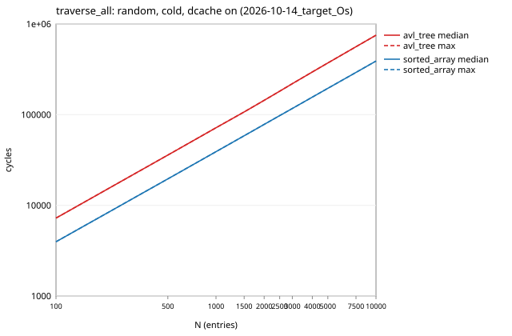

#### traverse_per_entry (random, cold, dcache on)

| N | array med | array max | avl med | avl max | tb avg (array/avl) |
|---:|---:|---:|---:|---:|---:|
| 100 | 39 | 39 | 72 | 72 | 0.00/0.00 |
| 500 | 39 | 39 | 71 | 71 | 0.00/0.00 |
| 1000 | 39 | 39 | 71 | 71 | 0.00/0.00 |
| 1500 | 39 | 39 | 71 | 71 | 0.00/0.00 |
| 2000 | 39 | 39 | 72 | 72 | 0.00/0.00 |
| 2500 | 39 | 39 | 72 | 72 | 0.00/0.00 |
| 3000 | 39 | 39 | 73 | 73 | 0.00/0.00 |
| 4000 | 39 | 39 | 73 | 74 | 0.00/0.00 |
| 5000 | 39 | 39 | 74 | 74 | 0.00/0.00 |
| 7500 | 39 | 39 | 74 | 74 | 0.00/0.00 |
| 10000 | 39 | 39 | 75 | 75 | 0.00/0.00 |

Crossover: none (the AVL median is not below the array median at the largest N).

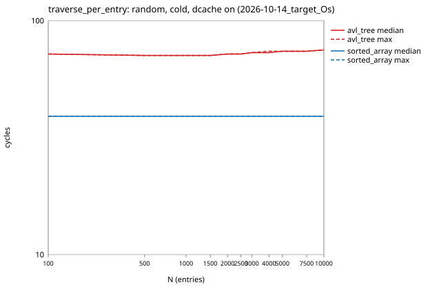

#### page_rank20 (random, cold, dcache on)

| N | array med | array max | avl med | avl max | tb avg (array/avl) |
|---:|---:|---:|---:|---:|---:|
| 100 | 794 | 799 | 3456 | 5095 | 0.00/0.00 |
| 500 | 795 | 799 | 12745 | 23103 | 0.00/0.00 |
| 1000 | 794 | 799 | 25235 | 45628 | 0.00/0.00 |
| 1500 | 794 | 805 | 36721 | 67951 | 0.00/0.00 |
| 2000 | 794 | 799 | 46463 | 91108 | 0.00/0.00 |
| 2500 | 794 | 799 | 57414 | 114359 | 0.00/0.00 |
| 3000 | 794 | 799 | 68307 | 138280 | 0.00/0.00 |
| 4000 | 795 | 799 | 93791 | 186057 | 0.00/0.00 |
| 5000 | 794 | 799 | 118388 | 233335 | 0.00/0.00 |
| 7500 | 795 | 799 | 182791 | 352281 | 0.00/0.00 |
| 10000 | 794 | 805 | 228598 | 470669 | 0.00/0.00 |

Crossover: none (the AVL median is not below the array median at the largest N).

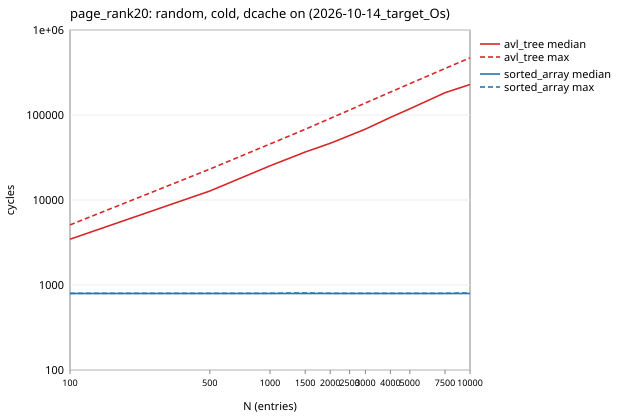

#### page_name20 (random, cold, dcache on)

| N | array med | array max | avl med | avl max | tb avg (array/avl) |
|---:|---:|---:|---:|---:|---:|
| 100 | 1925 | 2336 | 2817 | 3309 | 1.15/1.15 |
| 500 | 2085 | 2970 | 3095 | 4283 | 1.54/1.56 |
| 1000 | 2154 | 3407 | 3198 | 4640 | 1.61/1.64 |
| 1500 | 2213 | 3744 | 3268 | 4657 | 1.85/1.82 |
| 2000 | 2235 | 3729 | 3319 | 4779 | 1.87/1.89 |
| 2500 | 2269 | 4250 | 3359 | 5353 | 1.96/1.98 |
| 3000 | 2292 | 4229 | 3390 | 5123 | 2.09/2.06 |
| 4000 | 2324 | 3960 | 3460 | 5398 | 2.10/2.10 |
| 5000 | 2369 | 4263 | 3508 | 5334 | 2.36/2.33 |
| 7500 | 2407 | 4452 | 3583 | 5695 | 2.57/2.52 |
| 10000 | 2508 | 4837 | 3647 | 5943 | 2.69/2.68 |

Crossover: none (the AVL median is not below the array median at the largest N).

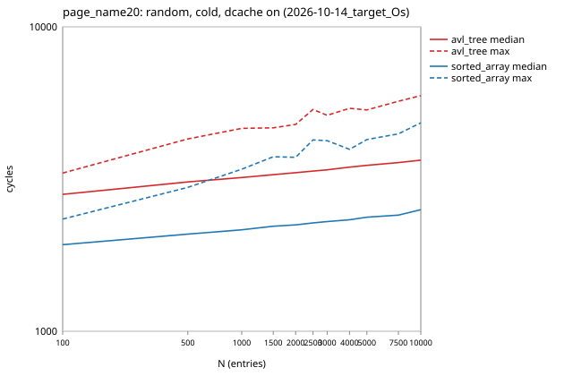

### `-Os`, D-cache off, warm

#### bulk_insert (random, warm, dcache off)

| N | array med | array max | array_wc med | array_wc max | avl med | avl max | tb avg (array/avl) |
|---:|---:|---:|---:|---:|---:|---:|---:|
| 100 | 291391 | 291391 | 123128 | 123128 | 165835 | 165849 | 9.00/8.00 |
| 500 | 6129814 | 6129831 | 2063694 | 2063697 | 1204995 | 1205017 | 178.00/183.00 |
| 1000 | 24608884 | 24608971 | 7770717 | 7770719 | 2767282 | 2767373 | 517.00/517.00 |
| 1500 | 53222527 | 53222527 | 16436260 | 16436307 | 4491791 | 4491904 | 985.00/990.00 |
| 2000 | 93304177 | 93304216 | 28399968 | 28399988 | 6304097 | 6304098 | 1472.00/1477.00 |
| 2500 | 142351723 | 142351757 | 42949930 | 42950014 | 8179263 | 8179309 | 2003.00/2020.00 |
| 3000 | 205529138 | 205529138 | 61575626 | 61575691 | 10147901 | 10147975 | 2626.00/2653.00 |
| 4000 | 362053661 | 362053728 | 107492468 | 107492707 | 14221394 | 14221506 | 3918.00/3957.00 |
| 5000 | 567051974 | 567052003 | 167366400 | 167366728 | 18521507 | 18521751 | 5510.00/5568.00 |
| 7500 | 1285534067 | 1285534067 | 376156020 | 376156186 | 29906965 | 29906984 | 10047.00/10139.00 |
| 10000 | 2255736475 | 2255736496 | 657049460 | 657050144 | 41840648 | 41840648 | 14857.00/14997.00 |

Crossover: from N = 100 the AVL median is below the array median for every larger N in the sweep.

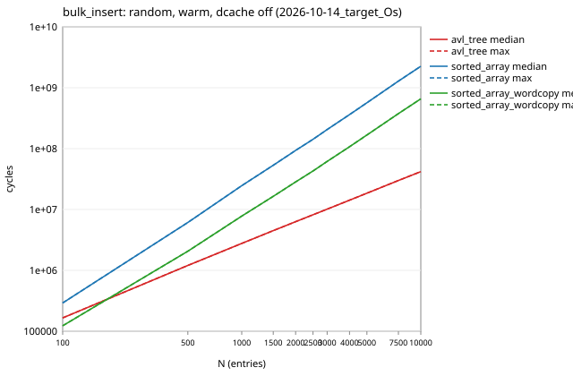

#### bulk_rebuild (random, warm, dcache off)

| N | array med | array max | avl med | avl max | tb avg (array/avl) |
|---:|---:|---:|---:|---:|---:|
| 100 | 107074 | 107074 | 294456 | 294468 | 10.00/10.00 |
| 500 | 815942 | 815947 | 1664094 | 1664098 | 203.00/203.00 |
| 1000 | 1890301 | 1890307 | 3703275 | 3703279 | 542.00/542.00 |
| 1500 | 3113884 | 3113933 | 6003552 | 6003679 | 1045.00/1045.00 |
| 2000 | 4377018 | 4377251 | 8372564 | 8372591 | 1552.00/1552.00 |
| 2500 | 5701614 | 5702338 | 10863240 | 10863244 | 2076.00/2076.00 |
| 3000 | 7110627 | 7110965 | 13461894 | 13462114 | 2749.00/2749.00 |
| 4000 | 9971015 | 9973204 | 18763631 | 18763663 | 4056.00/4056.00 |
| 5000 | 13077610 | 13081644 | 24431491 | 24431526 | 5755.00/5755.00 |
| 7500 | 21232784 | 21233462 | 39192957 | 39192957 | 10373.00/10373.00 |
| 10000 | 29832897 | 29845107 | 54740269 | 54740278 | 15352.00/15352.00 |

Crossover: none (the AVL median is not below the array median at the largest N).

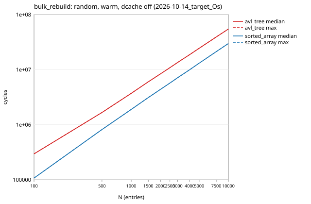

#### insert_random (random, warm, dcache off)

| N | array med | array max | array_wc med | array_wc max | avl med | avl max | tb avg (array/avl) |
|---:|---:|---:|---:|---:|---:|---:|---:|
| 100 | 6136 | 9604 | 2368 | 3874 | 2051 | 3764 | 0.15/0.15 |
| 500 | 22748 | 46021 | 7546 | 14886 | 2835 | 5018 | 0.56/0.53 |
| 1000 | 40996 | 90136 | 12968 | 27987 | 3218 | 5855 | 0.74/0.74 |
| 1500 | 60572 | 134628 | 18643 | 41629 | 3474 | 6422 | 1.03/1.06 |
| 2000 | 82250 | 178268 | 25337 | 54083 | 3581 | 6428 | 1.10/1.12 |
| 2500 | 100341 | 222722 | 30307 | 67403 | 3710 | 6861 | 1.06/1.07 |
| 3000 | 129647 | 267662 | 39063 | 80981 | 3868 | 7589 | 1.32/1.31 |
| 4000 | 170608 | 354503 | 51148 | 106066 | 4023 | 7000 | 1.43/1.44 |
| 5000 | 201819 | 443855 | 60227 | 132982 | 4185 | 7448 | 1.71/1.71 |
| 7500 | 320424 | 663943 | 95265 | 197501 | 4455 | 7835 | 1.93/1.95 |
| 10000 | 438469 | 884752 | 130386 | 262756 | 4710 | 9341 | 2.22/2.19 |

Crossover: from N = 100 the AVL median is below the array median for every larger N in the sweep.

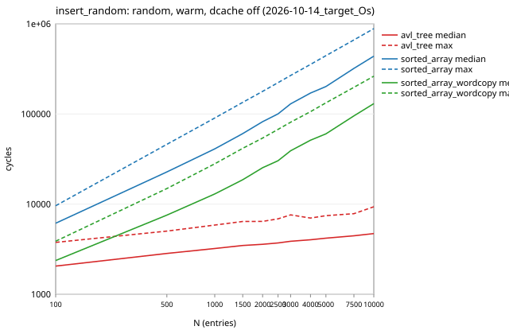

#### insert_front (random, warm, dcache off)

| N | array med | array max | array_wc med | array_wc max | avl med | avl max | tb avg (array/avl) |
|---:|---:|---:|---:|---:|---:|---:|---:|
| 100 | 9568 | 9568 | 3337 | 3347 | 1955 | 1964 | 0.00/0.00 |
| 500 | 44967 | 44981 | 13836 | 13855 | 2288 | 2301 | 0.00/0.00 |
| 1000 | 89095 | 89104 | 26842 | 26850 | 2271 | 2282 | 0.00/0.00 |
| 1500 | 133214 | 133228 | 39836 | 39845 | 2795 | 2806 | 0.00/0.00 |
| 2000 | 177287 | 177301 | 52780 | 52794 | 2795 | 2806 | 0.00/0.00 |
| 2500 | 221429 | 221443 | 65792 | 65800 | 3025 | 3031 | 0.00/0.00 |
| 3000 | 265478 | 265478 | 78724 | 78733 | 3025 | 3031 | 0.00/0.00 |
| 4000 | 353607 | 353607 | 104600 | 104609 | 3302 | 3308 | 0.00/0.00 |
| 5000 | 441802 | 441802 | 130548 | 130554 | 3302 | 3308 | 0.00/0.00 |
| 7500 | 662118 | 662118 | 195234 | 195242 | 3319 | 3327 | 0.00/0.00 |
| 10000 | 882499 | 882499 | 259992 | 260001 | 3323 | 3331 | 0.00/0.00 |

Crossover: from N = 100 the AVL median is below the array median for every larger N in the sweep.

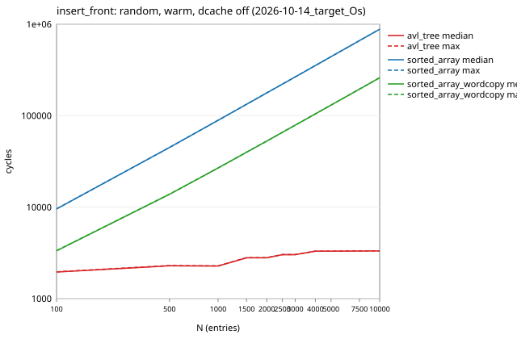

#### insert_end (random, warm, dcache off)

| N | array med | array max | array_wc med | array_wc max | avl med | avl max | tb avg (array/avl) |
|---:|---:|---:|---:|---:|---:|---:|---:|
| 100 | 680 | 691 | 678 | 687 | 2012 | 2023 | 0.00/0.00 |
| 500 | 801 | 812 | 799 | 808 | 2231 | 2244 | 0.00/0.00 |
| 1000 | 870 | 881 | 868 | 877 | 2973 | 2979 | 0.00/0.00 |
| 1500 | 939 | 950 | 937 | 946 | 2982 | 2988 | 0.00/0.00 |
| 2000 | 939 | 950 | 937 | 946 | 3210 | 3214 | 0.00/0.00 |
| 2500 | 1011 | 1022 | 1009 | 1018 | 3224 | 3228 | 0.00/0.00 |
| 3000 | 1009 | 1020 | 1007 | 1016 | 3233 | 3237 | 0.00/0.00 |
| 4000 | 1009 | 1020 | 1007 | 1016 | 3228 | 3232 | 0.00/0.00 |
| 5000 | 1081 | 1092 | 1079 | 1088 | 3228 | 3232 | 0.00/0.00 |
| 7500 | 1078 | 1082 | 1076 | 1085 | 3246 | 3250 | 0.00/0.00 |
| 10000 | 1152 | 1163 | 1150 | 1159 | 3509 | 3514 | 0.00/0.00 |

Crossover: none (the AVL median is not below the array median at the largest N).

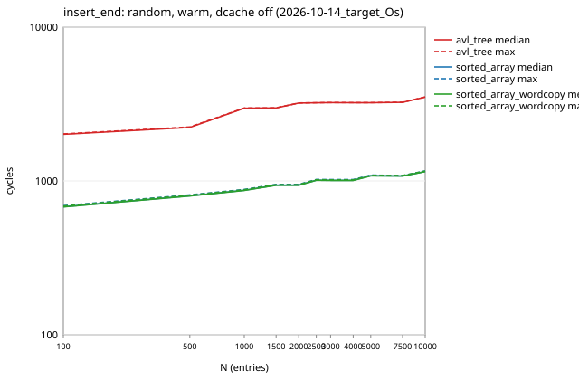

#### remove_random (random, warm, dcache off)

| N | array med | array max | array_wc med | array_wc max | avl med | avl max | tb avg (array/avl) |
|---:|---:|---:|---:|---:|---:|---:|---:|
| 100 | 2754 | 4010 | 2728 | 4139 | 2611 | 3782 | 1.08/1.08 |
| 500 | 7526 | 14796 | 7721 | 14112 | 3272 | 5108 | 1.32/1.33 |
| 1000 | 13503 | 27139 | 14174 | 26564 | 3539 | 6235 | 1.45/1.54 |
| 1500 | 20148 | 39897 | 21054 | 39418 | 3729 | 6433 | 1.68/1.61 |
| 2000 | 26167 | 52308 | 27308 | 50962 | 3848 | 6344 | 1.69/1.68 |
| 2500 | 31236 | 64369 | 31114 | 63424 | 3948 | 7151 | 1.75/1.74 |
| 3000 | 37119 | 77510 | 39048 | 75579 | 4021 | 6869 | 1.75/1.81 |
| 4000 | 47368 | 101780 | 48998 | 100242 | 4163 | 7525 | 1.95/1.97 |
| 5000 | 62034 | 126141 | 64707 | 124177 | 4250 | 8443 | 1.94/1.97 |
| 7500 | 88487 | 189636 | 89469 | 187030 | 4469 | 8086 | 2.11/2.12 |
| 10000 | 119995 | 251168 | 122315 | 247326 | 4638 | 8267 | 2.44/2.45 |

Crossover: from N = 100 the AVL median is below the array median for every larger N in the sweep. Medians within 10% (or within the 1 timer overhead) at N = 100: too close to call there.

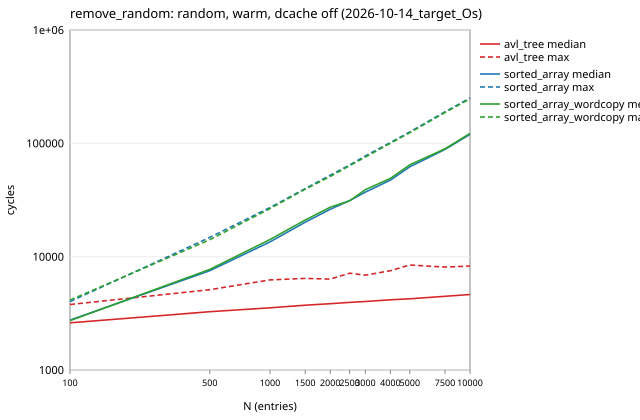

#### remove_first (random, warm, dcache off)

| N | array med | array max | array_wc med | array_wc max | avl med | avl max | tb avg (array/avl) |
|---:|---:|---:|---:|---:|---:|---:|---:|
| 100 | 3620 | 3620 | 3764 | 3784 | 2607 | 2610 | 1.00/1.00 |
| 500 | 13208 | 13208 | 14106 | 14125 | 3934 | 3946 | 3.00/3.00 |
| 1000 | 23991 | 23991 | 25827 | 25836 | 4602 | 4615 | 3.00/4.00 |
| 1500 | 35054 | 35057 | 37830 | 37845 | 4878 | 4886 | 4.00/4.00 |
| 2000 | 45757 | 45760 | 49471 | 49478 | 5158 | 5165 | 4.00/5.00 |
| 2500 | 56793 | 56820 | 61475 | 61475 | 5117 | 5127 | 5.00/5.00 |
| 3000 | 67476 | 67500 | 73089 | 73096 | 5118 | 5128 | 5.00/5.00 |
| 4000 | 88812 | 88839 | 96300 | 96307 | 6275 | 6288 | 5.00/7.00 |
| 5000 | 110587 | 110611 | 119950 | 119957 | 6273 | 6286 | 6.00/7.00 |
| 7500 | 164370 | 164370 | 178420 | 178427 | 6747 | 6762 | 7.00/8.00 |
| 10000 | 218198 | 218222 | 236936 | 236943 | 6314 | 6327 | 8.00/7.00 |

Crossover: from N = 100 the AVL median is below the array median for every larger N in the sweep.


#### remove_last (random, warm, dcache off)

| N | array med | array max | array_wc med | array_wc max | avl med | avl max | tb avg (array/avl) |
|---:|---:|---:|---:|---:|---:|---:|---:|
| 100 | 1346 | 1346 | 1358 | 1358 | 2612 | 2615 | 1.00/1.00 |
| 500 | 1468 | 1476 | 1480 | 1480 | 3084 | 3087 | 1.00/1.00 |
| 1000 | 1538 | 1538 | 1550 | 1550 | 3529 | 3549 | 1.00/1.00 |
| 1500 | 1607 | 1607 | 1611 | 1638 | 4031 | 4037 | 1.00/1.00 |
| 2000 | 1608 | 1608 | 1620 | 1620 | 4052 | 4057 | 1.00/1.00 |
| 2500 | 1679 | 1679 | 1691 | 1691 | 3790 | 3813 | 1.00/1.00 |
| 3000 | 1718 | 1718 | 1730 | 1730 | 3804 | 3804 | 1.00/1.00 |
| 4000 | 1736 | 1739 | 1743 | 1743 | 4444 | 4453 | 1.00/2.00 |
| 5000 | 2447 | 2450 | 2454 | 2454 | 4462 | 4471 | 2.00/2.00 |
| 7500 | 1804 | 1807 | 1811 | 1811 | 4444 | 4453 | 1.00/2.00 |
| 10000 | 1972 | 1972 | 1976 | 1995 | 4506 | 4506 | 1.00/1.00 |

Crossover: none (the AVL median is not below the array median at the largest N).


#### find_hit (random, warm, dcache off)

| N | array med | array max | avl med | avl max | tb avg (array/avl) |
|---:|---:|---:|---:|---:|---:|
| 100 | 2403 | 3464 | 1718 | 2541 | 2.15/1.15 |
| 500 | 2596 | 4139 | 2051 | 3916 | 2.46/1.52 |
| 1000 | 2674 | 4909 | 2151 | 4274 | 2.68/1.70 |
| 1500 | 2735 | 5385 | 2231 | 4571 | 2.78/1.76 |
| 2000 | 2782 | 5345 | 2307 | 4906 | 2.89/1.88 |
| 2500 | 2831 | 5635 | 2352 | 5085 | 2.99/2.00 |
| 3000 | 2865 | 6020 | 2397 | 5043 | 3.09/2.08 |
| 4000 | 2932 | 6285 | 2486 | 5205 | 3.16/2.13 |
| 5000 | 2977 | 6598 | 2535 | 5548 | 3.33/2.31 |
| 7500 | 3056 | 6280 | 2660 | 5910 | 3.52/2.53 |
| 10000 | 3150 | 7097 | 2737 | 6049 | 3.69/2.61 |

Crossover: from N = 100 the AVL median is below the array median for every larger N in the sweep.


#### find_miss (random, warm, dcache off)

| N | array med | array max | avl med | avl max | tb avg (array/avl) |
|---:|---:|---:|---:|---:|---:|
| 100 | 692 | 1826 | 912 | 1823 | 0.19/0.15 |
| 500 | 901 | 2814 | 1217 | 2863 | 0.71/0.53 |
| 1000 | 1009 | 2889 | 1346 | 3453 | 0.92/0.72 |
| 1500 | 1070 | 3998 | 1418 | 3218 | 1.16/0.92 |
| 2000 | 1099 | 3667 | 1495 | 3527 | 1.17/0.94 |
| 2500 | 1137 | 3706 | 1536 | 3876 | 1.19/1.07 |
| 3000 | 1157 | 4106 | 1553 | 3815 | 1.27/1.04 |
| 4000 | 1198 | 3802 | 1604 | 4328 | 1.34/1.17 |
| 5000 | 1234 | 4230 | 1676 | 4425 | 1.39/1.18 |
| 7500 | 1287 | 4553 | 1761 | 4738 | 1.55/1.33 |
| 10000 | 1313 | 4630 | 1834 | 5329 | 1.81/1.60 |

Crossover: none (the AVL median is not below the array median at the largest N).


#### update_message (random, warm, dcache off)

| N | array med | array max | avl med | avl max | tb avg (array/avl) |
|---:|---:|---:|---:|---:|---:|
| 100 | 1448 | 2412 | 1690 | 2601 | 1.07/1.07 |
| 500 | 1630 | 2977 | 1975 | 3993 | 1.34/1.35 |
| 1000 | 1724 | 3749 | 2122 | 4229 | 1.46/1.48 |
| 1500 | 1791 | 4242 | 2202 | 4779 | 1.66/1.65 |
| 2000 | 1815 | 4237 | 2293 | 4890 | 1.71/1.74 |
| 2500 | 1857 | 4484 | 2337 | 5040 | 1.80/1.84 |
| 3000 | 1889 | 4477 | 2347 | 5254 | 1.81/1.81 |
| 4000 | 1942 | 4558 | 2441 | 5676 | 1.92/1.89 |
| 5000 | 2009 | 5072 | 2517 | 5640 | 2.17/2.16 |
| 7500 | 2052 | 5398 | 2645 | 6207 | 2.20/2.28 |
| 10000 | 2115 | 5325 | 2763 | 6476 | 2.44/2.51 |

Crossover: none (the AVL median is not below the array median at the largest N).


#### traverse_all (random, warm, dcache off)

| N | array med | array max | avl med | avl max | tb avg (array/avl) |
|---:|---:|---:|---:|---:|---:|
| 100 | 4887 | 4887 | 10346 | 10350 | 0.00/0.00 |
| 500 | 24187 | 24187 | 51396 | 51400 | 0.00/0.00 |
| 1000 | 48310 | 48310 | 102741 | 102745 | 0.00/0.00 |
| 1500 | 72437 | 72437 | 153951 | 153955 | 0.00/0.00 |
| 2000 | 96560 | 96560 | 205536 | 205540 | 0.00/0.00 |
| 2500 | 120687 | 120687 | 256626 | 256630 | 0.00/0.00 |
| 3000 | 144810 | 144810 | 308266 | 308270 | 0.00/0.00 |
| 4000 | 193060 | 193060 | 411216 | 411220 | 0.00/0.00 |
| 5000 | 241310 | 241310 | 513936 | 513940 | 0.00/0.00 |
| 7500 | 361937 | 361937 | 770441 | 770445 | 0.00/0.00 |
| 10000 | 482560 | 482560 | 1027376 | 1027380 | 0.00/0.00 |

Crossover: none (the AVL median is not below the array median at the largest N).


#### traverse_per_entry (random, warm, dcache off)

| N | array med | array max | avl med | avl max | tb avg (array/avl) |
|---:|---:|---:|---:|---:|---:|
| 100 | 48 | 48 | 103 | 103 | 0.00/0.00 |
| 500 | 48 | 48 | 102 | 102 | 0.00/0.00 |
| 1000 | 48 | 48 | 102 | 102 | 0.00/0.00 |
| 1500 | 48 | 48 | 102 | 102 | 0.00/0.00 |
| 2000 | 48 | 48 | 102 | 102 | 0.00/0.00 |
| 2500 | 48 | 48 | 102 | 102 | 0.00/0.00 |
| 3000 | 48 | 48 | 102 | 102 | 0.00/0.00 |
| 4000 | 48 | 48 | 102 | 102 | 0.00/0.00 |
| 5000 | 48 | 48 | 102 | 102 | 0.00/0.00 |
| 7500 | 48 | 48 | 102 | 102 | 0.00/0.00 |
| 10000 | 48 | 48 | 102 | 102 | 0.00/0.00 |

Crossover: none (the AVL median is not below the array median at the largest N).


#### page_rank20 (random, warm, dcache off)

| N | array med | array max | avl med | avl max | tb avg (array/avl) |
|---:|---:|---:|---:|---:|---:|
| 100 | 978 | 979 | 4339 | 6262 | 0.00/0.00 |
| 500 | 974 | 979 | 14775 | 27129 | 0.00/0.00 |
| 1000 | 974 | 979 | 28856 | 53224 | 0.00/0.00 |
| 1500 | 974 | 979 | 41773 | 79088 | 0.00/0.00 |
| 2000 | 978 | 979 | 52684 | 105502 | 0.00/0.00 |
| 2500 | 974 | 979 | 64931 | 131325 | 0.00/0.00 |
| 3000 | 974 | 979 | 77088 | 157732 | 0.00/0.00 |
| 4000 | 978 | 979 | 105268 | 210060 | 0.00/0.00 |
| 5000 | 974 | 979 | 132635 | 262191 | 0.00/0.00 |
| 7500 | 974 | 979 | 203671 | 392588 | 0.00/0.00 |
| 10000 | 978 | 979 | 253832 | 522694 | 0.00/0.00 |

Crossover: none (the AVL median is not below the array median at the largest N).


#### page_name20 (random, warm, dcache off)

| N | array med | array max | avl med | avl max | tb avg (array/avl) |
|---:|---:|---:|---:|---:|---:|
| 100 | 2432 | 3063 | 3738 | 4506 | 1.15/1.15 |
| 500 | 2636 | 3985 | 4083 | 5888 | 1.54/1.56 |
| 1000 | 2716 | 4661 | 4193 | 6434 | 1.61/1.64 |
| 1500 | 2797 | 5177 | 4294 | 6441 | 1.85/1.82 |
| 2000 | 2826 | 5147 | 4366 | 6614 | 1.87/1.89 |
| 2500 | 2868 | 5941 | 4413 | 7586 | 1.96/1.98 |
| 3000 | 2900 | 5907 | 4456 | 7085 | 2.09/2.06 |
| 4000 | 2941 | 5497 | 4549 | 7600 | 2.10/2.10 |
| 5000 | 3010 | 5963 | 4618 | 7434 | 2.36/2.33 |
| 7500 | 3053 | 6228 | 4718 | 7928 | 2.57/2.52 |
| 10000 | 3191 | 6830 | 4798 | 8349 | 2.69/2.68 |

Crossover: none (the AVL median is not below the array median at the largest N).


### Other distributions (`-Os`, D-cache on, warm)

The operations most sensitive to insertion order and key sharing. Plots for every operation in these distributions are in `plots/`.

#### bulk_insert (ascending, warm, dcache on)

| N | array med | array max | array_wc med | array_wc max | avl med | avl max | tb avg (array/avl) |
|---:|---:|---:|---:|---:|---:|---:|---:|
| 100 | 39158 | 39186 | 38092 | 38103 | 132512 | 132556 | 16.00/17.00 |
| 500 | 276860 | 276875 | 271310 | 271310 | 906932 | 907013 | 158.00/196.00 |
| 1000 | 656476 | 656616 | 645329 | 645433 | 2064395 | 2064746 | 503.00/616.00 |
| 1500 | 1086203 | 1086545 | 1069441 | 1069629 | 3330267 | 3330454 | 908.00/1080.00 |
| 2000 | 1530763 | 1531108 | 1508242 | 1508691 | 4641190 | 4641597 | 1358.00/1663.00 |
| 2500 | 2033343 | 2034522 | 2005331 | 2005780 | 6045434 | 6045871 | 1949.00/2288.00 |
| 3000 | 2518664 | 2519147 | 2484631 | 2485147 | 7458402 | 7460223 | 2421.00/2908.00 |
| 4000 | 3536987 | 3537880 | 3491782 | 3492249 | 10366325 | 10367636 | 3583.00/4383.00 |
| 5000 | 4707531 | 4708000 | 4649978 | 4650730 | 13498626 | 13499039 | 5161.00/6051.00 |
| 7500 | 7652529 | 7652940 | 7559977 | 7560422 | 21455354 | 21456115 | 8934.00/10486.00 |
| 10000 | 10951589 | 10955098 | 10828828 | 10829116 | 30054213 | 30056730 | 13665.00/15869.00 |

Crossover: none (the AVL median is not below the array median at the largest N).


#### insert_random (ascending, warm, dcache on)

| N | array med | array max | array_wc med | array_wc max | avl med | avl max | tb avg (array/avl) |
|---:|---:|---:|---:|---:|---:|---:|---:|
| 100 | 1657 | 3670 | 1033 | 2469 | 1539 | 2438 | 0.16/0.15 |
| 500 | 6955 | 13725 | 3267 | 6269 | 1939 | 3092 | 0.48/0.46 |
| 1000 | 13357 | 25475 | 5836 | 10603 | 2163 | 3397 | 0.82/0.82 |
| 1500 | 17969 | 37801 | 7550 | 15725 | 2544 | 4181 | 1.12/1.08 |
| 2000 | 24195 | 49799 | 9770 | 19865 | 2386 | 3876 | 1.15/1.13 |
| 2500 | 31932 | 62334 | 12703 | 25053 | 2651 | 4528 | 1.12/1.13 |
| 3000 | 36127 | 75224 | 14481 | 30355 | 2801 | 4786 | 1.28/1.22 |
| 4000 | 49180 | 101362 | 19335 | 41681 | 2633 | 4775 | 1.44/1.42 |
| 5000 | 62957 | 128230 | 24902 | 53414 | 2968 | 4878 | 1.58/1.57 |
| 7500 | 93845 | 195570 | 38084 | 82183 | 3000 | 5002 | 1.70/1.71 |
| 10000 | 129185 | 261777 | 53138 | 109999 | 3256 | 5649 | 1.93/1.93 |

Crossover: from N = 100 the AVL median is below the array median for every larger N in the sweep. Medians within 10% (or within the 1 timer overhead) at N = 100: too close to call there.


#### insert_front (ascending, warm, dcache on)

| N | array med | array max | array_wc med | array_wc max | avl med | avl max | tb avg (array/avl) |
|---:|---:|---:|---:|---:|---:|---:|---:|
| 100 | 3058 | 3058 | 1557 | 1567 | 1500 | 1509 | 0.00/0.00 |
| 500 | 12764 | 12778 | 5263 | 5273 | 1843 | 1855 | 0.00/0.00 |
| 1000 | 24825 | 24834 | 9819 | 9829 | 2027 | 2031 | 0.00/0.00 |
| 1500 | 36880 | 36889 | 14374 | 14387 | 2028 | 2032 | 0.00/0.00 |
| 2000 | 48881 | 48895 | 18878 | 18893 | 2206 | 2210 | 0.00/0.00 |
| 2500 | 61046 | 61118 | 23535 | 23605 | 2205 | 2209 | 0.00/0.00 |
| 3000 | 73947 | 74131 | 28927 | 29262 | 2208 | 2212 | 0.00/0.00 |
| 4000 | 100915 | 101619 | 40761 | 41771 | 2368 | 2372 | 0.00/0.00 |
| 5000 | 128161 | 128910 | 52373 | 54043 | 2369 | 2373 | 0.00/0.00 |
| 7500 | 194978 | 195779 | 80069 | 83756 | 2542 | 2549 | 0.00/0.00 |
| 10000 | 260718 | 261929 | 107888 | 110603 | 2548 | 2553 | 0.00/0.00 |

Crossover: from N = 100 the AVL median is below the array median for every larger N in the sweep.


#### remove_random (ascending, warm, dcache on)

| N | array med | array max | array_wc med | array_wc max | avl med | avl max | tb avg (array/avl) |
|---:|---:|---:|---:|---:|---:|---:|---:|
| 100 | 1408 | 2488 | 1508 | 2665 | 1981 | 2808 | 1.12/1.13 |
| 500 | 2634 | 4680 | 3207 | 5592 | 2397 | 3866 | 1.31/1.32 |
| 1000 | 4158 | 7744 | 5126 | 9581 | 2602 | 3928 | 1.53/1.47 |
| 1500 | 5593 | 10729 | 7309 | 13634 | 2738 | 4520 | 1.59/1.60 |
| 2000 | 6886 | 13480 | 9065 | 17828 | 2808 | 4457 | 1.69/1.68 |
| 2500 | 8249 | 16688 | 10962 | 21841 | 2918 | 4532 | 1.73/1.75 |
| 3000 | 9546 | 20209 | 12989 | 26665 | 2967 | 4598 | 1.77/1.78 |
| 4000 | 12692 | 28095 | 17484 | 38670 | 3021 | 5229 | 1.93/1.94 |
| 5000 | 16718 | 36338 | 23064 | 49466 | 3140 | 4882 | 2.13/2.07 |
| 7500 | 24687 | 53683 | 34721 | 74818 | 3230 | 5720 | 2.10/2.15 |
| 10000 | 33675 | 73014 | 47427 | 100373 | 3376 | 5939 | 2.32/2.32 |

Crossover: from N = 500 the AVL median is below the array median for every larger N in the sweep. Medians within 10% (or within the 1 timer overhead) at N = 500: too close to call there.


#### find_hit (ascending, warm, dcache on)

| N | array med | array max | avl med | avl max | tb avg (array/avl) |
|---:|---:|---:|---:|---:|---:|
| 100 | 1691 | 2714 | 1268 | 1904 | 2.18/1.16 |
| 500 | 1825 | 2945 | 1451 | 2810 | 2.46/1.46 |
| 1000 | 1906 | 3153 | 1550 | 3023 | 2.69/1.68 |
| 1500 | 1947 | 3429 | 1611 | 2916 | 2.82/1.79 |
| 2000 | 1984 | 3570 | 1669 | 3464 | 2.92/1.92 |
| 2500 | 2018 | 3674 | 1704 | 3298 | 2.97/1.97 |
| 3000 | 2049 | 3594 | 1725 | 3334 | 3.12/2.11 |
| 4000 | 2086 | 3693 | 1780 | 3628 | 3.23/2.25 |
| 5000 | 2153 | 4012 | 1822 | 3623 | 3.40/2.40 |
| 7500 | 2186 | 4377 | 1885 | 4046 | 3.46/2.48 |
| 10000 | 2266 | 4416 | 1956 | 4049 | 3.65/2.60 |

Crossover: from N = 100 the AVL median is below the array median for every larger N in the sweep.


#### bulk_insert (descending, warm, dcache on)

| N | array med | array max | array_wc med | array_wc max | avl med | avl max | tb avg (array/avl) |
|---:|---:|---:|---:|---:|---:|---:|---:|
| 100 | 160949 | 160956 | 85892 | 85899 | 130162 | 130254 | 9.00/9.00 |
| 500 | 3303274 | 3303289 | 1428269 | 1428269 | 902747 | 903051 | 174.00/174.00 |
| 1000 | 12722512 | 12722733 | 5222677 | 5222895 | 2057441 | 2057644 | 566.00/570.00 |
| 1500 | 28186032 | 28186342 | 11311124 | 11311607 | 3315711 | 3315970 | 988.00/980.00 |
| 2000 | 49674449 | 49675147 | 19674845 | 19675607 | 4607037 | 4607285 | 1469.00/1486.00 |
| 2500 | 77263641 | 77264105 | 30389019 | 30390071 | 5994922 | 5995235 | 2083.00/2048.00 |
| 3000 | 111084885 | 111087594 | 43584632 | 43587446 | 7437367 | 7437887 | 2769.00/2736.00 |
| 4000 | 199715219 | 199722630 | 79719738 | 79752780 | 10349042 | 10349269 | 4277.00/4242.00 |
| 5000 | 316043642 | 316066710 | 128980353 | 129003306 | 13476464 | 13476826 | 6003.00/5913.00 |
| 7500 | 724497655 | 724497657 | 306583754 | 306583821 | 21516283 | 21516669 | 10595.00/10510.00 |
| 10000 | 1299775226 | 1299799259 | 556299513 | 556346454 | 30088798 | 30091361 | 16128.00/15835.00 |

Crossover: from N = 100 the AVL median is below the array median for every larger N in the sweep.


#### insert_random (descending, warm, dcache on)

| N | array med | array max | array_wc med | array_wc max | avl med | avl max | tb avg (array/avl) |
|---:|---:|---:|---:|---:|---:|---:|---:|
| 100 | 1908 | 3535 | 1183 | 2062 | 1530 | 2362 | 0.20/0.19 |
| 500 | 6422 | 13392 | 2995 | 5905 | 1940 | 3047 | 0.50/0.49 |
| 1000 | 12507 | 25678 | 5426 | 10701 | 2164 | 3516 | 0.83/0.84 |
| 1500 | 18690 | 37896 | 7613 | 15456 | 2553 | 4079 | 0.93/0.98 |
| 2000 | 23740 | 49864 | 9684 | 20297 | 2385 | 4189 | 0.99/0.99 |
| 2500 | 31529 | 62692 | 12477 | 25245 | 2709 | 4414 | 1.27/1.21 |
| 3000 | 37640 | 75434 | 14912 | 30454 | 2773 | 4614 | 1.24/1.19 |
| 4000 | 50512 | 101862 | 20104 | 41957 | 2634 | 4409 | 1.42/1.41 |
| 5000 | 62723 | 127960 | 25284 | 53354 | 2982 | 5040 | 1.63/1.59 |
| 7500 | 100377 | 195303 | 41371 | 82298 | 3074 | 5197 | 1.95/1.91 |
| 10000 | 125669 | 261071 | 51475 | 110332 | 3290 | 5927 | 2.07/2.04 |

Crossover: from N = 100 the AVL median is below the array median for every larger N in the sweep.


#### insert_front (descending, warm, dcache on)

| N | array med | array max | array_wc med | array_wc max | avl med | avl max | tb avg (array/avl) |
|---:|---:|---:|---:|---:|---:|---:|---:|
| 100 | 3058 | 3058 | 1561 | 1567 | 1306 | 1310 | 0.00/0.00 |
| 500 | 12764 | 12778 | 5263 | 5276 | 1649 | 1663 | 0.00/0.00 |
| 1000 | 24820 | 24834 | 9819 | 9829 | 1821 | 1833 | 0.00/0.00 |
| 1500 | 36880 | 36889 | 14374 | 14387 | 1999 | 2010 | 0.00/0.00 |
| 2000 | 48886 | 48895 | 18874 | 18892 | 1999 | 2006 | 0.00/0.00 |
| 2500 | 61037 | 61090 | 23524 | 23581 | 2176 | 2180 | 0.00/0.00 |
| 3000 | 73947 | 74140 | 28928 | 29173 | 2176 | 2180 | 0.00/0.00 |
| 4000 | 100907 | 101579 | 40751 | 42157 | 2177 | 2181 | 0.00/0.00 |
| 5000 | 128190 | 128925 | 52370 | 53953 | 2363 | 2367 | 0.00/0.00 |
| 7500 | 194834 | 195867 | 80224 | 83877 | 2177 | 2181 | 0.00/0.00 |
| 10000 | 260750 | 261922 | 107689 | 112032 | 2524 | 2531 | 0.00/0.00 |

Crossover: from N = 100 the AVL median is below the array median for every larger N in the sweep.


#### remove_random (descending, warm, dcache on)

| N | array med | array max | array_wc med | array_wc max | avl med | avl max | tb avg (array/avl) |
|---:|---:|---:|---:|---:|---:|---:|---:|
| 100 | 1412 | 2107 | 1511 | 2249 | 1950 | 2695 | 1.08/1.07 |
| 500 | 2710 | 4579 | 3313 | 5472 | 2386 | 3656 | 1.28/1.28 |
| 1000 | 4187 | 7732 | 5383 | 9618 | 2583 | 4216 | 1.47/1.53 |
| 1500 | 5307 | 10842 | 6817 | 13606 | 2752 | 4122 | 1.54/1.54 |
| 2000 | 6860 | 13672 | 8923 | 17537 | 2801 | 4368 | 1.61/1.64 |
| 2500 | 8605 | 16887 | 11773 | 21951 | 2874 | 4537 | 1.73/1.68 |
| 3000 | 9210 | 20195 | 12558 | 27030 | 2958 | 4670 | 1.77/1.80 |
| 4000 | 13102 | 28329 | 18024 | 38885 | 3016 | 4741 | 1.85/1.83 |
| 5000 | 16454 | 35305 | 22860 | 50107 | 3100 | 4826 | 2.03/1.96 |
| 7500 | 27086 | 55177 | 38123 | 75202 | 3237 | 5500 | 2.26/2.22 |
| 10000 | 34743 | 71990 | 49606 | 100028 | 3407 | 5493 | 2.40/2.39 |

Crossover: from N = 500 the AVL median is below the array median for every larger N in the sweep.


#### find_hit (descending, warm, dcache on)

| N | array med | array max | avl med | avl max | tb avg (array/avl) |
|---:|---:|---:|---:|---:|---:|
| 100 | 1693 | 2167 | 1236 | 1632 | 2.13/1.13 |
| 500 | 1843 | 3039 | 1442 | 2355 | 2.44/1.40 |
| 1000 | 1900 | 2962 | 1532 | 3008 | 2.64/1.67 |
| 1500 | 1958 | 3362 | 1610 | 2916 | 2.72/1.73 |
| 2000 | 1978 | 3379 | 1651 | 3058 | 2.85/1.84 |
| 2500 | 2011 | 3798 | 1703 | 3157 | 2.90/1.90 |
| 3000 | 2030 | 3682 | 1703 | 3452 | 2.96/1.97 |
| 4000 | 2062 | 3808 | 1751 | 3652 | 3.00/1.99 |
| 5000 | 2102 | 4087 | 1784 | 3830 | 3.18/2.16 |
| 7500 | 2215 | 4164 | 1925 | 3828 | 3.56/2.52 |
| 10000 | 2236 | 4645 | 1974 | 4310 | 3.62/2.60 |

Crossover: from N = 100 the AVL median is below the array median for every larger N in the sweep.


#### bulk_insert (prefix, warm, dcache on)

| N | array med | array max | array_wc med | array_wc max | avl med | avl max | tb avg (array/avl) |
|---:|---:|---:|---:|---:|---:|---:|---:|
| 100 | 99862 | 99870 | 62740 | 62740 | 124402 | 124428 | 15.00/14.00 |
| 500 | 1959057 | 1959078 | 939862 | 939883 | 914963 | 915147 | 326.00/312.00 |
| 1000 | 7049086 | 7049316 | 3135020 | 3135221 | 2101645 | 2101952 | 935.00/927.00 |
| 1500 | 15179287 | 15179596 | 6519002 | 6519656 | 3423063 | 3423458 | 1752.00/1743.00 |
| 2000 | 26492232 | 26493009 | 11129597 | 11130527 | 4828626 | 4829319 | 2673.00/2669.00 |
| 2500 | 41215881 | 41217594 | 17054723 | 17056048 | 6306273 | 6306886 | 3672.00/3652.00 |
| 3000 | 58715080 | 58716864 | 24069669 | 24070778 | 7811677 | 7811994 | 4687.00/4667.00 |
| 4000 | 103140350 | 103144796 | 42086470 | 42096105 | 10938087 | 10938455 | 6700.00/6688.00 |
| 5000 | 159083431 | 159096113 | 65199955 | 65217889 | 14196876 | 14197620 | 8955.00/8912.00 |
| 7500 | 361718995 | 361752567 | 150991996 | 151010563 | 22825221 | 22825309 | 15061.00/15022.00 |
| 10000 | 653221747 | 653221782 | 276239141 | 276245246 | 31889904 | 31890935 | 21542.00/21648.00 |

Crossover: from N = 500 the AVL median is below the array median for every larger N in the sweep.


#### insert_random (prefix, warm, dcache on)

| N | array med | array max | array_wc med | array_wc max | avl med | avl max | tb avg (array/avl) |
|---:|---:|---:|---:|---:|---:|---:|---:|
| 100 | 2194 | 3909 | 1310 | 2498 | 1581 | 2751 | 0.43/0.44 |
| 500 | 7460 | 13441 | 3483 | 6120 | 2234 | 3820 | 1.04/1.03 |
| 1000 | 12463 | 25761 | 5387 | 11154 | 2423 | 4472 | 1.36/1.39 |
| 1500 | 21027 | 37684 | 8576 | 15595 | 2603 | 4736 | 1.66/1.64 |
| 2000 | 23578 | 50255 | 9602 | 20767 | 2676 | 5147 | 1.75/1.74 |
| 2500 | 29858 | 62292 | 11833 | 25457 | 2801 | 5179 | 1.97/1.93 |
| 3000 | 39230 | 75177 | 15922 | 31049 | 2839 | 5283 | 1.88/1.87 |
| 4000 | 51077 | 101071 | 20892 | 42238 | 3012 | 5682 | 2.26/2.31 |
| 5000 | 64182 | 128132 | 26590 | 53642 | 3100 | 6167 | 2.35/2.32 |
| 7500 | 99461 | 193941 | 41350 | 81600 | 3277 | 6094 | 2.57/2.61 |
| 10000 | 132567 | 259387 | 55459 | 109305 | 3418 | 6552 | 2.77/2.77 |

Crossover: from N = 100 the AVL median is below the array median for every larger N in the sweep.


#### insert_front (prefix, warm, dcache on)

| N | array med | array max | array_wc med | array_wc max | avl med | avl max | tb avg (array/avl) |
|---:|---:|---:|---:|---:|---:|---:|---:|
| 100 | 3020 | 3026 | 1519 | 1527 | 1332 | 1332 | 0.00/0.00 |
| 500 | 12760 | 12769 | 5258 | 5264 | 1705 | 1717 | 0.00/0.00 |
| 1000 | 24815 | 24824 | 9809 | 9817 | 2051 | 2062 | 0.00/0.00 |
| 1500 | 36877 | 36886 | 14371 | 14379 | 2052 | 2063 | 0.00/0.00 |
| 2000 | 48878 | 48892 | 18871 | 18888 | 2237 | 2239 | 0.00/0.00 |
| 2500 | 61052 | 61113 | 23540 | 23603 | 2237 | 2241 | 0.00/0.00 |
| 3000 | 73948 | 74146 | 28924 | 29172 | 2235 | 2239 | 0.00/0.00 |
| 4000 | 100918 | 101586 | 40753 | 41823 | 2417 | 2422 | 0.00/0.00 |
| 5000 | 128168 | 128886 | 52364 | 53915 | 2409 | 2414 | 0.00/0.00 |
| 7500 | 195015 | 195833 | 80204 | 83204 | 2584 | 2591 | 0.00/0.00 |
| 10000 | 260802 | 261941 | 108013 | 111236 | 2595 | 2600 | 0.00/0.00 |

Crossover: from N = 100 the AVL median is below the array median for every larger N in the sweep.


#### remove_random (prefix, warm, dcache on)

| N | array med | array max | array_wc med | array_wc max | avl med | avl max | tb avg (array/avl) |
|---:|---:|---:|---:|---:|---:|---:|---:|
| 100 | 1439 | 2220 | 1546 | 2337 | 1959 | 2752 | 1.17/1.15 |
| 500 | 2747 | 4760 | 3288 | 5708 | 2426 | 4123 | 1.60/1.59 |
| 1000 | 4175 | 7809 | 5296 | 9712 | 2655 | 4482 | 1.80/1.84 |
| 1500 | 5466 | 10988 | 6862 | 13801 | 2816 | 4814 | 2.09/2.10 |
| 2000 | 6820 | 14327 | 8762 | 18240 | 2944 | 5007 | 2.20/2.17 |
| 2500 | 8177 | 17263 | 11313 | 22370 | 3011 | 5048 | 2.39/2.38 |
| 3000 | 9893 | 21206 | 13822 | 27385 | 3094 | 5317 | 2.46/2.44 |
| 4000 | 12986 | 28409 | 17920 | 38065 | 3191 | 5835 | 2.47/2.53 |
| 5000 | 16263 | 36616 | 22798 | 49649 | 3297 | 6037 | 2.70/2.71 |
| 7500 | 25981 | 54712 | 35924 | 74519 | 3463 | 6358 | 2.90/2.92 |
| 10000 | 36009 | 72307 | 51180 | 98868 | 3565 | 6253 | 2.99/3.06 |

Crossover: from N = 500 the AVL median is below the array median for every larger N in the sweep.


#### find_hit (prefix, warm, dcache on)

| N | array med | array max | avl med | avl max | tb avg (array/avl) |
|---:|---:|---:|---:|---:|---:|
| 100 | 1695 | 2421 | 1257 | 1943 | 2.22/1.19 |
| 500 | 1829 | 3040 | 1467 | 2849 | 2.81/1.83 |
| 1000 | 1880 | 3383 | 1562 | 3213 | 3.03/2.07 |
| 1500 | 1937 | 3694 | 1617 | 3377 | 3.42/2.37 |
| 2000 | 1955 | 3825 | 1687 | 3645 | 3.44/2.44 |
| 2500 | 2009 | 4096 | 1728 | 3758 | 3.68/2.67 |
| 3000 | 2033 | 4102 | 1782 | 3949 | 3.86/2.83 |
| 4000 | 2061 | 4096 | 1813 | 4096 | 3.88/2.88 |
| 5000 | 2131 | 4466 | 1867 | 4297 | 4.07/3.06 |
| 7500 | 2170 | 4797 | 1946 | 4394 | 4.16/3.17 |
| 10000 | 2313 | 5189 | 2052 | 4724 | 4.57/3.59 |

Crossover: from N = 100 the AVL median is below the array median for every larger N in the sweep.


## Host results (non-authoritative, ns)

Main view: `random` distribution. "array" is the sorted array with `memmove`, "array_wc" is the word-copy variant, and "avl" is the AVL tree. Each cell is median / max over the repetitions. The "tb avg" column is the average number of tie-break callback calls per operation.

Each table is followed by a log-log plot (median solid, max dashed). The crossover line comes from `scripts/summarize.py`. It names the smallest N from which the AVL median stays below the array median for every larger N in the sweep. N values where the two medians are within 10% of each other, or within the empty-timer cost, are flagged as too close to call.

### Warm

#### bulk_insert (random, warm, dcache n/a)

| N | array med | array max | array_wc med | array_wc max | avl med | avl max | tb avg (array/avl) |
|---:|---:|---:|---:|---:|---:|---:|---:|
| 100 | 5350 | 9354 | 3486 | 4668 | 4895 | 6066 | 9.00/8.00 |
| 500 | 36455 | 45129 | 46039 | 58217 | 37694 | 46118 | 178.00/183.00 |
| 1000 | 110871 | 119010 | 132483 | 153257 | 104239 | 125521 | 517.00/517.00 |
| 1500 | 201544 | 210953 | 257848 | 263622 | 201502 | 205246 | 985.00/990.00 |
| 2000 | 305026 | 346116 | 386268 | 421440 | 274490 | 278468 | 1472.00/1477.00 |
| 2500 | 403022 | 429828 | 566179 | 574581 | 378141 | 386922 | 2003.00/2020.00 |
| 3000 | 522203 | 534384 | 728511 | 736277 | 447268 | 533660 | 2626.00/2653.00 |
| 4000 | 805475 | 1009686 | 1181178 | 1191840 | 626973 | 635673 | 3918.00/3957.00 |
| 5000 | 1155089 | 1163296 | 1747292 | 3331890 | 871419 | 887706 | 5510.00/5568.00 |
| 7500 | 2532682 | 2557135 | 3700285 | 3884574 | 1362591 | 1367864 | 10047.00/10139.00 |
| 10000 | 4518645 | 4725114 | 6269116 | 6296826 | 1958696 | 2005488 | 14857.00/14997.00 |

Crossover: from N = 1000 the AVL median is below the array median for every larger N in the sweep. Medians within 10% (or within the 34 timer overhead) at N = 100, 500, 1000, 1500, 2500: too close to call there.


#### bulk_rebuild (random, warm, dcache n/a)

| N | array med | array max | avl med | avl max | tb avg (array/avl) |
|---:|---:|---:|---:|---:|---:|
| 100 | 9991 | 17492 | 11915 | 23870 | 10.00/10.00 |
| 500 | 44899 | 92211 | 48761 | 64798 | 203.00/203.00 |
| 1000 | 103325 | 111499 | 106488 | 118190 | 542.00/542.00 |
| 1500 | 178204 | 193117 | 192217 | 195656 | 1045.00/1045.00 |
| 2000 | 236106 | 240997 | 256913 | 260882 | 1552.00/1552.00 |
| 2500 | 333354 | 343767 | 352238 | 357028 | 2076.00/2076.00 |
| 3000 | 391616 | 413543 | 419982 | 426789 | 2749.00/2749.00 |
| 4000 | 554786 | 575807 | 590433 | 595331 | 4056.00/4056.00 |
| 5000 | 726962 | 730926 | 781948 | 789826 | 5755.00/5755.00 |
| 7500 | 1195010 | 1206634 | 1270035 | 1279542 | 10373.00/10373.00 |
| 10000 | 1726237 | 1780106 | 1879246 | 1885971 | 15352.00/15352.00 |

Crossover: none (the AVL median is not below the array median at the largest N). Medians within 10% (or within the 34 timer overhead) at N = 500, 1000, 1500, 2000, 2500, 3000, 4000, 5000, 7500, 10000: too close to call there.


#### insert_random (random, warm, dcache n/a)

| N | array med | array max | array_wc med | array_wc max | avl med | avl max | tb avg (array/avl) |
|---:|---:|---:|---:|---:|---:|---:|---:|
| 100 | 147 | 384 | 115 | 257 | 166 | 432 | 0.15/0.15 |
| 500 | 129 | 897 | 155 | 543 | 132 | 454 | 0.56/0.53 |
| 1000 | 162 | 420 | 212 | 896 | 148 | 362 | 0.74/0.74 |
| 1500 | 193 | 824 | 272 | 1608 | 162 | 348 | 1.03/1.06 |
| 2000 | 210 | 462 | 305 | 5172 | 164 | 379 | 1.10/1.12 |
| 2500 | 241 | 1147 | 370 | 2077 | 177 | 459 | 1.06/1.07 |
| 3000 | 261 | 579 | 417 | 812 | 179 | 765 | 1.32/1.31 |
| 4000 | 316 | 2614 | 508 | 1015 | 194 | 729 | 1.43/1.44 |
| 5000 | 352 | 787 | 592 | 2803 | 199 | 4968 | 1.71/1.71 |
| 7500 | 487 | 1268 | 834 | 1862 | 213 | 462 | 1.93/1.95 |
| 10000 | 713 | 1860 | 1155 | 2841 | 235 | 541 | 2.22/2.19 |

Crossover: from N = 1000 the AVL median is below the array median for every larger N in the sweep. Medians within 10% (or within the 34 timer overhead) at N = 100, 500, 1000, 1500: too close to call there.


#### insert_front (random, warm, dcache n/a)

| N | array med | array max | array_wc med | array_wc max | avl med | avl max | tb avg (array/avl) |
|---:|---:|---:|---:|---:|---:|---:|---:|
| 100 | 74 | 123 | 82 | 6585 | 97 | 874 | 0.00/0.00 |
| 500 | 84 | 255 | 142 | 2244 | 61 | 200 | 0.00/0.00 |
| 1000 | 125 | 150 | 237 | 3533 | 63 | 226 | 0.00/0.00 |
| 1500 | 167 | 174 | 331 | 358 | 74 | 88 | 0.00/0.00 |
| 2000 | 198 | 1490 | 409 | 1918 | 71 | 240 | 0.00/0.00 |
| 2500 | 249 | 3291 | 528 | 2144 | 74 | 78 | 0.00/0.00 |
| 3000 | 275 | 320 | 595 | 638 | 75 | 93 | 0.00/0.00 |
| 4000 | 362 | 917 | 784 | 852 | 80 | 96 | 0.00/0.00 |
| 5000 | 516 | 1859 | 1006 | 2466 | 78 | 110 | 0.00/0.00 |
| 7500 | 947 | 5577 | 1581 | 2814 | 79 | 94 | 0.00/0.00 |
| 10000 | 1399 | 4643 | 2113 | 3361 | 85 | 104 | 0.00/0.00 |

Crossover: from N = 500 the AVL median is below the array median for every larger N in the sweep. Medians within 10% (or within the 34 timer overhead) at N = 100, 500: too close to call there.


#### insert_end (random, warm, dcache n/a)

| N | array med | array max | array_wc med | array_wc max | avl med | avl max | tb avg (array/avl) |
|---:|---:|---:|---:|---:|---:|---:|---:|
| 100 | 52 | 56 | 44 | 58 | 61 | 65 | 0.00/0.00 |
| 500 | 37 | 135 | 37 | 52 | 61 | 134 | 0.00/0.00 |
| 1000 | 50 | 70 | 46 | 52 | 79 | 267 | 0.00/0.00 |
| 1500 | 44 | 155 | 43 | 49 | 79 | 96 | 0.00/0.00 |
| 2000 | 43 | 96 | 41 | 45 | 79 | 99 | 0.00/0.00 |
| 2500 | 55 | 183 | 55 | 82 | 80 | 122 | 0.00/0.00 |
| 3000 | 46 | 52 | 44 | 102 | 80 | 1661 | 0.00/0.00 |
| 4000 | 53 | 58 | 51 | 4699 | 79 | 1569 | 0.00/0.00 |
| 5000 | 47 | 57 | 47 | 441 | 79 | 96 | 0.00/0.00 |
| 7500 | 67 | 104 | 66 | 83 | 79 | 4723 | 0.00/0.00 |
| 10000 | 60 | 65 | 58 | 84 | 91 | 292 | 0.00/0.00 |

Crossover: none (the AVL median is not below the array median at the largest N). Medians within 10% (or within the 34 timer overhead) at N = 100, 500, 1000, 2500, 4000, 5000, 7500, 10000: too close to call there.


#### remove_random (random, warm, dcache n/a)

| N | array med | array max | array_wc med | array_wc max | avl med | avl max | tb avg (array/avl) |
|---:|---:|---:|---:|---:|---:|---:|---:|
| 100 | 144 | 304 | 146 | 273 | 158 | 270 | 1.08/1.08 |
| 500 | 169 | 3753 | 190 | 919 | 183 | 497 | 1.32/1.33 |
| 1000 | 198 | 2089 | 235 | 931 | 196 | 651 | 1.45/1.54 |
| 1500 | 234 | 1938 | 308 | 615 | 207 | 499 | 1.68/1.61 |
| 2000 | 247 | 486 | 337 | 1936 | 202 | 387 | 1.69/1.68 |
| 2500 | 275 | 721 | 400 | 1806 | 218 | 460 | 1.75/1.74 |
| 3000 | 292 | 2140 | 423 | 857 | 212 | 460 | 1.75/1.81 |
| 4000 | 339 | 1815 | 517 | 5077 | 229 | 4979 | 1.95/1.97 |
| 5000 | 408 | 959 | 669 | 18350 | 231 | 476 | 1.94/1.97 |
| 7500 | 606 | 2207 | 875 | 2114 | 236 | 503 | 2.11/2.12 |
| 10000 | 905 | 2304 | 1268 | 7052 | 266 | 588 | 2.44/2.45 |

Crossover: from N = 1000 the AVL median is below the array median for every larger N in the sweep. Medians within 10% (or within the 34 timer overhead) at N = 100, 500, 1000, 1500: too close to call there.


#### remove_first (random, warm, dcache n/a)

| N | array med | array max | array_wc med | array_wc max | avl med | avl max | tb avg (array/avl) |
|---:|---:|---:|---:|---:|---:|---:|---:|
| 100 | 94 | 109 | 115 | 117 | 77 | 2253 | 1.00/1.00 |
| 500 | 140 | 459 | 173 | 189 | 129 | 181 | 3.00/3.00 |
| 1000 | 185 | 195 | 238 | 838 | 150 | 521 | 3.00/4.00 |
| 1500 | 241 | 6055 | 370 | 1698 | 156 | 2030 | 4.00/4.00 |
| 2000 | 269 | 1434 | 382 | 429 | 167 | 1395 | 4.00/5.00 |
| 2500 | 336 | 1687 | 492 | 2508 | 165 | 170 | 5.00/5.00 |
| 3000 | 386 | 1713 | 573 | 607 | 162 | 165 | 5.00/5.00 |
| 4000 | 478 | 1803 | 678 | 758 | 193 | 1697 | 5.00/7.00 |
| 5000 | 627 | 642 | 911 | 4529 | 196 | 1442 | 6.00/7.00 |
| 7500 | 1041 | 1101 | 1299 | 1606 | 215 | 1666 | 7.00/8.00 |
| 10000 | 1486 | 3392 | 1749 | 7401 | 205 | 209 | 8.00/7.00 |

Crossover: from N = 100 the AVL median is below the array median for every larger N in the sweep. Medians within 10% (or within the 34 timer overhead) at N = 100, 500: too close to call there.


#### remove_last (random, warm, dcache n/a)

| N | array med | array max | array_wc med | array_wc max | avl med | avl max | tb avg (array/avl) |
|---:|---:|---:|---:|---:|---:|---:|---:|
| 100 | 70 | 86 | 68 | 70 | 76 | 92 | 1.00/1.00 |
| 500 | 75 | 99 | 73 | 81 | 81 | 312 | 1.00/1.00 |
| 1000 | 84 | 87 | 80 | 140 | 92 | 343 | 1.00/1.00 |
| 1500 | 86 | 154 | 86 | 264 | 104 | 363 | 1.00/1.00 |
| 2000 | 82 | 98 | 81 | 85 | 99 | 758 | 1.00/1.00 |
| 2500 | 87 | 2318 | 86 | 1565 | 99 | 102 | 1.00/1.00 |
| 3000 | 85 | 4719 | 84 | 91 | 92 | 2352 | 1.00/1.00 |
| 4000 | 79 | 778 | 80 | 91 | 117 | 120 | 1.00/2.00 |
| 5000 | 111 | 117 | 115 | 120 | 116 | 196 | 2.00/2.00 |
| 7500 | 87 | 92 | 86 | 91 | 117 | 141 | 1.00/2.00 |
| 10000 | 98 | 103 | 96 | 100 | 114 | 127 | 1.00/1.00 |

Crossover: none (the AVL median is not below the array median at the largest N). Medians within 10% (or within the 34 timer overhead) at N = 100, 500, 1000, 1500, 2000, 2500, 3000, 5000, 7500, 10000: too close to call there.


#### find_hit (random, warm, dcache n/a)

| N | array med | array max | avl med | avl max | tb avg (array/avl) |
|---:|---:|---:|---:|---:|---:|
| 100 | 155 | 3421 | 109 | 246 | 2.15/1.15 |
| 500 | 191 | 2915 | 145 | 2279 | 2.46/1.52 |
| 1000 | 208 | 2035 | 156 | 581 | 2.68/1.70 |
| 1500 | 209 | 683 | 164 | 358 | 2.78/1.76 |
| 2000 | 207 | 450 | 163 | 1228 | 2.89/1.88 |
| 2500 | 229 | 738 | 175 | 400 | 2.99/2.00 |
| 3000 | 219 | 466 | 173 | 386 | 3.09/2.08 |
| 4000 | 224 | 555 | 180 | 414 | 3.16/2.13 |
| 5000 | 228 | 524 | 183 | 456 | 3.33/2.31 |
| 7500 | 239 | 515 | 197 | 479 | 3.52/2.53 |
| 10000 | 247 | 583 | 210 | 1969 | 3.69/2.61 |

Crossover: from N = 100 the AVL median is below the array median for every larger N in the sweep.


#### find_miss (random, warm, dcache n/a)

| N | array med | array max | avl med | avl max | tb avg (array/avl) |
|---:|---:|---:|---:|---:|---:|
| 100 | 79 | 182 | 66 | 137 | 0.19/0.15 |
| 500 | 88 | 335 | 84 | 356 | 0.71/0.53 |
| 1000 | 96 | 256 | 90 | 212 | 0.92/0.72 |
| 1500 | 100 | 336 | 90 | 243 | 1.16/0.92 |
| 2000 | 100 | 1521 | 95 | 237 | 1.17/0.94 |
| 2500 | 96 | 314 | 103 | 301 | 1.19/1.07 |
| 3000 | 101 | 1109 | 98 | 284 | 1.27/1.04 |
| 4000 | 108 | 305 | 103 | 320 | 1.34/1.17 |
| 5000 | 98 | 352 | 110 | 1742 | 1.39/1.18 |
| 7500 | 110 | 386 | 115 | 343 | 1.55/1.33 |
| 10000 | 123 | 404 | 127 | 362 | 1.81/1.60 |

Crossover: none (the AVL median is not below the array median at the largest N). Medians within 10% (or within the 34 timer overhead) at N = 100, 500, 1000, 1500, 2000, 2500, 3000, 4000, 5000, 7500, 10000: too close to call there.


#### update_message (random, warm, dcache n/a)

| N | array med | array max | avl med | avl max | tb avg (array/avl) |
|---:|---:|---:|---:|---:|---:|
| 100 | 108 | 1568 | 88 | 204 | 1.07/1.07 |
| 500 | 145 | 478 | 130 | 311 | 1.34/1.35 |
| 1000 | 155 | 322 | 148 | 319 | 1.46/1.48 |
| 1500 | 159 | 391 | 156 | 442 | 1.66/1.65 |
| 2000 | 160 | 382 | 160 | 832 | 1.71/1.74 |
| 2500 | 172 | 431 | 168 | 494 | 1.80/1.84 |
| 3000 | 165 | 446 | 159 | 406 | 1.81/1.81 |
| 4000 | 180 | 2472 | 166 | 2815 | 1.92/1.89 |
| 5000 | 184 | 443 | 175 | 415 | 2.17/2.16 |
| 7500 | 191 | 4770 | 186 | 497 | 2.20/2.28 |
| 10000 | 205 | 1614 | 204 | 447 | 2.44/2.51 |

Crossover: from N = 2500 the AVL median is below the array median for every larger N in the sweep. Medians within 10% (or within the 34 timer overhead) at N = 100, 500, 1000, 1500, 2000, 2500, 3000, 4000, 5000, 7500, 10000: too close to call there.


#### traverse_all (random, warm, dcache n/a)

| N | array med | array max | avl med | avl max | tb avg (array/avl) |
|---:|---:|---:|---:|---:|---:|
| 100 | 201 | 208 | 236 | 2340 | 0.00/0.00 |
| 500 | 754 | 3207 | 1268 | 4106 | 0.00/0.00 |
| 1000 | 1501 | 3626 | 2436 | 6362 | 0.00/0.00 |
| 1500 | 2201 | 9657 | 4098 | 5639 | 0.00/0.00 |
| 2000 | 2848 | 4351 | 6396 | 11382 | 0.00/0.00 |
| 2500 | 3551 | 5845 | 8633 | 12337 | 0.00/0.00 |
| 3000 | 4239 | 5612 | 9623 | 17509 | 0.00/0.00 |
| 4000 | 5613 | 7357 | 17239 | 22062 | 0.00/0.00 |
| 5000 | 7050 | 11686 | 20765 | 28137 | 0.00/0.00 |
| 7500 | 10564 | 15017 | 41568 | 46990 | 0.00/0.00 |
| 10000 | 15096 | 17895 | 66935 | 72664 | 0.00/0.00 |

Crossover: none (the AVL median is not below the array median at the largest N).


#### traverse_per_entry (random, warm, dcache n/a)

| N | array med | array max | avl med | avl max | tb avg (array/avl) |
|---:|---:|---:|---:|---:|---:|
| 100 | 2 | 2 | 2 | 23 | 0.00/0.00 |
| 500 | 1 | 6 | 2 | 8 | 0.00/0.00 |
| 1000 | 1 | 3 | 2 | 6 | 0.00/0.00 |
| 1500 | 1 | 6 | 2 | 3 | 0.00/0.00 |
| 2000 | 1 | 2 | 3 | 5 | 0.00/0.00 |
| 2500 | 1 | 2 | 3 | 4 | 0.00/0.00 |
| 3000 | 1 | 1 | 3 | 5 | 0.00/0.00 |
| 4000 | 1 | 1 | 4 | 5 | 0.00/0.00 |
| 5000 | 1 | 2 | 4 | 5 | 0.00/0.00 |
| 7500 | 1 | 2 | 5 | 6 | 0.00/0.00 |
| 10000 | 1 | 1 | 6 | 7 | 0.00/0.00 |

Crossover: none (the AVL median is not below the array median at the largest N). Medians within 10% (or within the 34 timer overhead) at N = 100, 500, 1000, 1500, 2000, 2500, 3000, 4000, 5000, 7500, 10000: too close to call there.


#### page_rank20 (random, warm, dcache n/a)

| N | array med | array max | avl med | avl max | tb avg (array/avl) |
|---:|---:|---:|---:|---:|---:|
| 100 | 50 | 52 | 139 | 694 | 0.00/0.00 |
| 500 | 46 | 53 | 518 | 2641 | 0.00/0.00 |
| 1000 | 46 | 51 | 1017 | 4066 | 0.00/0.00 |
| 1500 | 46 | 49 | 1448 | 4614 | 0.00/0.00 |
| 2000 | 44 | 78 | 1769 | 4132 | 0.00/0.00 |
| 2500 | 44 | 49 | 2144 | 6281 | 0.00/0.00 |
| 3000 | 44 | 53 | 2557 | 6702 | 0.00/0.00 |
| 4000 | 44 | 51 | 3416 | 9580 | 0.00/0.00 |
| 5000 | 44 | 63 | 4380 | 9905 | 0.00/0.00 |
| 7500 | 44 | 50 | 6641 | 21138 | 0.00/0.00 |
| 10000 | 46 | 51 | 8394 | 24774 | 0.00/0.00 |

Crossover: none (the AVL median is not below the array median at the largest N).


#### page_name20 (random, warm, dcache n/a)

| N | array med | array max | avl med | avl max | tb avg (array/avl) |
|---:|---:|---:|---:|---:|---:|
| 100 | 148 | 7066 | 152 | 292 | 1.15/1.15 |
| 500 | 179 | 311 | 263 | 462 | 1.54/1.56 |
| 1000 | 191 | 2011 | 289 | 2002 | 1.61/1.64 |
| 1500 | 199 | 436 | 312 | 539 | 1.85/1.82 |
| 2000 | 194 | 390 | 300 | 3171 | 1.87/1.89 |
| 2500 | 203 | 430 | 312 | 919 | 1.96/1.98 |
| 3000 | 202 | 425 | 318 | 3950 | 2.09/2.06 |
| 4000 | 212 | 944 | 332 | 599 | 2.10/2.10 |
| 5000 | 220 | 471 | 341 | 2392 | 2.36/2.33 |
| 7500 | 228 | 532 | 356 | 676 | 2.57/2.52 |
| 10000 | 248 | 599 | 364 | 1997 | 2.69/2.68 |

Crossover: none (the AVL median is not below the array median at the largest N). Medians within 10% (or within the 34 timer overhead) at N = 100: too close to call there.


### Cold

#### bulk_insert (random, cold, dcache n/a)

| N | array med | array max | array_wc med | array_wc max | avl med | avl max | tb avg (array/avl) |
|---:|---:|---:|---:|---:|---:|---:|---:|
| 100 | 4770 | 7135 | 4988 | 9859 | 6368 | 10449 | 9.00/8.00 |
| 500 | 40387 | 77414 | 50991 | 100319 | 39046 | 54910 | 178.00/183.00 |
| 1000 | 116361 | 126499 | 142505 | 151403 | 115367 | 196324 | 517.00/517.00 |
| 1500 | 225824 | 319248 | 291957 | 339566 | 203894 | 211740 | 985.00/990.00 |
| 2000 | 298944 | 323403 | 413784 | 425239 | 281026 | 298555 | 1472.00/1477.00 |
| 2500 | 462254 | 679959 | 559845 | 582286 | 379507 | 391735 | 2003.00/2020.00 |
| 3000 | 533629 | 542417 | 780654 | 792828 | 483995 | 531851 | 2626.00/2653.00 |
| 4000 | 853457 | 867119 | 1206920 | 1250579 | 657976 | 697271 | 3918.00/3957.00 |
| 5000 | 1224004 | 1244525 | 1734921 | 1741338 | 843097 | 878590 | 5510.00/5568.00 |
| 7500 | 2538306 | 2575193 | 3855061 | 4146115 | 1383314 | 1408809 | 10047.00/10139.00 |
| 10000 | 4509384 | 4928415 | 6588260 | 6614422 | 2024738 | 2201376 | 14857.00/14997.00 |

Crossover: from N = 500 the AVL median is below the array median for every larger N in the sweep. Medians within 10% (or within the 12 timer overhead) at N = 500, 1000, 1500, 2000, 3000: too close to call there.


#### bulk_rebuild (random, cold, dcache n/a)

| N | array med | array max | avl med | avl max | tb avg (array/avl) |
|---:|---:|---:|---:|---:|---:|
| 100 | 8598 | 11417 | 20898 | 29526 | 10.00/10.00 |
| 500 | 46704 | 493789 | 57954 | 65403 | 203.00/203.00 |
| 1000 | 111310 | 150731 | 131431 | 146983 | 542.00/542.00 |
| 1500 | 182213 | 211896 | 212003 | 316050 | 1045.00/1045.00 |
| 2000 | 251580 | 295144 | 270983 | 280240 | 1552.00/1552.00 |
| 2500 | 348319 | 418850 | 371627 | 402122 | 2076.00/2076.00 |
| 3000 | 398501 | 404115 | 463331 | 511319 | 2749.00/2749.00 |
| 4000 | 567864 | 603514 | 638128 | 651845 | 4056.00/4056.00 |
| 5000 | 779682 | 787841 | 840148 | 867641 | 5755.00/5755.00 |
| 7500 | 1270113 | 1304922 | 1320528 | 1339398 | 10373.00/10373.00 |
| 10000 | 1721461 | 1793992 | 1813690 | 1838209 | 15352.00/15352.00 |

Crossover: none (the AVL median is not below the array median at the largest N). Medians within 10% (or within the 12 timer overhead) at N = 2000, 2500, 5000, 7500, 10000: too close to call there.


#### insert_random (random, cold, dcache n/a)

| N | array med | array max | array_wc med | array_wc max | avl med | avl max | tb avg (array/avl) |
|---:|---:|---:|---:|---:|---:|---:|---:|
| 100 | 685 | 1523 | 578 | 1736 | 939 | 2541 | 0.14/0.14 |
| 500 | 797 | 2176 | 934 | 2891 | 1327 | 3154 | 0.64/0.62 |
| 1000 | 1146 | 3408 | 1465 | 3715 | 1908 | 2972 | 0.66/0.66 |
| 1500 | 1651 | 3189 | 1804 | 5341 | 2243 | 4612 | 0.84/0.88 |
| 2000 | 2117 | 4973 | 2678 | 5177 | 2457 | 18976 | 1.16/1.08 |
| 2500 | 2295 | 13820 | 2187 | 5323 | 2505 | 4855 | 1.02/0.96 |
| 3000 | 2434 | 4665 | 2922 | 6031 | 2595 | 5587 | 1.10/1.04 |
| 4000 | 3294 | 9993 | 2980 | 5649 | 2519 | 5958 | 1.30/1.22 |
| 5000 | 3110 | 8607 | 3050 | 7419 | 2531 | 9380 | 1.74/1.72 |
| 7500 | 3996 | 7949 | 4159 | 10527 | 2420 | 4938 | 1.98/2.06 |
| 10000 | 4410 | 10545 | 5116 | 16738 | 2909 | 9074 | 1.72/1.66 |

Crossover: from N = 4000 the AVL median is below the array median for every larger N in the sweep. Medians within 10% (or within the 12 timer overhead) at N = 2500, 3000: too close to call there.


#### insert_front (random, cold, dcache n/a)

| N | array med | array max | array_wc med | array_wc max | avl med | avl max | tb avg (array/avl) |
|---:|---:|---:|---:|---:|---:|---:|---:|
| 100 | 667 | 1057 | 539 | 791 | 739 | 1142 | 0.00/0.00 |
| 500 | 780 | 1173 | 870 | 1516 | 761 | 6897 | 0.00/0.00 |
| 1000 | 1231 | 1616 | 1479 | 2333 | 1213 | 1785 | 0.00/0.00 |
| 1500 | 1691 | 3467 | 2003 | 3900 | 1316 | 3660 | 0.00/0.00 |
| 2000 | 1955 | 5438 | 2296 | 4639 | 1352 | 2022 | 0.00/0.00 |
| 2500 | 2392 | 5970 | 2513 | 3654 | 1568 | 2185 | 0.00/0.00 |
| 3000 | 2718 | 6237 | 3393 | 9149 | 1618 | 3708 | 0.00/0.00 |
| 4000 | 3912 | 8468 | 3730 | 5194 | 1588 | 1983 | 0.00/0.00 |
| 5000 | 3566 | 5091 | 4604 | 9154 | 1632 | 2150 | 0.00/0.00 |
| 7500 | 5421 | 10206 | 5353 | 13398 | 1962 | 4175 | 0.00/0.00 |
| 10000 | 6493 | 11366 | 6429 | 9102 | 2050 | 2821 | 0.00/0.00 |

Crossover: from N = 500 the AVL median is below the array median for every larger N in the sweep. Medians within 10% (or within the 12 timer overhead) at N = 100, 500, 1000: too close to call there.


#### insert_end (random, cold, dcache n/a)

| N | array med | array max | array_wc med | array_wc max | avl med | avl max | tb avg (array/avl) |
|---:|---:|---:|---:|---:|---:|---:|---:|
| 100 | 379 | 997 | 374 | 1083 | 743 | 1051 | 0.00/0.00 |
| 500 | 619 | 1100 | 467 | 937 | 895 | 1960 | 0.00/0.00 |
| 1000 | 515 | 1235 | 662 | 1039 | 1190 | 1969 | 0.00/0.00 |
| 1500 | 696 | 1529 | 548 | 1013 | 1334 | 3386 | 0.00/0.00 |
| 2000 | 772 | 1829 | 733 | 1825 | 1488 | 2722 | 0.00/0.00 |
| 2500 | 681 | 1441 | 778 | 1352 | 1576 | 2178 | 0.00/0.00 |
| 3000 | 627 | 1586 | 842 | 1544 | 1618 | 3050 | 0.00/0.00 |
| 4000 | 591 | 1226 | 658 | 1048 | 1365 | 1931 | 0.00/0.00 |
| 5000 | 671 | 933 | 713 | 5605 | 1643 | 2139 | 0.00/0.00 |
| 7500 | 619 | 1184 | 544 | 1065 | 1431 | 1939 | 0.00/0.00 |
| 10000 | 688 | 1004 | 644 | 1102 | 1816 | 2940 | 0.00/0.00 |

Crossover: none (the AVL median is not below the array median at the largest N).


#### remove_random (random, cold, dcache n/a)

| N | array med | array max | array_wc med | array_wc max | avl med | avl max | tb avg (array/avl) |
|---:|---:|---:|---:|---:|---:|---:|---:|
| 100 | 1246 | 1797 | 1307 | 2283 | 1310 | 2468 | 1.10/1.20 |
| 500 | 1813 | 6458 | 1628 | 3216 | 1777 | 3100 | 1.28/1.44 |
| 1000 | 2819 | 3658 | 2147 | 4242 | 2203 | 7236 | 1.50/1.42 |
| 1500 | 2268 | 4237 | 2290 | 3721 | 2522 | 3659 | 1.36/1.28 |
| 2000 | 3180 | 5462 | 3139 | 5224 | 3047 | 5081 | 1.66/1.82 |
| 2500 | 3056 | 8548 | 3397 | 5187 | 2960 | 6836 | 2.14/2.14 |
| 3000 | 3255 | 5722 | 3370 | 14072 | 3413 | 11171 | 1.62/1.66 |
| 4000 | 3094 | 4969 | 3192 | 6315 | 2775 | 4068 | 1.86/1.64 |
| 5000 | 3662 | 5458 | 3886 | 6212 | 2796 | 3965 | 2.18/2.00 |
| 7500 | 4288 | 7756 | 4345 | 9752 | 2951 | 4211 | 2.44/2.20 |
| 10000 | 5735 | 9878 | 5734 | 11161 | 3490 | 4804 | 2.92/2.56 |

Crossover: from N = 4000 the AVL median is below the array median for every larger N in the sweep. Medians within 10% (or within the 12 timer overhead) at N = 100, 500, 2000, 2500, 3000: too close to call there.


#### remove_first (random, cold, dcache n/a)

| N | array med | array max | array_wc med | array_wc max | avl med | avl max | tb avg (array/avl) |
|---:|---:|---:|---:|---:|---:|---:|---:|
| 100 | 1115 | 1780 | 1151 | 1775 | 1104 | 1369 | 1.00/1.00 |
| 500 | 1698 | 4061 | 1529 | 2229 | 1487 | 7570 | 3.00/3.00 |
| 1000 | 2172 | 3446 | 2417 | 7522 | 2136 | 2779 | 3.00/4.00 |
| 1500 | 2681 | 4707 | 2591 | 5029 | 2631 | 4319 | 4.00/5.00 |
| 2000 | 3721 | 4995 | 2810 | 4421 | 2728 | 3917 | 4.00/5.00 |
| 2500 | 3148 | 8148 | 4002 | 7895 | 2467 | 3567 | 5.00/5.00 |
| 3000 | 3420 | 7440 | 4016 | 10486 | 2671 | 4002 | 5.00/5.00 |
| 4000 | 4469 | 5821 | 3972 | 7652 | 2470 | 5270 | 5.00/7.00 |
| 5000 | 4669 | 6271 | 4834 | 7801 | 2410 | 4583 | 6.00/7.00 |
| 7500 | 5846 | 7371 | 6127 | 9413 | 2900 | 3605 | 7.00/7.00 |
| 10000 | 8237 | 21197 | 8100 | 10771 | 2655 | 3685 | 8.00/7.00 |

Crossover: from N = 100 the AVL median is below the array median for every larger N in the sweep. Medians within 10% (or within the 12 timer overhead) at N = 100, 1000, 1500: too close to call there.


#### remove_last (random, cold, dcache n/a)

| N | array med | array max | array_wc med | array_wc max | avl med | avl max | tb avg (array/avl) |
|---:|---:|---:|---:|---:|---:|---:|---:|
| 100 | 858 | 1741 | 914 | 1459 | 1063 | 1619 | 1.00/1.00 |
| 500 | 883 | 1464 | 913 | 1382 | 1269 | 1713 | 1.00/1.00 |
| 1000 | 1042 | 1722 | 1106 | 1646 | 1405 | 2554 | 1.00/1.00 |
| 1500 | 1079 | 2251 | 1038 | 2374 | 1539 | 3656 | 1.00/1.00 |
| 2000 | 1027 | 2187 | 1134 | 1727 | 1721 | 2814 | 1.00/1.00 |
| 2500 | 1090 | 1977 | 1127 | 2664 | 1661 | 2400 | 1.00/1.00 |
| 3000 | 1239 | 1906 | 1490 | 3714 | 1532 | 8875 | 1.00/1.00 |
| 4000 | 1041 | 1503 | 1034 | 2027 | 1512 | 6958 | 1.00/2.00 |
| 5000 | 1283 | 1941 | 1306 | 2127 | 1877 | 2605 | 2.00/2.00 |
| 7500 | 988 | 1657 | 1138 | 2826 | 1799 | 2464 | 1.00/2.00 |
| 10000 | 1236 | 2197 | 1066 | 1405 | 1978 | 3179 | 1.00/1.00 |

Crossover: none (the AVL median is not below the array median at the largest N).


#### find_hit (random, cold, dcache n/a)

| N | array med | array max | avl med | avl max | tb avg (array/avl) |
|---:|---:|---:|---:|---:|---:|
| 100 | 1164 | 1976 | 1007 | 1751 | 2.08/1.04 |
| 500 | 1395 | 7158 | 1951 | 3603 | 2.34/1.36 |
| 1000 | 1563 | 6058 | 1852 | 3631 | 2.50/1.60 |
| 1500 | 1623 | 3364 | 2705 | 4175 | 3.08/2.16 |
| 2000 | 2383 | 3621 | 2892 | 4073 | 2.98/1.92 |
| 2500 | 1755 | 3795 | 2583 | 4278 | 3.02/2.08 |
| 3000 | 1943 | 3537 | 2337 | 5550 | 3.20/2.16 |
| 4000 | 1881 | 4120 | 2400 | 3561 | 3.20/2.12 |
| 5000 | 1887 | 3749 | 2691 | 4197 | 3.04/2.08 |
| 7500 | 2135 | 6723 | 2614 | 5176 | 3.98/3.04 |
| 10000 | 1913 | 3903 | 2822 | 4212 | 4.10/3.00 |

Crossover: none (the AVL median is not below the array median at the largest N).


#### find_miss (random, cold, dcache n/a)

| N | array med | array max | avl med | avl max | tb avg (array/avl) |
|---:|---:|---:|---:|---:|---:|
| 100 | 520 | 1688 | 704 | 1946 | 0.24/0.18 |
| 500 | 684 | 3134 | 1089 | 2539 | 0.80/0.60 |
| 1000 | 931 | 5331 | 1413 | 3131 | 0.64/0.52 |
| 1500 | 876 | 3331 | 2110 | 4249 | 1.02/0.92 |
| 2000 | 1104 | 3897 | 1691 | 4248 | 1.20/0.90 |
| 2500 | 1037 | 3064 | 1754 | 3531 | 1.26/1.12 |
| 3000 | 1021 | 3865 | 1730 | 3861 | 0.98/0.84 |
| 4000 | 945 | 8839 | 1620 | 3698 | 0.76/0.68 |
| 5000 | 1037 | 2667 | 1802 | 7410 | 1.00/0.82 |
| 7500 | 1071 | 3229 | 2041 | 3996 | 2.08/1.88 |
| 10000 | 1115 | 4278 | 2027 | 4255 | 1.26/1.22 |

Crossover: none (the AVL median is not below the array median at the largest N).


#### update_message (random, cold, dcache n/a)

| N | array med | array max | avl med | avl max | tb avg (array/avl) |
|---:|---:|---:|---:|---:|---:|
| 100 | 1177 | 2006 | 989 | 1606 | 1.10/1.10 |
| 500 | 1458 | 2952 | 2069 | 3669 | 1.42/1.50 |
| 1000 | 1771 | 3872 | 1642 | 2720 | 1.56/1.48 |
| 1500 | 1658 | 3327 | 1873 | 3787 | 1.82/1.72 |
| 2000 | 1907 | 2998 | 2407 | 3795 | 1.32/1.46 |
| 2500 | 1933 | 4955 | 2095 | 4448 | 1.76/1.60 |
| 3000 | 1956 | 3637 | 1983 | 3601 | 1.98/1.82 |
| 4000 | 1529 | 3033 | 2315 | 3449 | 1.78/1.84 |
| 5000 | 1756 | 2732 | 2605 | 4123 | 1.84/1.88 |
| 7500 | 2061 | 4793 | 2492 | 7532 | 2.40/2.18 |
| 10000 | 2334 | 4450 | 2491 | 3985 | 2.14/1.92 |

Crossover: none (the AVL median is not below the array median at the largest N). Medians within 10% (or within the 12 timer overhead) at N = 1000, 2500, 3000, 10000: too close to call there.


#### traverse_all (random, cold, dcache n/a)

| N | array med | array max | avl med | avl max | tb avg (array/avl) |
|---:|---:|---:|---:|---:|---:|
| 100 | 470 | 3392 | 811 | 6938 | 0.00/0.00 |
| 500 | 1202 | 6602 | 3082 | 9506 | 0.00/0.00 |
| 1000 | 1941 | 8387 | 5719 | 27610 | 0.00/0.00 |
| 1500 | 2691 | 10021 | 7705 | 37648 | 0.00/0.00 |
| 2000 | 3336 | 12975 | 9873 | 25632 | 0.00/0.00 |
| 2500 | 4154 | 9884 | 12285 | 27169 | 0.00/0.00 |
| 3000 | 4827 | 11948 | 15515 | 46497 | 0.00/0.00 |
| 4000 | 6210 | 9825 | 23210 | 50562 | 0.00/0.00 |
| 5000 | 7563 | 13341 | 31138 | 64442 | 0.00/0.00 |
| 7500 | 11235 | 23817 | 55487 | 97813 | 0.00/0.00 |
| 10000 | 14497 | 32934 | 82019 | 93861 | 0.00/0.00 |

Crossover: none (the AVL median is not below the array median at the largest N).


#### traverse_per_entry (random, cold, dcache n/a)

| N | array med | array max | avl med | avl max | tb avg (array/avl) |
|---:|---:|---:|---:|---:|---:|
| 100 | 4 | 33 | 8 | 69 | 0.00/0.00 |
| 500 | 2 | 13 | 6 | 19 | 0.00/0.00 |
| 1000 | 1 | 8 | 5 | 27 | 0.00/0.00 |
| 1500 | 1 | 6 | 5 | 25 | 0.00/0.00 |
| 2000 | 1 | 6 | 4 | 12 | 0.00/0.00 |
| 2500 | 1 | 3 | 4 | 10 | 0.00/0.00 |
| 3000 | 1 | 3 | 5 | 15 | 0.00/0.00 |
| 4000 | 1 | 2 | 5 | 12 | 0.00/0.00 |
| 5000 | 1 | 2 | 6 | 12 | 0.00/0.00 |
| 7500 | 1 | 3 | 7 | 13 | 0.00/0.00 |
| 10000 | 1 | 3 | 8 | 9 | 0.00/0.00 |

Crossover: none (the AVL median is not below the array median at the largest N). Medians within 10% (or within the 12 timer overhead) at N = 100, 500, 1000, 1500, 2000, 2500, 3000, 4000, 5000, 7500, 10000: too close to call there.


#### page_rank20 (random, cold, dcache n/a)

| N | array med | array max | avl med | avl max | tb avg (array/avl) |
|---:|---:|---:|---:|---:|---:|
| 100 | 312 | 568 | 729 | 1107 | 0.00/0.00 |
| 500 | 311 | 668 | 2283 | 3368 | 0.00/0.00 |
| 1000 | 273 | 505 | 3998 | 5763 | 0.00/0.00 |
| 1500 | 235 | 620 | 5653 | 9213 | 0.00/0.00 |
| 2000 | 240 | 430 | 8699 | 14458 | 0.00/0.00 |
| 2500 | 334 | 594 | 9487 | 16840 | 0.00/0.00 |
| 3000 | 230 | 614 | 12608 | 20274 | 0.00/0.00 |
| 4000 | 316 | 438 | 15456 | 27928 | 0.00/0.00 |
| 5000 | 322 | 531 | 19495 | 25480 | 0.00/0.00 |
| 7500 | 215 | 483 | 28086 | 50831 | 0.00/0.00 |
| 10000 | 316 | 552 | 42990 | 66426 | 0.00/0.00 |

Crossover: none (the AVL median is not below the array median at the largest N).


#### page_name20 (random, cold, dcache n/a)

| N | array med | array max | avl med | avl max | tb avg (array/avl) |
|---:|---:|---:|---:|---:|---:|
| 100 | 1610 | 3025 | 1372 | 6514 | 1.20/1.16 |
| 500 | 1664 | 3461 | 2522 | 3513 | 1.50/1.42 |
| 1000 | 1764 | 4221 | 2983 | 8735 | 1.62/1.74 |
| 1500 | 1822 | 8367 | 3264 | 6308 | 1.96/1.82 |
| 2000 | 1875 | 5005 | 4002 | 6659 | 1.68/1.66 |
| 2500 | 1668 | 7514 | 3874 | 4830 | 1.92/1.98 |
| 3000 | 1881 | 3483 | 4102 | 10036 | 2.22/2.22 |
| 4000 | 2042 | 3602 | 3991 | 6081 | 2.20/2.00 |
| 5000 | 1990 | 4416 | 3961 | 5763 | 2.30/2.38 |
| 7500 | 2165 | 3734 | 4108 | 6267 | 2.56/2.72 |
| 10000 | 2397 | 4426 | 4545 | 6155 | 2.42/2.32 |

Crossover: none (the AVL median is not below the array median at the largest N).


### Other distributions (host, warm)

The tables below cover the operations most sensitive to insertion order and key sharing, each followed by its plot. Full data is in the CSV, and plots for every operation in these distributions are in `plots/`.


#### bulk_insert (ascending, warm, dcache n/a)

| N | array med | array max | array_wc med | array_wc max | avl med | avl max | tb avg (array/avl) |
|---:|---:|---:|---:|---:|---:|---:|---:|
| 100 | 1959 | 3440 | 1894 | 2417 | 3831 | 8472 | 16.00/17.00 |
| 500 | 17578 | 19885 | 16746 | 19829 | 28009 | 30742 | 158.00/196.00 |
| 1000 | 45599 | 48356 | 44423 | 49473 | 68255 | 74313 | 503.00/616.00 |
| 1500 | 80700 | 85645 | 78379 | 84169 | 114335 | 124511 | 908.00/1080.00 |
| 2000 | 117370 | 123000 | 109665 | 113395 | 162921 | 167332 | 1358.00/1663.00 |
| 2500 | 149705 | 157501 | 146927 | 151374 | 214797 | 224460 | 1949.00/2288.00 |
| 3000 | 185751 | 189082 | 179660 | 184906 | 268317 | 273265 | 2421.00/2908.00 |
| 4000 | 260275 | 315965 | 254298 | 261162 | 382547 | 421541 | 3583.00/4383.00 |
| 5000 | 457842 | 1103125 | 362261 | 400253 | 537105 | 550737 | 5161.00/6051.00 |
| 7500 | 604972 | 605887 | 594723 | 599440 | 824795 | 835089 | 8934.00/10486.00 |
| 10000 | 830669 | 837711 | 859766 | 869973 | 1169199 | 1194713 | 13665.00/15869.00 |

Crossover: none (the AVL median is not below the array median at the largest N).


#### insert_random (ascending, warm, dcache n/a)

| N | array med | array max | array_wc med | array_wc max | avl med | avl max | tb avg (array/avl) |
|---:|---:|---:|---:|---:|---:|---:|---:|
| 100 | 71 | 256 | 83 | 271 | 88 | 230 | 0.16/0.15 |
| 500 | 120 | 290 | 147 | 1523 | 120 | 1656 | 0.48/0.46 |
| 1000 | 161 | 904 | 217 | 420 | 142 | 309 | 0.82/0.82 |
| 1500 | 192 | 390 | 269 | 525 | 163 | 592 | 1.12/1.08 |
| 2000 | 223 | 496 | 320 | 1657 | 158 | 346 | 1.15/1.13 |
| 2500 | 241 | 492 | 380 | 753 | 161 | 367 | 1.12/1.13 |
| 3000 | 262 | 1751 | 422 | 2531 | 176 | 396 | 1.28/1.22 |
| 4000 | 313 | 686 | 520 | 5400 | 177 | 440 | 1.44/1.42 |
| 5000 | 381 | 3783 | 656 | 2426 | 203 | 2549 | 1.58/1.57 |
| 7500 | 511 | 3052 | 900 | 2232 | 207 | 437 | 1.70/1.71 |
| 10000 | 682 | 4572 | 1206 | 7347 | 213 | 490 | 1.93/1.93 |

Crossover: from N = 1000 the AVL median is below the array median for every larger N in the sweep. Medians within 10% (or within the 34 timer overhead) at N = 100, 500, 1000, 1500: too close to call there.


#### insert_front (ascending, warm, dcache n/a)

| N | array med | array max | array_wc med | array_wc max | avl med | avl max | tb avg (array/avl) |
|---:|---:|---:|---:|---:|---:|---:|---:|
| 100 | 40 | 46 | 52 | 55 | 55 | 70 | 0.00/0.00 |
| 500 | 81 | 93 | 136 | 138 | 65 | 79 | 0.00/0.00 |
| 1000 | 120 | 1570 | 226 | 238 | 71 | 6312 | 0.00/0.00 |
| 1500 | 161 | 513 | 322 | 1742 | 71 | 88 | 0.00/0.00 |
| 2000 | 207 | 216 | 412 | 3695 | 76 | 149 | 0.00/0.00 |
| 2500 | 237 | 278 | 506 | 563 | 70 | 74 | 0.00/0.00 |
| 3000 | 275 | 1791 | 596 | 1916 | 76 | 95 | 0.00/0.00 |
| 4000 | 363 | 1647 | 784 | 2009 | 79 | 109 | 0.00/0.00 |
| 5000 | 541 | 1170 | 1052 | 4133 | 84 | 254 | 0.00/0.00 |
| 7500 | 978 | 3862 | 1584 | 6197 | 86 | 106 | 0.00/0.00 |
| 10000 | 1338 | 2782 | 2214 | 7230 | 84 | 103 | 0.00/0.00 |

Crossover: from N = 500 the AVL median is below the array median for every larger N in the sweep. Medians within 10% (or within the 34 timer overhead) at N = 100, 500: too close to call there.


#### remove_random (ascending, warm, dcache n/a)

| N | array med | array max | array_wc med | array_wc max | avl med | avl max | tb avg (array/avl) |
|---:|---:|---:|---:|---:|---:|---:|---:|
| 100 | 107 | 259 | 116 | 259 | 142 | 283 | 1.12/1.13 |
| 500 | 159 | 355 | 180 | 1987 | 168 | 343 | 1.31/1.32 |
| 1000 | 191 | 384 | 239 | 1387 | 186 | 466 | 1.53/1.47 |
| 1500 | 224 | 2396 | 293 | 1969 | 201 | 1853 | 1.59/1.60 |
| 2000 | 261 | 505 | 336 | 675 | 202 | 393 | 1.69/1.68 |
| 2500 | 278 | 2310 | 395 | 2148 | 207 | 386 | 1.73/1.75 |
| 3000 | 289 | 1451 | 427 | 860 | 210 | 468 | 1.77/1.78 |
| 4000 | 341 | 1619 | 512 | 2067 | 227 | 473 | 1.93/1.94 |
| 5000 | 419 | 1697 | 656 | 3118 | 238 | 2431 | 2.13/2.07 |
| 7500 | 621 | 1538 | 872 | 2879 | 229 | 4921 | 2.10/2.15 |
| 10000 | 844 | 2274 | 1258 | 4611 | 239 | 533 | 2.32/2.32 |

Crossover: from N = 1000 the AVL median is below the array median for every larger N in the sweep. Medians within 10% (or within the 34 timer overhead) at N = 500, 1000, 1500: too close to call there.


#### find_hit (ascending, warm, dcache n/a)

| N | array med | array max | avl med | avl max | tb avg (array/avl) |
|---:|---:|---:|---:|---:|---:|
| 100 | 137 | 386 | 95 | 239 | 2.18/1.16 |
| 500 | 181 | 386 | 136 | 4859 | 2.46/1.46 |
| 1000 | 197 | 416 | 153 | 309 | 2.69/1.68 |
| 1500 | 207 | 1116 | 160 | 339 | 2.82/1.79 |
| 2000 | 219 | 799 | 164 | 376 | 2.92/1.92 |
| 2500 | 222 | 2052 | 169 | 369 | 2.97/1.97 |
| 3000 | 219 | 492 | 174 | 1551 | 3.12/2.11 |
| 4000 | 221 | 480 | 187 | 446 | 3.23/2.25 |
| 5000 | 244 | 2377 | 198 | 731 | 3.40/2.40 |
| 7500 | 254 | 1099 | 191 | 1979 | 3.46/2.48 |
| 10000 | 296 | 3452 | 199 | 2150 | 3.65/2.60 |

Crossover: from N = 100 the AVL median is below the array median for every larger N in the sweep.


#### bulk_insert (descending, warm, dcache n/a)

| N | array med | array max | array_wc med | array_wc max | avl med | avl max | tb avg (array/avl) |
|---:|---:|---:|---:|---:|---:|---:|---:|
| 100 | 2264 | 2593 | 3477 | 4365 | 3696 | 3913 | 9.00/9.00 |
| 500 | 28154 | 31101 | 40521 | 48929 | 28279 | 32739 | 174.00/174.00 |
| 1000 | 87918 | 103368 | 136347 | 261040 | 71835 | 78766 | 566.00/570.00 |
| 1500 | 175672 | 179109 | 283930 | 294851 | 118324 | 121528 | 988.00/980.00 |
| 2000 | 270375 | 273261 | 452165 | 459584 | 160218 | 165500 | 1469.00/1486.00 |
| 2500 | 397345 | 402561 | 720270 | 1016680 | 222805 | 256559 | 2083.00/2048.00 |
| 3000 | 564811 | 570123 | 952296 | 973278 | 267059 | 271942 | 2769.00/2736.00 |
| 4000 | 947134 | 959470 | 1727839 | 1752063 | 408287 | 414436 | 4277.00/4242.00 |
| 5000 | 1701935 | 1770848 | 2794752 | 3069228 | 506533 | 512729 | 6003.00/5913.00 |
| 7500 | 4570682 | 4584581 | 6258005 | 6438176 | 824681 | 838344 | 10595.00/10510.00 |
| 10000 | 8548130 | 8556944 | 11402238 | 11967836 | 1235621 | 1245681 | 16128.00/15835.00 |

Crossover: from N = 1000 the AVL median is below the array median for every larger N in the sweep. Medians within 10% (or within the 34 timer overhead) at N = 500: too close to call there.


#### insert_random (descending, warm, dcache n/a)

| N | array med | array max | array_wc med | array_wc max | avl med | avl max | tb avg (array/avl) |
|---:|---:|---:|---:|---:|---:|---:|---:|
| 100 | 75 | 174 | 88 | 196 | 91 | 184 | 0.20/0.19 |
| 500 | 122 | 296 | 145 | 337 | 121 | 254 | 0.50/0.49 |
| 1000 | 156 | 487 | 219 | 1024 | 147 | 315 | 0.83/0.84 |
| 1500 | 192 | 439 | 278 | 572 | 168 | 353 | 0.93/0.98 |
| 2000 | 206 | 417 | 306 | 623 | 155 | 347 | 0.99/0.99 |
| 2500 | 251 | 3784 | 396 | 2549 | 174 | 418 | 1.27/1.21 |
| 3000 | 266 | 522 | 426 | 817 | 183 | 1395 | 1.24/1.19 |
| 4000 | 333 | 1043 | 572 | 2918 | 188 | 690 | 1.42/1.41 |
| 5000 | 371 | 1598 | 649 | 1382 | 198 | 1736 | 1.63/1.59 |
| 7500 | 544 | 1992 | 963 | 5544 | 214 | 538 | 1.95/1.91 |
| 10000 | 723 | 2484 | 1200 | 5091 | 231 | 1517 | 2.07/2.04 |

Crossover: from N = 500 the AVL median is below the array median for every larger N in the sweep. Medians within 10% (or within the 34 timer overhead) at N = 100, 500, 1000, 1500: too close to call there.


#### insert_front (descending, warm, dcache n/a)

| N | array med | array max | array_wc med | array_wc max | avl med | avl max | tb avg (array/avl) |
|---:|---:|---:|---:|---:|---:|---:|---:|
| 100 | 41 | 52 | 52 | 55 | 49 | 100 | 0.00/0.00 |
| 500 | 81 | 85 | 136 | 1457 | 59 | 76 | 0.00/0.00 |
| 1000 | 120 | 153 | 237 | 950 | 69 | 82 | 0.00/0.00 |
| 1500 | 168 | 1967 | 338 | 342 | 75 | 80 | 0.00/0.00 |
| 2000 | 199 | 211 | 411 | 5055 | 71 | 88 | 0.00/0.00 |
| 2500 | 251 | 259 | 532 | 2139 | 79 | 99 | 0.00/0.00 |
| 3000 | 276 | 292 | 595 | 5197 | 79 | 258 | 0.00/0.00 |
| 4000 | 379 | 2591 | 820 | 3351 | 79 | 259 | 0.00/0.00 |
| 5000 | 540 | 730 | 1053 | 3911 | 80 | 110 | 0.00/0.00 |
| 7500 | 993 | 2955 | 1654 | 5901 | 77 | 258 | 0.00/0.00 |
| 10000 | 1395 | 3225 | 2214 | 6357 | 90 | 269 | 0.00/0.00 |

Crossover: from N = 500 the AVL median is below the array median for every larger N in the sweep. Medians within 10% (or within the 34 timer overhead) at N = 100, 500: too close to call there.


#### remove_random (descending, warm, dcache n/a)

| N | array med | array max | array_wc med | array_wc max | avl med | avl max | tb avg (array/avl) |
|---:|---:|---:|---:|---:|---:|---:|---:|
| 100 | 106 | 230 | 118 | 246 | 139 | 242 | 1.08/1.07 |
| 500 | 161 | 352 | 184 | 402 | 175 | 389 | 1.28/1.28 |
| 1000 | 191 | 498 | 250 | 1226 | 195 | 402 | 1.47/1.53 |
| 1500 | 229 | 4876 | 296 | 610 | 203 | 1591 | 1.54/1.54 |
| 2000 | 246 | 1316 | 335 | 647 | 202 | 406 | 1.61/1.64 |
| 2500 | 286 | 1091 | 421 | 3446 | 214 | 789 | 1.73/1.68 |
| 3000 | 287 | 608 | 414 | 1858 | 224 | 949 | 1.77/1.80 |
| 4000 | 366 | 1188 | 555 | 2820 | 227 | 818 | 1.85/1.83 |
| 5000 | 410 | 988 | 645 | 1451 | 227 | 2178 | 2.03/1.96 |
| 7500 | 671 | 2022 | 965 | 2070 | 248 | 818 | 2.26/2.22 |
| 10000 | 896 | 3103 | 1255 | 4724 | 259 | 2408 | 2.40/2.39 |

Crossover: from N = 1500 the AVL median is below the array median for every larger N in the sweep. Medians within 10% (or within the 34 timer overhead) at N = 100, 500, 1000, 1500: too close to call there.


#### find_hit (descending, warm, dcache n/a)

| N | array med | array max | avl med | avl max | tb avg (array/avl) |
|---:|---:|---:|---:|---:|---:|
| 100 | 134 | 269 | 101 | 198 | 2.13/1.13 |
| 500 | 180 | 394 | 138 | 302 | 2.44/1.40 |
| 1000 | 203 | 2342 | 160 | 386 | 2.64/1.67 |
| 1500 | 214 | 453 | 167 | 361 | 2.72/1.73 |
| 2000 | 207 | 482 | 162 | 388 | 2.85/1.84 |
| 2500 | 211 | 520 | 175 | 379 | 2.90/1.90 |
| 3000 | 217 | 1569 | 181 | 454 | 2.96/1.97 |
| 4000 | 227 | 857 | 184 | 447 | 3.00/1.99 |
| 5000 | 241 | 537 | 185 | 472 | 3.18/2.16 |
| 7500 | 258 | 1007 | 197 | 6758 | 3.56/2.52 |
| 10000 | 264 | 2379 | 212 | 775 | 3.62/2.60 |

Crossover: from N = 100 the AVL median is below the array median for every larger N in the sweep. Medians within 10% (or within the 34 timer overhead) at N = 100: too close to call there.


#### bulk_insert (prefix, warm, dcache n/a)

| N | array med | array max | array_wc med | array_wc max | avl med | avl max | tb avg (array/avl) |
|---:|---:|---:|---:|---:|---:|---:|---:|
| 100 | 2354 | 3363 | 3101 | 6690 | 3527 | 6156 | 15.00/14.00 |
| 500 | 41513 | 48524 | 46945 | 55686 | 35535 | 49949 | 326.00/312.00 |
| 1000 | 120970 | 129261 | 145649 | 165104 | 116147 | 132178 | 935.00/927.00 |
| 1500 | 218469 | 229905 | 277013 | 288105 | 213100 | 225457 | 1752.00/1743.00 |
| 2000 | 334965 | 348671 | 433666 | 438099 | 304055 | 313266 | 2673.00/2669.00 |
| 2500 | 462535 | 471836 | 616586 | 629810 | 402094 | 414526 | 3672.00/3652.00 |
| 3000 | 602094 | 612942 | 826941 | 851986 | 501849 | 541007 | 4687.00/4667.00 |
| 4000 | 920617 | 936514 | 1314934 | 1337430 | 712301 | 722364 | 6700.00/6688.00 |
| 5000 | 1307433 | 1314276 | 1900810 | 1920089 | 884756 | 917921 | 8955.00/8912.00 |
| 7500 | 2754426 | 2790135 | 3945545 | 3959209 | 1466044 | 1557344 | 15061.00/15022.00 |
| 10000 | 4912165 | 4921083 | 6867209 | 7018838 | 2155918 | 2163452 | 21542.00/21648.00 |

Crossover: from N = 500 the AVL median is below the array median for every larger N in the sweep. Medians within 10% (or within the 34 timer overhead) at N = 1000, 1500, 2000: too close to call there.


#### insert_random (prefix, warm, dcache n/a)

| N | array med | array max | array_wc med | array_wc max | avl med | avl max | tb avg (array/avl) |
|---:|---:|---:|---:|---:|---:|---:|---:|
| 100 | 82 | 246 | 98 | 231 | 101 | 365 | 0.43/0.44 |
| 500 | 131 | 294 | 159 | 757 | 136 | 298 | 1.04/1.03 |
| 1000 | 167 | 527 | 227 | 847 | 157 | 366 | 1.36/1.39 |
| 1500 | 199 | 447 | 288 | 2219 | 165 | 572 | 1.66/1.64 |
| 2000 | 229 | 2001 | 341 | 2989 | 171 | 895 | 1.75/1.74 |
| 2500 | 256 | 2250 | 402 | 1179 | 180 | 874 | 1.97/1.93 |
| 3000 | 281 | 2505 | 461 | 1443 | 183 | 820 | 1.88/1.87 |
| 4000 | 346 | 1398 | 567 | 2464 | 201 | 934 | 2.26/2.31 |
| 5000 | 394 | 2055 | 669 | 3810 | 221 | 1956 | 2.35/2.32 |
| 7500 | 544 | 2213 | 936 | 2956 | 213 | 505 | 2.57/2.61 |
| 10000 | 704 | 1655 | 1276 | 3676 | 232 | 591 | 2.77/2.77 |

Crossover: from N = 1000 the AVL median is below the array median for every larger N in the sweep. Medians within 10% (or within the 34 timer overhead) at N = 100, 500, 1000: too close to call there.


#### insert_front (prefix, warm, dcache n/a)

| N | array med | array max | array_wc med | array_wc max | avl med | avl max | tb avg (array/avl) |
|---:|---:|---:|---:|---:|---:|---:|---:|
| 100 | 42 | 143 | 55 | 2087 | 51 | 149 | 0.00/0.00 |
| 500 | 84 | 90 | 142 | 177 | 62 | 2194 | 0.00/0.00 |
| 1000 | 125 | 352 | 237 | 964 | 75 | 176 | 0.00/0.00 |
| 1500 | 169 | 1105 | 337 | 1352 | 74 | 91 | 0.00/0.00 |
| 2000 | 207 | 556 | 430 | 455 | 79 | 248 | 0.00/0.00 |
| 2500 | 248 | 668 | 529 | 3298 | 73 | 80 | 0.00/0.00 |
| 3000 | 288 | 298 | 623 | 4059 | 79 | 235 | 0.00/0.00 |
| 4000 | 377 | 973 | 821 | 3344 | 84 | 117 | 0.00/0.00 |
| 5000 | 539 | 1170 | 1052 | 2342 | 79 | 100 | 0.00/0.00 |
| 7500 | 991 | 4495 | 1580 | 2962 | 85 | 1333 | 0.00/0.00 |
| 10000 | 1339 | 2528 | 2212 | 6568 | 89 | 111 | 0.00/0.00 |

Crossover: from N = 500 the AVL median is below the array median for every larger N in the sweep. Medians within 10% (or within the 34 timer overhead) at N = 100, 500: too close to call there.


#### remove_random (prefix, warm, dcache n/a)

| N | array med | array max | array_wc med | array_wc max | avl med | avl max | tb avg (array/avl) |
|---:|---:|---:|---:|---:|---:|---:|---:|
| 100 | 113 | 253 | 121 | 270 | 148 | 254 | 1.17/1.15 |
| 500 | 170 | 535 | 192 | 600 | 181 | 363 | 1.60/1.59 |
| 1000 | 199 | 772 | 249 | 1292 | 199 | 1448 | 1.80/1.84 |
| 1500 | 235 | 1737 | 304 | 2766 | 205 | 2412 | 2.09/2.10 |
| 2000 | 258 | 891 | 355 | 2315 | 212 | 904 | 2.20/2.17 |
| 2500 | 287 | 2049 | 415 | 830 | 220 | 463 | 2.39/2.38 |
| 3000 | 312 | 3959 | 467 | 2956 | 227 | 906 | 2.46/2.44 |
| 4000 | 358 | 766 | 553 | 2927 | 231 | 886 | 2.47/2.53 |
| 5000 | 427 | 2461 | 657 | 2728 | 239 | 2250 | 2.70/2.71 |
| 7500 | 666 | 1904 | 898 | 2431 | 242 | 511 | 2.90/2.92 |
| 10000 | 870 | 4603 | 1266 | 3902 | 263 | 3681 | 2.99/3.06 |

Crossover: from N = 1500 the AVL median is below the array median for every larger N in the sweep. Medians within 10% (or within the 34 timer overhead) at N = 500, 1000, 1500: too close to call there.


#### find_hit (prefix, warm, dcache n/a)

| N | array med | array max | avl med | avl max | tb avg (array/avl) |
|---:|---:|---:|---:|---:|---:|
| 100 | 144 | 318 | 102 | 218 | 2.22/1.19 |
| 500 | 187 | 2242 | 145 | 640 | 2.81/1.83 |
| 1000 | 207 | 2774 | 153 | 362 | 3.03/2.07 |
| 1500 | 218 | 1552 | 165 | 398 | 3.42/2.37 |
| 2000 | 212 | 915 | 170 | 736 | 3.44/2.44 |
| 2500 | 222 | 975 | 178 | 698 | 3.68/2.67 |
| 3000 | 228 | 544 | 184 | 5149 | 3.86/2.83 |
| 4000 | 235 | 554 | 189 | 826 | 3.88/2.88 |
| 5000 | 247 | 1042 | 193 | 873 | 4.07/3.06 |
| 7500 | 254 | 3592 | 196 | 528 | 4.16/3.17 |
| 10000 | 249 | 626 | 209 | 526 | 4.57/3.59 |

Crossover: from N = 100 the AVL median is below the array median for every larger N in the sweep.


Each warm and cold table above is followed by its plot. The plots are log-log, with medians as solid lines and maxima as dashed lines, and are generated by `scripts/plot.py` into `plots/`. To regenerate them, run `python3 scripts/plot.py results/<file>.csv --mode warm|cold [--dist …]`.

### Host observations

These are measurements only, on the host, and may not carry over to the target.

**Operations that move entries** (`insert_random`, `remove_random`, `bulk_insert`, warm, `random`):
- The AVL median is below the array median from N = 1,000 onwards.
- At N = 1,000 to 1,500, the two medians are within 10% of each other, so too close to call.
- At N = 10,000, the medians are 713 ns (array) vs 235 ns (AVL) for `insert_random`, and 905 ns vs 266 ns for `remove_random`.
- The array costs grow roughly linearly with N; the AVL costs grow roughly logarithmically.

**Worst-case positions:**
- `insert_front` and `remove_first`: the AVL median is lower from N = 500 and N = 100 respectively.
- `insert_end` and `remove_last`: the array is never slower in the sweep. The array then moves zero or almost zero entries.

**Bulk builds:**
- `bulk_rebuild` (append then sort) is within 10% between the two implementations from N = 500 upwards. At N = 100 the array is 16% lower.
- `bulk_insert` with `ascending` order is lower for the array, since every insert lands at the end. With `descending` order the array is about 7× higher than the AVL at N = 10,000 (8.5 ms vs 1.2 ms).

**Lookups** (`find_hit`, `find_miss`, `page_name20`):
- `find_hit`: the AVL median is 37 to 54 ns lower than the array median at every N.
- `find_miss`: the medians are within 10% of each other at every N.
- `page_name20`: the array median is lower at every N from 500 upwards (248 vs 364 ns at N = 10,000).
- The array calls the tie-break about one more time per `find_hit` than the AVL. That is the final equality check after `lower_bound`.

**Rank-based access and traversal:**
- `page_rank20` is constant at about 45 ns for the array. For the AVL it grows with N, reaching 8.4 µs at N = 10,000 warm, because the AVL walks from the start.
- `traverse_all` at N = 10,000 is 15 µs for the array vs 67 µs for the AVL (warm), and 14 µs vs 82 µs cold.
- In none of these does the AVL median fall below the array median in the sweep.

**Cold runs:**
- The `insert_random` and `remove_random` crossovers move up to N = 4,000.
- `find_hit` becomes lower for the array (1.9 µs vs 2.8 µs at N = 10,000). A binary search over the contiguous array touches fewer distinct lines than the tree walk.

**Tie-break calls:**
- They rise with N for both structures, reaching about 2.2 to 3.7 per single operation at N = 10,000.
- `bulk_insert` makes about 15,000 calls in total at N = 10,000.
- On the real system each call compares full names. If those names have to come from the SD card instead of RAM, this count matters more than the index cost itself.

**Noise:**
- Host max and p99 values are dominated by OS preemption: isolated maxima of 2 to 18 µs appear in operations whose p99 is well under 1 µs.
- They are not a measure of either structure's worst case. The target's PRIMASK-protected max values are.

## Caveats and deviations from the brief

1. **Target harness fixes during the runs.**
   - The first flash hard-faulted before any measurement: `SCB_DisableDCache()` was called while the D-cache had never been enabled, and its clean-by-set/way wrote back undefined cache contents (imprecise bus fault). It is now called only when the cache is on.
   - Run 1 timed `bulk_insert` as one 32-bit region. One point (array, descending, N = 10,000, D-cache off) took about 71 s and wrapped the counter once (reported 251,189,134; run 2 measured 4,546,167,058 = 251,189,134 + 2^32 + 0.0002%). Run 2 uses the chained timer. Run 1 is kept only for the layout comparison.
   - The `-O0` run uses the run 2 harness. OpenOCD twice left the core halted in the tick handler after a semihosting call (outside timed regions); a watchdog resumed it.
2. **Location.** The code lives in `source/benchmark/name_index/`, not `bench/`, as decided with the user. The benchmark has its own CMake targets and is never part of `app_logic`.
3. **N is capped at 10,000**, the design maximum, not 50,000. Nothing in the sweep was skipped for lack of space.
4. **DTCM placement was not measured.** Per the decision, everything sits in AXI SRAM (RAM_D1). DTCM is uncached, so the D-cache settings would not have applied there anyway.
5. **The D-cache is 32 KB, not 16 KB.** That is the STM32H723 datasheet value; the run reads the actual geometry from CCSIDR. The sweep is therefore dense around 2,700 entries, not 1,300.
6. **The benchmark runs as a FreeRTOS task**, not on bare metal before the scheduler starts, because the SD driver needs `osDelay`. Timed index regions have IRQs masked. Bulk builds at large N keep IRQs masked for up to 71 s (array, descending, D-cache off). That is fine for a benchmark, but the RTOS tick count drifts during the run.
7. **The AVL shape drifts.** Restoring the AVL after each insert or remove repetition keeps the same contents but not necessarily the same shape. Restoring an exact copy would need a second 180 KB arena, which does not fit. The array is restored exactly.
8. **The prefix distribution is not harder than random.** Realistic names already share keys (57% at N = 10,000), so `prefix` mostly re-tests the same tie-break path. A more extreme tie-break stress test (for example, 100% shared keys) was not run.
9. **The AVL page fetch by rank is O(k)** because nodes are not augmented with subtree sizes, as the brief's node layout specifies. `page_name20` measures the seek-by-name alternative.
10. **AVL rebuild uses a different algorithm than the brief's "n inserts".** It sorts the appended nodes in place and links a balanced tree. The n-insert build is reported separately as `bulk_insert` for both structures.
11. **`find` uses a probe sector.** It passes the reserved sector value `NI_PROBE_SECTOR` (0xFFFE) to the tie-break callback, which resolves it to the name being searched, so that the indexes never see full names. A Storage-backed callback in the real system has to support the same convention.
12. **Key folding is ASCII only.** UTF-8 names are compared bytewise.
13. **Host timing.** Timings are wall-clock ns with no IRQ control. Cold mode on the host uses only 50 repetitions per single operation and a 32 MiB eviction buffer. `traverse_per_entry` is integer ns, which is too coarse on the host to compare; use `traverse_all`.
14. **The word-copy variant was not timed for every operation.** It was timed only for `bulk_insert`, `insert_*` and `remove_*`.
15. **Code layout changes target medians.** With identical index sources, a 344 B shift of the index code changed AVL medians by 5% to 25% and word-copy removes by 8% to 14% (see the run-to-run section). Each target number is from one build; no alignment pinning or repeated layouts beyond the two runs.
16. **SD timings vary between runs.** `sd_write_block` median differs by 40% and `sd_read_block` by 13% between run 1 and run 2 on the same card. Only 100 to 200 repetitions per SD operation were taken, at one card position.

## Not measured

- Controlled code-layout variation (for example `-falign-functions=32`, or several padded builds), beyond the two `-Os` runs.
- Other SD cards, or SD timing at other card positions.
- DTCM placement (decided against).
- N above 10,000 (decided against).
- An exact-state restore for AVL repetitions (no memory for a second arena).
